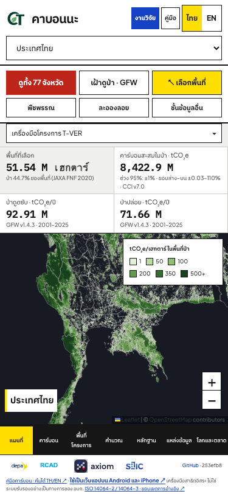
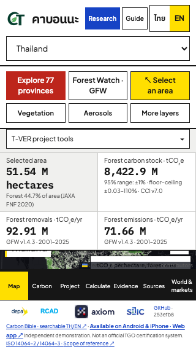
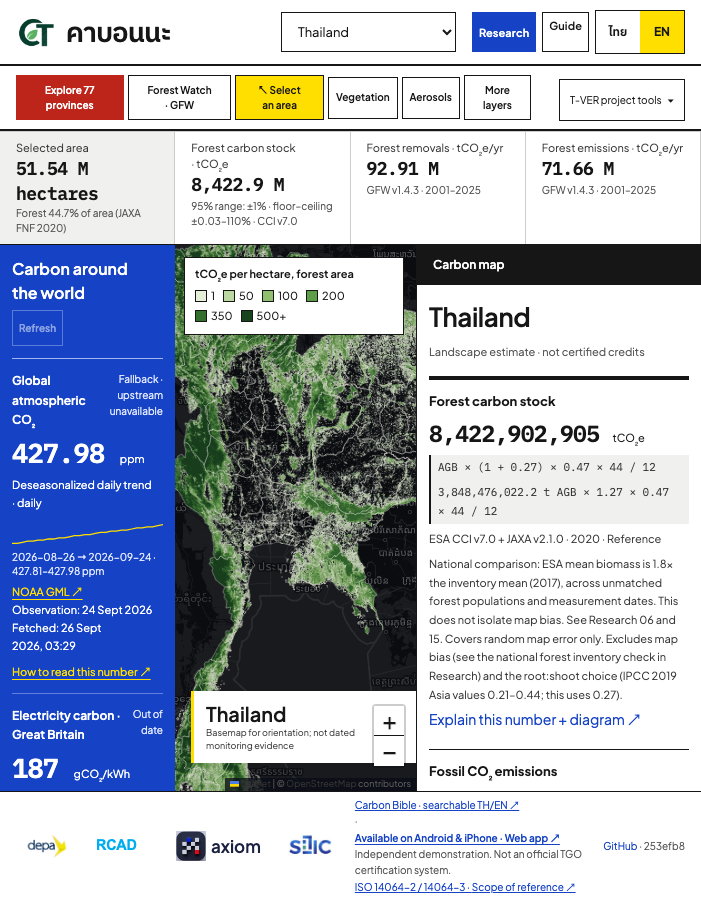
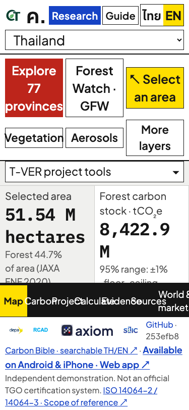
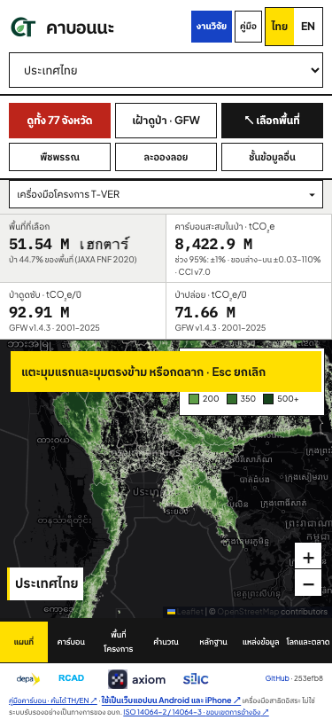
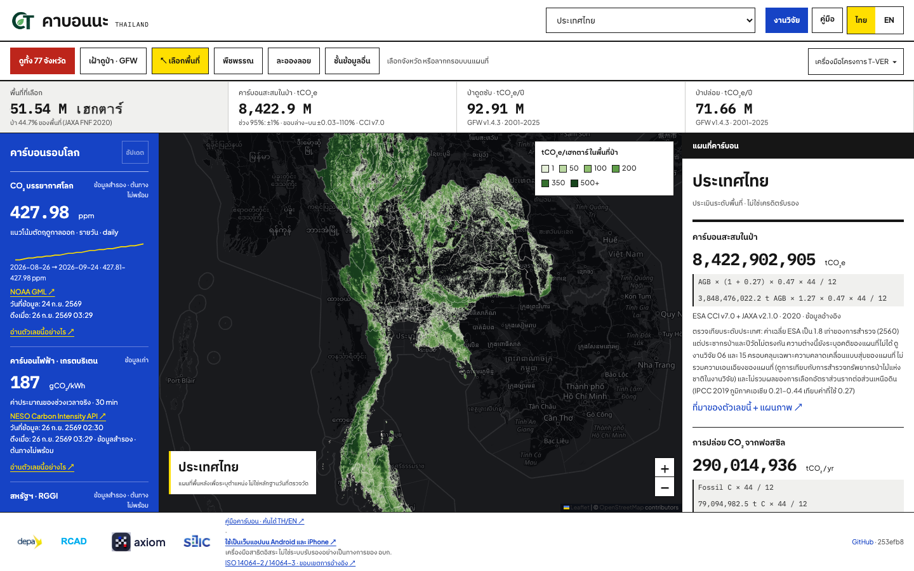
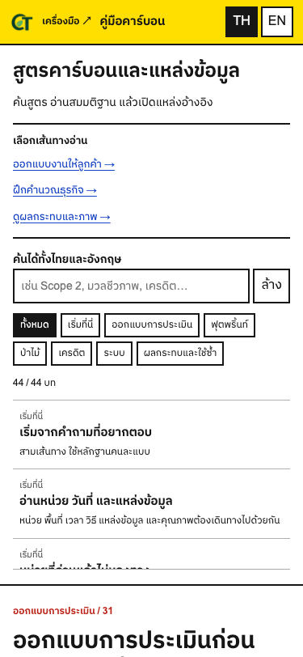

# Frontend audit · 11 October 2026

**Verdict: fails the house MoMA/Rams composition and screen-space audit.** The main defects are the oversized task header, conflicting hierarchy, short-screen collapse and premature desktop layout. Two concrete interaction defects accompany the visual findings: drawing guidance covers the legend, and opening layers from a province result leaves the navigation selection stale.

Scope: audit and corrective specification, not an application redesign. No frontend, calculation, dataset, export or privacy behaviour changed. Audited release: **253efb8**, confirmed by both local Git and the live `/version.json`. The owner's screenshot shows the same release. Measurements below come from a clean local rendering of that release; live-version confirmation alone is not a byte-for-byte comparison of every served asset.

“MoMA” here means the owner's house rules recorded in the design contract and shared Rams/MoMA lessons: flat surfaces, square geometry, deliberate hierarchy and functional use of space. This is not a claim that a museum publishes or certifies a web compliance standard. The newer owner-approved Bauhaus palette in [DESIGN.md](DESIGN.md) takes precedence over the older Malaysia colours and unrelated projects' palette rules.

## Human task and evidence

Person: a first-time visitor or potential client. Situation: they open the tool on a phone or tablet. Outcome: choose a province or an area, understand the quantity and its date, and inspect the evidence. Obstacle: preferences, reference links, six actions, expert navigation and four metrics compete before the map is reached.

Primary job: **operate the carbon map**. Research, partner identities and installation information support that job. All maps, layers, institutional marks, scientific qualifications and calculation flows must survive a correction. Making the page simpler must not remove these features or obscure uncertainty.

Checked Thai and English at 375×667, 375×812, 390×844, 700×900, 701×900, 768×1024, 1280×900 and 1440×900. Also checked 320×568; province selection; drawing; layers; in-app Research; Bible; manual; full paper; and a simulated doubling of rendered CSS font sizes. This text simulation is not a certification of browser zoom, OS text enlargement or WCAG conformance. No uninstructed human usability session was conducted.

Evidence: [raw measurements](audits/2026-10-11/metrics.json), [additional measurements](audits/2026-10-11/extra-metrics.json), [navigation state](audits/2026-10-11/navigation-state.json), and screenshots below. Visibility checks exclude content hidden inside the closed native `details` element; bounding rectangles alone can count those hidden controls incorrectly.

## Screen budget

These are CSS pixels, not the doubled physical pixels of a Retina screenshot. Map share is its rectangular area divided by viewport area; it does not subtract obscuring controls. Legend share is the overlapping legend area divided by the map area.

| Viewport | Language | Header height | Map starts at | Map height | Map share | Legend share of map |
|---|---|---:|---:|---:|---:|---:|
| 320×568 | Thai | — | 384 | 57 | 10.0% | — |
| 320×568 | English | — | 408 | 31 | 5.4% | — |
| 375×667 | Thai | 241 | 384 | 168 | 25.2% | 20.2% |
| 375×667 | English | 248 | 385 | 154 | 23.1% | 20.0% |
| 375×812 | Thai | 241 | 384 | 313 | 38.5% | 10.9% |
| 375×812 | English | 248 | 385 | 299 | 36.8% | 10.3% |
| 700×900 | Thai | 241 | 370 | 426 | 47.4% | 4.3% |
| 701×900 | Thai | 128 | 245 | 545 | 20.8% | 14.5% |
| 768×1024 | English | 128 | 242 | 672 | 26.3% | 8.3% |
| 1440×900 | Thai | 128 | 210 | 597 | 37.9% | 3.9% |

At 375×812 Thai, the header consumes **29.7%** of the viewport. The map starts after **47.3%** of its height has already been spent. Bottom navigation and footer take another **115 px**. At 701×900, the map is only **241 px wide** between the two rails. Its greater height does not compensate for that narrow working column.



## Findings and corrections

P1 = a material obstacle to operating or understanding the system. P2 = a significant hierarchy, consistency or reading defect. These are audit priorities, not fabricated accessibility certification levels.

### F01 · P1 · Header mixes unrelated jobs and spends 241 px

Location: `.top`, `.top-right`, `.search`, `.quick-tools`, `.advanced-tools`.

The phone header stacks identity/navigation, a full-width location selector, a six-button block and expert tools. There are **12 visible controls before the map**, including the location selector and expert disclosure. Research, language preference, layers and the two core geographic actions compete for attention. Research/Guide controls are 36 px tall; the language group is 44 px tall. Their neighbouring edges do not register. The Guide target is about 31 px wide, and each language target is 32 px wide.

Correction: organize the header into two deliberate rows with common 44 px control geometry: identity/preferences/help, then location and the primary geographic actions. Keep province exploration and area selection prominent. Put layers and Forest Watch in a map-context control group. Put expert workflow access with the workflow navigation. Keep all destinations available; do not simply shrink their text.

Source: [kabonna.css](../public/css/kabonna.css), especially the mobile rules; [malaysia.css](../public/css/malaysia.css) supplies the language buttons' inherited fixed height. This is also a cascade problem: visual ownership is divided among three presentation stylesheets.

### F02 · P1 · Short phones almost lose the map

At 320×568, the English map is **31 px high** and Thai is **57 px**. At 375×667 it is 154–168 px. The fixed-height body with auto-sized chrome and a shrinking `minmax(0,1fr)` stage gives away the working surface. The page remains free of horizontal overflow while becoming practically unusable.

Correction: make short-height behaviour explicit. Allow vertical scrolling or collapse supporting chrome before the working surface reaches a minimum usable height. A viewport-width-only layout rule cannot handle this. Test height as well as width; do not satisfy the test by clipping or removing source labels.

Sources: the body/stage grid in [app.css](../public/css/app.css) and [dashboard.css](../public/css/dashboard.css).



### F03 · P1 · A one-pixel breakpoint halves map prominence

Moving from 700 to 701 px switches from the phone composition to three simultaneous columns. Thai map share drops from **47.4% to 20.8%**, and its width becomes 241 px. Global observations and the detailed calculation rail become permanent even though the viewport cannot comfortably support them.

Correction: keep an intermediate tablet composition: dominant map plus a switchable results/world panel, or one secondary rail at a time. Enable three permanent columns only when the map has adequate working width. This preserves the owner's world-data requirement through reachable views; it does not delete world data.

Source: the `min-width:701px` stage rules in [kabonna.css](../public/css/kabonna.css).



### F04 · P1 · Enlarged text collapses the working surface

Doubling each element's computed font size at 375×812 produces **zero map height** in both languages. Navigation labels collide and KPI content is cut by the fixed screen layout. The absence of horizontal page overflow is not a usable reflow result.

Correction: support content-driven control height, wrapping navigation and scrollable page regions when text grows. Preserve all labels and keyboard/touch access. Verify actual browser zoom and device text settings during implementation; the current simulation establishes a failure mode, not a complete accessibility audit.



### F05 · P1 · Layer navigation reports the wrong active view

Reproduction: open **Explore 77 provinces**, choose the first province, then select **More layers**. Actual state: `body.dataset.view = "map"`; the map is visible; the selected bottom button remains **Carbon**, with `data-view="rail"` and `aria-pressed="true"`.

Correction: use one view-transition function that changes the visible pane and every related selected state together. Apply it to layers, drawing, vegetation, aerosols, province selection, Research and ordinary bottom navigation. Retain the current geographic selection and browser-local project inputs.

Source: [landscape.js](../public/js/landscape.js), `moreLayers` and `showMap` handlers set the view directly; compare with the bottom navigation handler in [app.js](../public/js/app.js). [Recorded reproduction](audits/2026-10-11/navigation-state.json).

### F06 · P1 · Drawing instructions cover the data legend

Activating area selection draws the yellow instruction strip over the upper part of the legend. The legend's title and some bins are obscured precisely when the user needs to interpret the map. Layer controls occupy another large opaque region; the captured province state has a 150×282 px panel on a 375×313 px map.

Correction: reserve a control/instruction zone with coordinated layout and stacking. Collapse the legend on short screens, make it explicitly expandable and avoid positioning unrelated overlays over one another. Keep units and bin values accessible when collapsed; do not remove them.



### F07 · P1 · The stock KPI omits the observation year

The stock hint shows uncertainty and **CCI v7.0**, but no explicit **2020** beside the large stock number. The neighbouring forest-area card names JAXA FNF 2020, and annual flux cards name 2001–2025. A dataset version is not an observation date. On phones the calculation rail containing the fuller explanation is not visible in the default map view.

Correction: keep quantity, unit, period and estimate status together in every summary. Put the full uncertainty interpretation behind an accessible detail action, with a short visible quality statement. Do not erase the uncertainty to recover space. Screenshot/export context must remain sufficient to distinguish stock from annual flow and issued credits.

Source: rendered `#kStockHint`; full trace in [selection-view.js](../public/js/selection-view.js).

### F08 · P2 · Typography and emphasis lack a controlled scale

The visible 375 px Thai entry uses **11 computed font sizes**: 8, 9, 10, 11, 12, 13, 14, 15, 17, 20 and 22 px. That count includes mapping controls and data text; it is not a claim that every mathematical subscript must share one size. The substantive issue is multiple micro-text sizes, 9 px navigation/source text, and adjacent controls with inconsistent reading size. Four equal KPI cells also give area, stock and annual flows similar prominence despite different meanings.

Correction: establish display/body/metadata roles with a small explicit scale; use numeric type for quantities and normal text for labels. Keep dates and qualification readable. Structure stock and annual flows as different groups. Use colour and position to establish action hierarchy rather than making every link or control a bright block.

### F09 · P2 · The footer spends permanent operating space on supporting material

Footer height is **65 px in Thai** and **77 px in English** on a 375×812 phone, and 93 px at 1440×900. Partner marks, Bible, installation, certification limitations, ISO scope and build metadata stay on screen during every task. Their content is earned and should remain available, but its permanent placement competes with the map and repeats destinations elsewhere.

Correction: keep a concise visible identity/provenance line and place the full white-backed partner strip, installation guidance and scope notes in a reachable information area. Retain the independent-estimate status near results; moving the footer must not imply certification.



### F10 · P2 · Navigation is duplicated across layers of chrome

The closed expert tools disclosure exposes the same five workflow destinations already offered by the phone's bottom bar. The location selector and province browser are related selection mechanisms but visually appear as unrelated large controls. Research, operating manual and Carbon Bible are separate reading surfaces with insufficiently clear grouping.

Correction: distinguish place selection, map tools, assessment workflow and reference reading. Preserve the underlying routes and native controls. Give a single consistent entry to each navigation group and keep a clear return path. A menu is useful only if its name tells a novice what it contains.

### F11 · P2 · Square-geometry hard rule is incompletely enforced

The rendered `.leaflet-control-zoom.leaflet-bar` wrapper has **4 px border radius**. Its anchors are square; the parent retains Leaflet's radius. Visible box/text shadows are absent in the inspected entry states.

Correction: enforce square geometry on the relevant container as well as its children, then inspect the rendered radius. Preserve zoom functionality and marker-position transforms. The existing shadow checks do not establish radius compliance.

Source: [flat-controls.css](../public/css/flat-controls.css) targets controls and popup containers, but does not reset `.leaflet-bar` itself.

### F12 · P2 · Bible deep links make readers traverse the index first

Opening `bible.html?lang=th#assessment-brief` places the article at **y=746 px** on a 375×812 screen; English begins at **y=769 px**. Almost the whole opening screen is the index, routes, search, category buttons and chapter list. The explanation promised by the deep link is barely visible.

Correction: on a phone, open a chapter deep link at its article and offer the index as a reversible disclosure or separate navigation state. Keep search, categories, language persistence and sources. A user arriving without a chapter can start at the index.

Source: [bible.js](../public/js/bible.js) and the mobile index layout in [bible.css](../public/css/bible.css).



## Corrective composition

Two compositions considered with the same content:

1. Keep every current band and shrink controls/text. Rejected: the actual screen already has 8–12 px supporting text and undersized controls; further shrinking worsens reading and touch use.
2. Separate global preferences, geographic actions, map context, assessment workflow and reference reading. Recommended: retain every feature but disclose the secondary groups on demand, protect the map at intermediate widths and keep evidence with the numbers.

Proposed phone structure, **not implemented**:

```text
Identity + language + Help                  44 px targets
Location + Provinces + Select area          44 px targets
Dated selection summary / expandable evidence
Map + coordinated layers, alerts and legend
Assessment workflow navigation
Compact provenance / reachable partner information
```

Starting acceptance budgets to test, not purported MoMA standards: two header rows around 104 px including spacing; map at least 55% of a 375×812 entry viewport and at least 280 px high at 375×667; no abrupt three-column switch at 701 px; legend/instructions never overlap; important controls at least 44×44 px; selected navigation always agrees with visible pane; enlarged text preserves access to the map and every task. Adjust proposed budgets with real content and a first-time user rather than treating them as certification thresholds.

## Why the earlier checks missed this

The previous design check tested widths 375/768/1440, no horizontal overflow, selected contrast pairs, shadows and map height above 280 px. Its 375 px viewport was **812 px tall**. The current page passes that height check while failing shorter 667 and 568 px screens. It did not measure the header budget, map share, breakpoint discontinuity, overlay collision, active-view agreement, inherited radius or deep-link opening position.

Passing implementation tests was real evidence for those tested behaviours. It did not establish authored composition or independent novice usability. The correction should add these specific gates rather than another generic visual score or a fabricated “MoMA percentage.”

## Verification and next order

- **Observed:** dimensions and defects above; screenshots inspected; no page errors in the main capture; no horizontal overflow at the tested normal sizes; no visible entry-state box/text shadows.
- **Passed separately:** local and live release identifiers agree on 253efb8. This audit did not rerun scientific calculations or the full regression suite because it changes no application behaviour.
- **Unverified:** actual first-time-human performance, physical-device enlargement, complete assistive-technology coverage and any revised composition.

Correct in this order: short-screen/reflow and header budget; tablet composition; navigation state and overlay coordination; visible period/quality context; type hierarchy and footer; square wrapper; reading deep links. Re-capture the same states and run the existing workflow/privacy/calculation regressions after implementation.

Reproduce the local evidence:

```bash
npm run dev
node scripts/frontend-audit-2026-10-11.mjs
node scripts/frontend-audit-extra-2026-10-11.mjs
```

The scripts are read-only browser captures. Their generated measurements/screenshots go to `test-results/frontend-audit-2026-10-11/`. The committed evidence above is the baseline, not an assertion that a future edited page still matches it.
