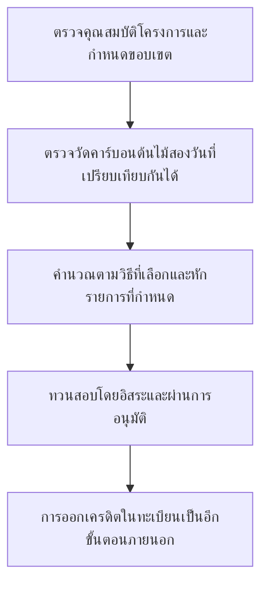
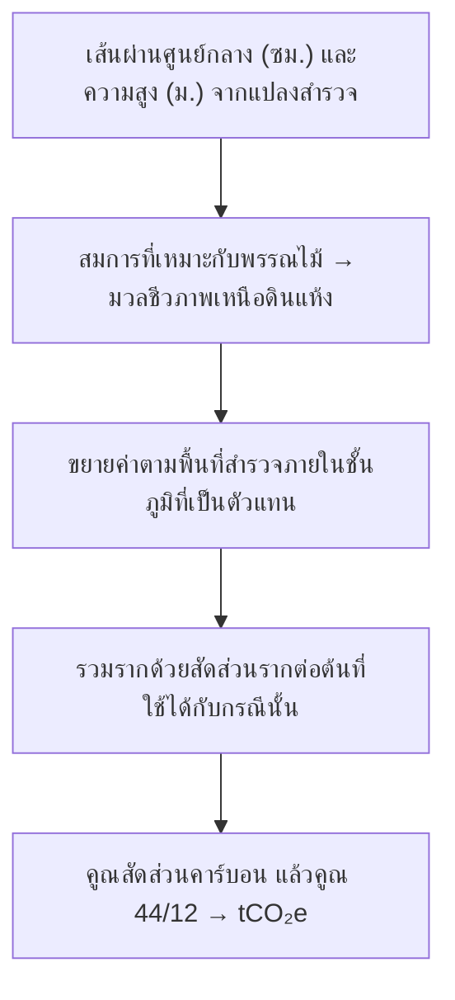
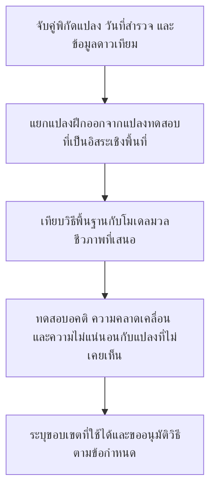
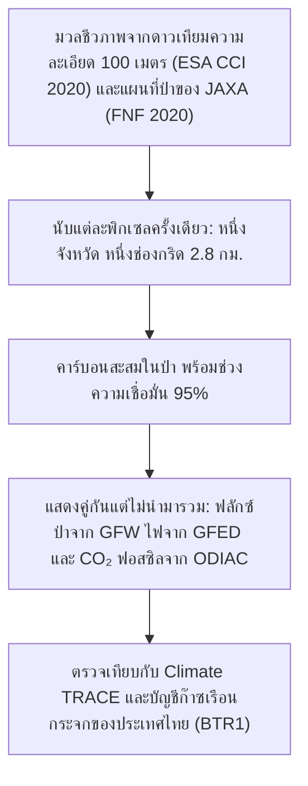
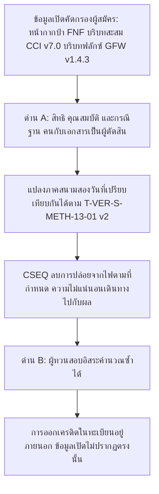
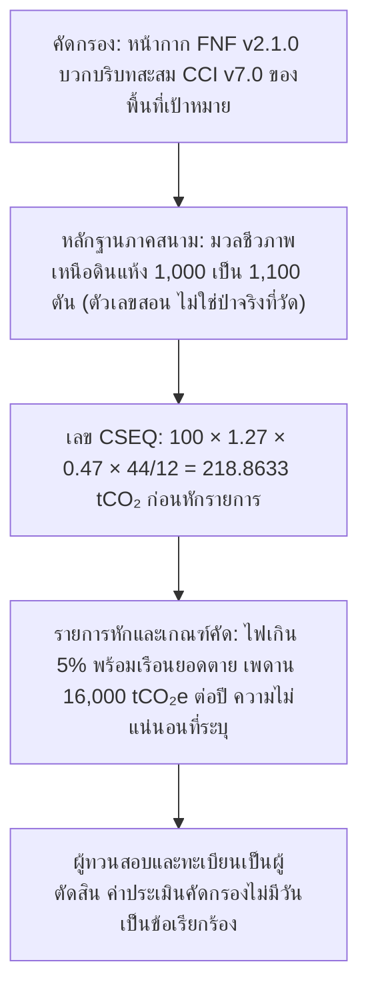
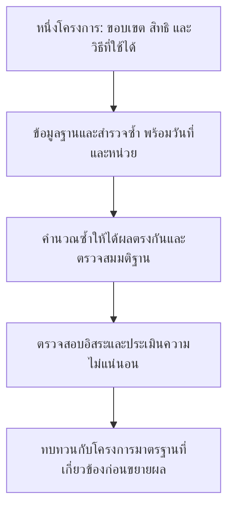
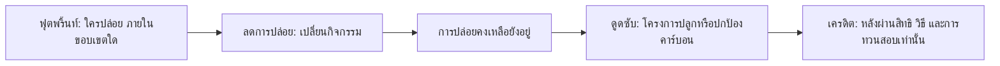
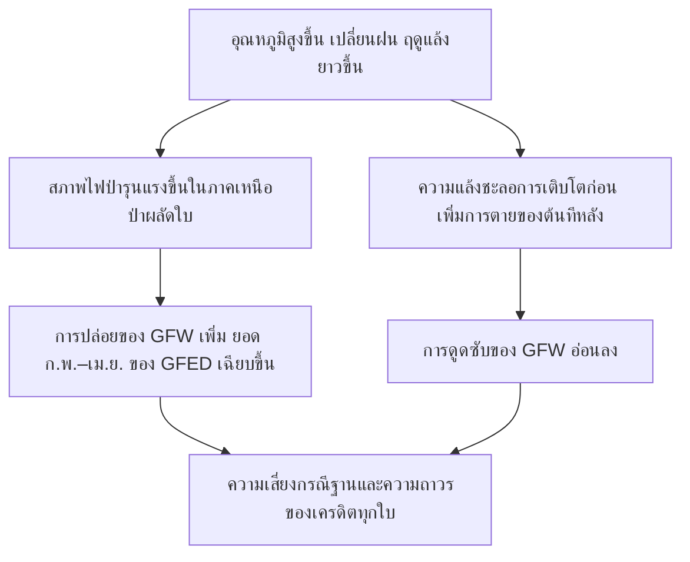
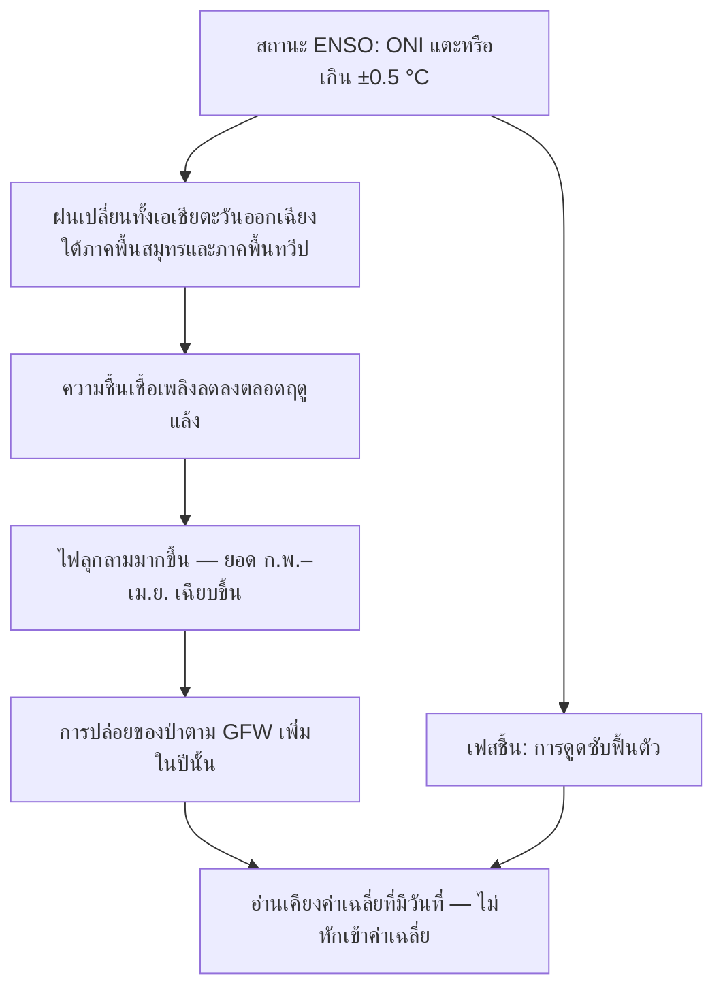

การศึกษาอิสระ เขียนในรูปวิทยานิพนธ์สั้น · คาร์บอนนะ · ประเทศไทย · กันยายน 2569

# สร้างระบบคำนวณรอยเท้าคาร์บอนของป่าจากข้อมูลสาธารณะและข้อมูลเปิด

ข้อมูลเปิดและข้อมูลสาธารณะช่วยประมาณคาร์บอนระดับภูมิทัศน์ได้ การเทียบกับการสำรวจป่าไทยพบความต่างที่ยังต้องตรวจบนขอบเขตเดียวกัน แต่ผลิตเครดิตไม่ได้ การศึกษานี้สร้างระบบที่แยกประโยคเหล่านั้นออกจากกัน และแสดงตัวเลขทุกตัวที่ออกมา

นี่คือการศึกษาอิสระที่เขียนในรูปวิทยานิพนธ์สั้น ไม่ใช่วิทยานิพนธ์ที่ยื่นต่อมหาวิทยาลัย ไม่ใช่ปริญญา และไม่ใช่การประเมินอย่างเป็นทางการของ อบก. ระบบที่ใช้งานชื่อ คาร์บอนนะ บทด้านล่างคือตัววิทยานิพนธ์: คำถาม วิธี หลักฐาน ขอบเขต และหน้าตาที่คนทั่วไปเห็น

<dl class="thesis">
<dt>คำถาม</dt>
<dd>ระบบสาธารณะคำนวณรอยเท้าคาร์บอนของป่าในประเทศไทยจากข้อมูลเปิดและข้อมูลสาธารณะได้หรือไม่ ในระดับจังหวัด กรอบที่วาด หรือขอบเขตโครงการ โดยไม่แกล้งว่าผลลัพธ์คือเครดิตที่ออกแล้ว</dd>
<dt>คำตอบ</dt>
<dd>ได้ สำหรับบัญชีระดับภูมิทัศน์ และได้เพียงเท่านั้น มวลชีวภาพจากดาวเทียม หน้ากากป่า การสูญเสียและการเพิ่มขึ้นของป่า ไฟ และ CO₂ จากเชื้อเพลิงฟอสซิล รวมในขอบเขตเดียวได้ โดยแต่ละตัวเก็บหน่วยของตัวเอง ไม่ได้ สำหรับตัวเลขรอยเท้าเดียว และไม่ได้สำหรับเครดิต คาร์บอนสะสมไม่ใช่ฟลักซ์ของช่วงเวลา ฟลักซ์ไม่ใช่การปล่อยจากไฟ ไฟไม่ใช่ CO₂ ฟอสซิล และไม่มีตัวใดเป็นเครดิตที่ อบก. รับรอง การเทียบกับการสำรวจระดับประเทศพบความต่าง แต่ยังระบุความเอนเอียงของแผนที่ไม่ได้ ช่วง 1.35–2.0 เท่าเป็นกรณีความไวภายใต้สมมติฐานป่าซ้อนกัน มวลชีวภาพส่วนเพิ่ม และสมการแอลโลเมตรี (หัวข้อ 06) แสดงสองค่าแยกกัน ไม่ใช้แทนการตรวจแปลง</dd>
<dt>สิ่งที่สร้าง</dt>
<dd>ขั้นตอนเตรียมข้อมูลแบบออฟไลน์ที่แปลงแรสเตอร์และตารางสาธารณะเป็นบัญชี ซึ่งพิกเซล 100 เมตรทุกพิกเซลอยู่ได้ไม่เกินหนึ่งจังหวัด และอยู่ในกริดหนึ่งช่องพอดี ดังนั้นยอดจังหวัด ยอดประเทศ และยอดกริดตรงกัน จากนั้นเบราว์เซอร์ตอบจังหวัด กรอบ หรือขอบเขตที่นำเข้าได้ทันที เครื่องมืออีกส่วนใช้ T-VER-S-METH-13-01 v2 กับตัวเลขที่ผู้ใช้ใส่จากภาคสนามเท่านั้น รายการ T-VER สาธารณะของ อบก. วางข้างแผนที่เป็นบริบท ไม่เคยเป็นข้อมูลนำเข้า</dd>
<dt>สิ่งที่การศึกษานี้ไม่ได้อ้าง</dt>
<dd>ไม่มีแบบจำลองที่ฝึกแล้ว ไม่มีการรับรองจาก อบก. ไม่มีความเห็นของผู้ทวนสอบ และไม่มีการออกเครดิต ภาพบรรยากาศ (ละอองลอย จุดความร้อน คาร์บอนมอนอกไซด์ และ CO₂ ในคอลัมน์อากาศ) เป็นความเข้มข้นและการตรวจพบ ไม่ใช่บัญชีการปล่อย ค่าทวนสอบไม่อยู่ในข้อมูลทะเบียน จึงไม่นำมาตั้งราคาในที่นี้</dd>
</dl>

| ส่วนของวิทยานิพนธ์ | อยู่ที่บท |
|---|---|
| คำถาม และเหตุผลที่ตัวเลขเดียวเป็นคำตอบที่ผิด | 01 |
| การคำนวณ จากต้นไม้ที่วัดได้ถึง tCO₂e | 02 |
| ดาวเทียมเห็นอะไร และอะไรยังต้องวัดบนพื้น | 03, 06 |
| แบบจำลองทำงานได้ตรงไหน | 04 |
| เปิดชุดข้อมูลเปิดทุกชุดก่อนเชื่อป้าย | 05 |
| เหตุผลที่ข้อมูลเปิดไม่กลายเป็นเครดิต | 07 |
| โครงการนำร่องแรกต้องพิสูจน์อะไร | 08 |
| ใครเป็นคนทำงาน | 09 |
| หลักฐานเก็บไว้ที่ไหน | 10 |
| ทะเบียนของ อบก. เป็นบริบท ไม่ใช่ข้อมูลนำเข้า | 11, 12 |
| แผนที่เชื่อได้แค่ไหน: ความไม่แน่นอนและการตรวจกับการสำรวจทรัพยากรป่าไม้แห่งชาติ | 06 |
| ทำไมชื่อที่คนทั่วไปเห็นคือ คาร์บอนนะ | 13 |
| ระบบอื่น ๆ และวิธีการที่ระบบนี้ยืมมาจากใคร | 14 |

คนคนหนึ่งอาจดูแลป่ามาหลายปี แต่ยังตอบได้ยากว่างานที่ทำสร้างผลลัพธ์เท่าไร ต้นไม้มีอยู่จริง ความทุ่มเทมีอยู่จริง ส่วนหลักฐานกลับกระจายอยู่ในสมุดสำรวจ แผนที่ ตารางราชการ และคลังภาพดาวเทียม การนำข้อมูลเหล่านี้มาประเมินคาร์บอนอย่างมีเหตุผลต้องลงแรง หน้าจอที่สวยเพียงอย่างเดียวทำงานส่วนนี้แทนไม่ได้

โครงการนี้จึงเริ่มจากการทำให้หลักฐานอยู่ใกล้มือขึ้น ทำให้สูตรถูกตั้งคำถามได้ง่ายขึ้น และทำให้คนสำรวจกับคนตรวจผลมองเห็นข้อมูลชุดเดียวกันว่าอะไรตรวจวัดแล้ว อะไรเป็นสมมติฐาน และอะไรยังต้องกลับไปวัด เทคโนโลยีมีคุณค่าเมื่อช่วยให้การพูดคุยเรื่องเหล่านี้ตรงไปตรงมาขึ้น

จุดเริ่มต้นคือการสอบถามเรื่องใช้ AI ช่วยประเมินคาร์บอนป่าไม้จากผู้ทำงานด้านการจัดการก๊าซเรือนกระจกของไทย โค้ดเปิดเผยและตรวจย้อนการคำนวณได้ ยังไม่ได้อ้างการรับรองจาก อบก. โมเดล AI ที่ผ่านการอนุมัติ หรือการออกเครดิต

## 01 · เริ่มจากคำถามให้ตรงกัน

“ป่านี้เก็บคาร์บอนอยู่เท่าไร” กับ “โครงการนี้จะได้รับเครดิตเท่าไร” ต้องใช้หลักฐานต่างกัน ป่าอาจมีคาร์บอนสะสมอยู่มาก แต่ไม่ได้หมายความว่าคาร์บอนทั้งหมดนั้นจะนำมาขอเครดิตใหม่ได้

| สิ่งที่ต้องแยก | ความหมายแบบอ่านง่าย | เครื่องมือนี้ทำอะไร |
|---|---|---|
| คาร์บอนคงเหลือ | คาร์บอนในส่วนของต้นไม้ที่นับรวม ณ วันที่หนึ่ง แสดงเป็น tCO₂e | แปลงมวลชีวภาพที่ระบุ หรือรับค่าคาร์บอนต้นไม้รวมที่มีขอบเขตตรงกัน |
| ผลต่างในช่วงติดตาม | ความเปลี่ยนแปลงระหว่างวันที่เปรียบเทียบกันได้ หลังหักรายการที่วิธีกำหนด | คำนวณค่าประเมินจากข้อมูลที่ให้มา และเก็บค่าติดลบไว้ |
| เครดิตที่ออกแล้ว | หน่วยที่ผ่านขั้นตอนอนุมัติและบันทึกตามโครงการที่เกี่ยวข้อง | ไม่ได้เชื่อมทะเบียน และไม่อนุมานจากค่าประเมิน |

ลำดับนี้สำคัญ การวาดรูปหลายเหลี่ยมกำหนดพื้นที่คำนวณ แต่ไม่ได้พิสูจน์สิทธิที่ดิน การเห็นต้นไม้ไม่ได้พิสูจน์ additionality หรือประโยชน์ส่วนเพิ่มตามเงื่อนไขของวิธีที่ใช้ และยอดขึ้นทะเบียนไม่ได้พิสูจน์ว่าคาร์บอนชุดเดียวกันไม่เคยถูกนำไปอ้างสิทธิที่อื่น

## 02 · ตามคาร์บอนหนึ่งตันผ่านสูตร

ก่อนต้นไม้จะกลายเป็นตัวเลขในบัญชีคาร์บอน ต้องมีการตรวจวัด เส้นผ่านศูนย์กลางกับความสูงนำเข้าสู่ **สมการแอลโลเมตรี** ซึ่งเป็นความสัมพันธ์ที่พัฒนาจากต้นไม้ที่วัดจริงเพื่อประมาณมวลชีวภาพแห้ง คำว่า “แห้ง” สำคัญ เพราะน้ำเพิ่มน้ำหนักโดยไม่ได้เพิ่มคาร์บอนที่กำลังประเมิน สมการต้องเหมาะกับประเภทป่าและพรรณไม้ด้วย

ตัวนำเข้าปัจจุบันรองรับสมการภาคผนวก TGO สำหรับป่าเบญจพรรณและป่าเต็งรัง โดยต้นไม้มี DBH ตั้งแต่ 4.5 ซม. ระบบประมาณมวลเหนือดินของต้นไม้ แล้วขยายค่าจากพื้นที่สำรวจภายใต้สมมติฐานว่ามีชั้นภูมิเดียวและแปลงเป็นตัวแทนของพื้นที่ สูตรไม่ได้ยืนยันให้ว่าการสุ่มแปลงเหมาะสม ไฟล์ CSV รุ่นนี้ยังแทนแปลงว่างไม่ได้ จึงห้ามตัดแปลงที่ไม่มีต้นไม้ออกเพื่อให้ระบบอ่านไฟล์ได้ รายละเอียดสัมประสิทธิ์ หน่วย และสิ่งที่ไม่นับรวมอยู่ใน [คู่มือ](guide-th.html)

สำหรับพรรณไม้ทั่วไปใน [เครื่องมือคำนวณต้นไม้ TGO v2](https://tver.tgo.or.th/database/Uploads/Tool/c575f516-1f3c-4dbc-83ec-2ab65e1d76dc.pdf) ใช้สัดส่วนรากต่อมวลเหนือดิน 0.27 และสัดส่วนคาร์บอน 0.47 ส่วน 44/12 ใช้แปลงมวลคาร์บอนเป็นมวล CO₂ ที่สอดคล้องกัน พรรณไม้กลุ่มอื่นมีค่าต่างออกไป หากข้อมูลรวมรากอยู่แล้วหรือเป็น tCO₂e อยู่แล้ว การคูณซ้ำจะทำให้ผลสูงเกินจริง

### ตัวอย่างที่ลองคำนวณตามได้

สมมติมวลชีวภาพเหนือดินแห้งของโครงการเดิมเพิ่มจาก **1,000 เป็น 1,100 ตัน** โดยใช้ปัจจัยและส่วนที่นับรวมเหมือนกัน ตัวเลขนี้เป็นข้อมูลสมมติสำหรับอธิบาย ไม่ใช่ผลสำรวจป่าจริงในประเทศไทย

| ขั้น | การคำนวณ | ผล |
|---|---|---:|
| มวลเหนือดินที่เพิ่ม | 1,100 − 1,000 | มวลแห้ง 100 ตัน |
| รวมรากที่ประมาณ | 100 × 1.27 | มวลรวม 127 ตัน |
| แปลงเป็นคาร์บอน | 127 × 0.47 | 59.69 tC |
| แปลงเป็น CO₂ | 59.69 × 44/12 | 218.8633 tCO₂ |

นี่คือการเพิ่มของคาร์บอนก่อนหักรายการที่เกี่ยวข้อง ถ้าใช้ระยะเวลาห้าปีพอดี ค่าเฉลี่ยคือ 43.7727 tCO₂ ต่อปี ส่วนแอปใช้จำนวนวันที่ผ่านไปหารด้วย 365.25 จึงได้ค่าเฉลี่ยของวันที่ตัวอย่างต่างกันเล็กน้อย ค่าเฉลี่ยรายปีไม่ได้สร้างสิทธิให้อ้างเครดิตเพิ่มอีกห้าครั้งนอกเหนือจากยอดรวมของช่วงนั้น

อ้างอิงบัญชีที่เลือกคือ [Standard T-VER-S-METH-13-01 v2](https://tver.tgo.or.th/database/Uploads/Methodology/482ce748-b43f-4432-aef8-d7745dcc2692.pdf): คาร์บอนต้นไม้ปัจจุบัน ลบค่าฐานหรือครั้งล่าสุดที่รับรอง ลบการปล่อยจากโครงการตามที่กำหนดและ leakage วิธีนี้ไม่พิจารณา leakage จึงกำหนดส่วนนี้เป็นศูนย์ในเครื่องมือ ต้องอ่านเงื่อนไขไฟไหม้ คุณสมบัติ และเกณฑ์โครงการขนาดเล็กจากเอกสารฉบับเต็ม กิจกรรมหรือมาตรฐานระดับอื่นอาจใช้บัญชีต่างกัน หากคาร์บอนลดลง ผลต้องติดลบ ระบบไม่ควรซ่อนการสูญเสียด้วยการเปลี่ยนเป็นศูนย์

## 03 · ดาวเทียมเห็นอะไร และยังต้องรู้อะไรจากคนในพื้นที่

หน้า [ผลิตภัณฑ์พืชพรรณของ JAXA](https://earth.jaxa.jp/en/data/products/vegetation/index.html) เป็นจุดเริ่มต้นที่ดี มีทางไปสู่ดัชนีพืชพรรณ ข้อมูลพื้นที่ใบ และผลิตภัณฑ์ป่า/ไม่ใช่ป่า สิ่งเหล่านี้เป็นข้อมูลสังเกตพืชพรรณ ไม่ใช่ยอดเครดิตที่ออกแล้ว

NDVI เปรียบเทียบการสะท้อนแสงสีแดงกับอินฟราเรดใกล้ ช่วยบอกลักษณะความเขียว แต่พิกเซลที่เขียวขึ้นไม่ได้แปลเป็นคาร์บอนจำนวนเดียวกันได้ทุกแห่ง ประเภทป่า ฤดูกาล โครงสร้างเรือนยอด และสภาพขณะสังเกตมีผลต่อการตีความ โมเดลที่เชื่อมภาพกับมวลชีวภาพจึงต้องมีข้อมูลตรวจวัดและการทดสอบที่เหมาะสม

| แหล่งข้อมูล | ช่วยโครงการนำร่องด้านใด | ข้อจำกัดที่ต้องติดไปกับข้อมูล |
|---|---|---|
| [JAXA PALSAR / PALSAR-2](https://www.eorc.jaxa.jp/ALOS/en/dataset/fnf_e.htm) | ตัวแปรเรดาร์และการคัดกรองพื้นที่ป่า ภาพโมเสกประมาณ 25 เมตร | เก็บวันที่สังเกต mask และรุ่นประมวลผล ตรวจการลงทะเบียนและเงื่อนไขดาวน์โหลด |
| [Sentinel-2](https://dataspace.copernicus.eu/data-collections/copernicus-sentinel-missions/sentinel-2) | ตัวแปรเชิงแสงและหลักฐานความเปลี่ยนแปลงหลังคัดเมฆ | เลือกฤดูกาลและการประมวลผลที่เทียบกันได้ |
| [NASA GEDI L4A v3](https://doi.org/10.3334/ORNLDAAC/2508) | ค่าประมาณความหนาแน่นมวลเหนือดินตามรอยเท้าการวัด พร้อมค่าคลาดเคลื่อนและข้อมูลคุณภาพ | ไม่ใช่การสำรวจครบทุกแปลง และไม่ใช่ค่าจริงภาคสนามที่ไร้ความผิดพลาด |
| แปลงตรวจวัดภาคสนาม | ข้อมูลท้องถิ่นสำหรับสร้างและทดสอบโมเดลอย่างอิสระ | ต้องรู้แผนสุ่ม พิกัด วันที่ พรรณไม้หรือกลุ่มไม้ และคุณภาพการวัด |

เครื่องมือประเมินโครงการไม่ได้ใช้ผลิตภัณฑ์เหล่านี้ ตัวเลขมาจากข้อมูลตรวจวัดของผู้ใช้เท่านั้น ส่วนแผนที่คาร์บอน (หัวข้อ 06) ใช้ผลิตภัณฑ์ดาวเทียมที่เผยแพร่แล้ว รวมถึง ESA CCI Biomass และแผนที่ป่าของ JAXA โดยไม่ได้รันแบบจำลองของตนเอง สิ่งที่ทำคือจัดกริดใหม่ ใช้หน้ากากพื้นที่ป่า และแปลงหน่วยผลิตภัณฑ์เหล่านั้น และตัวเลขระดับภูมิทัศน์ไม่ถูกนำไปใช้ในการคำนวณโครงการ แผนที่ถนนและภาพพื้นหลังช่วยค้นตำแหน่ง ไม่ใช่หลักฐาน

## 04 · ให้งาน AI ที่พิสูจน์ได้ว่าทำสำเร็จหรือไม่

งานแรกของ AI ควรชัดเจน: ทำนายมวลชีวภาพของป่าประเภทที่กำหนดจากข้อมูลที่มีวันที่ แล้วเปรียบเทียบกับการตรวจวัดอิสระ โมเดลภาษาช่วยอธิบายวิธีหรือเตือนช่องข้อมูลที่ขาดได้ แต่ไม่ควรใช้ประโยคที่ฟังน่าเชื่อแทนค่ามวลชีวภาพที่ยังไม่มี

ทางลัดที่ชวนให้หลงเชื่อคือสุ่มพิกเซลใกล้กันไปอยู่ทั้งชุดฝึกและชุดทดสอบ คะแนนอาจดีเพราะโมเดลคุ้นกับพื้นที่เดียวกัน แนวทางที่เสนอสำหรับโครงการนี้คือกันแปลงทดสอบที่แยกออกไปเชิงพื้นที่ แล้วดูข้อผิดพลาดตามประเภทป่าและช่วงมวลชีวภาพ เปรียบเทียบการถดถอยแบบง่ายกับโมเดลอย่าง Random Forest ก่อนเพิ่มความซับซ้อน ทั้งหมดนี้เป็นแผนทดสอบ ยังไม่ใช่ผลทดลองที่ทำเสร็จแล้ว

ความไม่แน่นอนต้องเดินทางไปกับสูตร ผลต่างของแผนที่คาร์บอนสองใบที่มีความคลาดเคลื่อนก็ยังมีความคลาดเคลื่อน ข้อผิดพลาดร่วมของโมเดล การสุ่มแปลง และความสัมพันธ์เชิงพื้นที่มีผลต่อความเชื่อมั่นในผลต่าง การเพิ่มทศนิยมไม่ได้แก้ปัญหาเหล่านี้ รุ่นปัจจุบันระบุชัดว่ายังไม่มีค่าความไม่แน่นอนในไฟล์ส่งออก การประเมินช่วงความเชื่อมั่นที่ผ่านการตรวจสอบยังเป็นงานที่ต้องทำก่อนใช้ประเมินโครงการอย่างจริงจัง

## 05 · ข้อมูลเปิด ต้องเปิดไฟล์ดูด้วย

การค้นคำว่า “ป่าไม้” ใน data.go.th เมื่อ **25 กันยายน 2569** พบ **570 ระเบียนชุดข้อมูล และ 2,111 ระเบียนทรัพยากร** นี่คือจำนวนรายการในบัญชีข้อมูล ซึ่งรวมเอกสาร ชิ้นส่วนไฟล์ ลิงก์ และรายการที่อาจดูซ้ำ ไม่ใช่ชุดมวลชีวภาพพร้อมใช้ 570 ชุด งานวิจัยเลือกดาวน์โหลดและตรวจเก้าไฟล์ ส่วนแอปบรรจุข้อมูลจังหวัด-ปีที่ปรับรูปแบบแล้ว 11 ระเบียน

| แหล่งที่ตรวจ | สิ่งที่พบในข้อมูลจริง | การตัดสินใจใช้ |
|---|---|---|
| [พื้นที่ป่าสระบุรี](https://data.go.th/dataset/saraburi-forest-area) | เจ็ดปี พ.ศ. 2561–2567; ปี 2567: 532,177.56 ไร่ | บริบทจังหวัดในอดีต |
| [พื้นที่ป่ากาญจนบุรี](https://data.go.th/dataset/forest-area-2567) | สี่ปี พ.ศ. 2564–2567; ปี 2567: 7,478,170.33 ไร่ | บริบทจังหวัด ตรวจความสอดคล้องของหน่วยแล้ว |
| [พื้นที่ป่า RFD ปี 2562](https://data.go.th/dataset/forestarea_2562_wgs84) | ZIP มีเพียง metadata ตรวจส่วนหัวไฟล์เรขาคณิตแยกต่างหาก | ยังไม่นำเข้ารูปทรงเต็ม พิกัดเป็น UTM 47N ต้องแปลงก่อน |
| [คาร์บอนพื้นที่อนุรักษ์ DNP](https://data.go.th/dataset/gdpublish-67-dnp07-31-02) | ตารางระบุ tCO₂eq แต่ไม่มีตัวหารรายปีชัดเจน | ห้ามเรียกว่าเครดิตรายปี |
| [ตารางป่าสงวน](https://data.go.th/dataset/gdpublish-https-www-forest-go-th-land) | หน่วยพื้นที่ไม่สอดคล้องกันในแถวที่ตรวจ | กันออก ไม่เดาแก้ค่า |

อ่านเหตุผลย้อนหลังได้ใน [บันทึกวิจัยฉบับเต็ม](https://github.com/Nonarkara/carbon/blob/main/RESEARCH.md), [รายการตรวจไฟล์](https://github.com/Nonarkara/carbon/blob/main/research/extracted/download-manifest.json) และ [ข้อมูลจังหวัดที่ปรับรูปแบบแล้ว](data/province-forest-area.csv) วันที่แก้ไขรายการไม่ได้เท่ากับวันที่ตรวจวัด หากสัญญาอนุญาตขัดกันหรือจำกัดการใช้ ต้องตรวจให้ชัดก่อนนำไปเผยแพร่ต่อ

### Dashboard กรมป่าไม้: ข้อมูลตั้งต้นที่ต้องอ่านพร้อมข้อสังเกต

[Dashboard กรมป่าไม้](https://fp.forest.go.th/rfd_app/rfd_dashboard_m/app/main.php) ที่ตรวจเมื่อ 25 กันยายน 2569 แสดงผู้ขึ้นทะเบียนสวนป่า **83,290 ราย, 83,681 แปลง, พื้นที่ 1,447,111 ไร่ และต้นไม้ 139,013,341 ต้น** แต่หน้าสรุปรายภาครวมได้ **83,217 ราย** ต่างกัน 73 ราย ระหว่างตรวจไม่พบวันที่ปรับปรุงที่อธิบายความต่างนี้ จึงเก็บเป็นตัวเลขจากคนละมุมมองตามที่พบ โดยไม่ได้แก้ให้ตรงกันเอง

เมื่อเปิดรายละเอียดภาคเหนือ พบผู้ขึ้นทะเบียนในน่าน 9,480 ราย และอุตรดิตถ์ 9,538 ราย ข้อมูลนี้ช่วยตั้งคำถามว่าจะเริ่มหาพันธมิตรนำร่องที่ใด แต่ไม่ได้บอกมวลชีวภาพของต้นไม้ที่ยังมีชีวิตในปัจจุบัน จุดเรียกข้อมูลสาธารณะตอบกลับเป็น HTML กับข้อมูลตั้งค่ากราฟโดยไม่ต้องล็อกอิน ยังไม่ได้ยืนยันสัญญาการให้บริการ API ที่มีเอกสารรองรับ ตัวเลขส่วนนี้เป็นภาพบันทึกการสำรวจแหล่งข้อมูล ไม่ใช่ข้อมูลสดที่เชื่อมแล้วหรือข้อมูลนำเข้าสูตร

## 06 · การดูดซับและการปล่อยคาร์บอน มองจากอวกาศ

เครื่องมือประเมินโครงการตอบคำถามระดับแปลง: คาร์บอนที่วัดได้ในพื้นที่นี้เปลี่ยนไปเท่าไร ส่วนแผนที่คาร์บอนตอบคำถามระดับภูมิทัศน์ ป่าในจังหวัดหนึ่งเก็บคาร์บอนไว้เท่าไร ดูดซับและปล่อยออกปีละเท่าไร และในพื้นที่เดียวกันมีการปล่อยจากแหล่งอื่นอีกเท่าไร แผนที่นี้ใช้ผลิตภัณฑ์จากข้อมูลดาวเทียมที่เผยแพร่แล้ว และไม่ได้รันแบบจำลองของตนเอง สิ่งที่ทำคือจัดกริดใหม่ ใช้หน้ากากพื้นที่ป่า และแปลงหน่วยผลิตภัณฑ์เหล่านั้น ตามที่อธิบายด้านล่าง ทุกตัวเลขเป็นค่าประเมินเพื่อคัดกรอง ไม่ใช่เครดิต และไม่นำไปใช้เป็นข้อมูลนำเข้าของเครื่องมือประเมินโครงการ

### สี่ปริมาณ สี่ชุดข้อมูล

| ปริมาณ | สิ่งที่แผนที่แสดง | ชุดข้อมูล | ช่วงเวลา | ความละเอียด |
|---|---|---|---|---|
| **คาร์บอนสะสม** | คาร์บอนในต้นไม้ในพื้นที่ป่า หน่วย tCO₂e | [ESA CCI Biomass v7.0](https://catalogue.ceda.ac.uk/uuid/6429d1aafe1e43b9b414e4a5a7f8b903) มวลชีวภาพเหนือพื้นดิน ร่วมกับแผนที่ป่า [JAXA PALSAR-2 FNF v2.1.0](https://www.eorc.jaxa.jp/ALOS/en/dataset/fnf_e.htm) | 2020 | 100 เมตร |
| **ฟลักซ์ของป่า** | การดูดซับขั้นต้น การปล่อยขั้นต้น และค่าสุทธิ หน่วย tCO₂e ต่อปี | [GFW forest carbon flux v1.4.3](https://essd.copernicus.org/articles/17/1217/2025/) (Harris et al. 2021; Gibbs et al. 2025) | เฉลี่ย 2001–2025 | แบบจำลอง 30 เมตร สรุปรายจังหวัด |
| **ไฟ** | CO₂ จากไฟทุกประเภทในภูมิทัศน์ พร้อมสัดส่วนตามประเภทพื้นที่และรายเดือน | [GFED5.1](https://zenodo.org/records/16794692) | เฉลี่ย 2013–2022 | 0.25° (ประมาณ 28 กม.) |
| **CO₂ ฟอสซิล** | การปล่อยจากพลังงาน อุตสาหกรรม และการขนส่ง | [ODIAC2025](https://db.cger.nies.go.jp/dataset/ODIAC/) | 2024 | 1 กม. |

แหล่งตรวจเทียบ ได้แก่ [Climate TRACE API v7](https://api.climatetrace.org/v7/docs) ข้อมูลภาคป่าไม้รายจังหวัดปี 2024 และ[รายงานความโปร่งใสรายสองปีฉบับแรกของประเทศไทย](https://www.dcce.go.th/wp-content/uploads/2024/12/Submitted-1st-BTR_compressed-1.pdf) (BTR1) ระดับประเทศปี 2022 ขอบเขตจังหวัดเป็นข้อมูลของกรมแผนที่ทหาร เผยแพร่ผ่าน [OCHA/HDX (COD-AB v01)](https://data.humdata.org/dataset/cod-ab-tha)

### JAXA อยู่ตรงไหนในระบบนี้

หน้าข้อมูลพืชพรรณของ JAXA มี NDVI ดัชนีพื้นที่ใบ และแผนที่ป่า/ไม่ใช่ป่า แต่ไม่มีข้อมูลใดเป็นคาร์บอนสะสม แผนที่คาร์บอนใช้แผนที่ป่า/ไม่ใช่ป่าปี 2020 ของ JAXA สามทาง คือเป็นชั้น "ป่าไม้ JAXA (FNF 2020)" ที่มองเห็นได้ เป็นตัวกำหนดว่าส่วนใดของแต่ละพิกเซลมวลชีวภาพนับเป็นป่า และประเภทพื้นที่บกของ FNF ใช้ถ่วงน้ำหนักการกระจายข้อมูลไฟและ CO₂ ฟอสซิลที่มีความละเอียดหยาบลงบนพื้นที่บก ป่าทั้งสองชั้นของ FNF ถูกนับ คือเรือนยอดปกคลุมตั้งแต่ 90% ขึ้นไป และ 10–90%

ป่าตาม FNF ไม่ใช่ป่าตามกรมป่าไม้ FNF จัดพื้นที่ **44.7%** ของประเทศเป็นป่าในปี 2020 ขณะที่[กรมป่าไม้](https://data.forest.go.th/dataset/https-www-forest-go-th-land)รายงาน **31.64%** (102,353,484.76 ไร่) ในปีเดียวกัน แผนที่ป่าจากเรดาร์เห็นเรือนยอดต้นไม้ แต่แยกไม่ได้ว่าเป็นป่าธรรมชาติ สวนป่า หรือไม้ยืนต้นเศรษฐกิจและสวนไม้ผล คำว่า "ป่า" บนแผนที่นี้จึงหมายถึง "เรือนยอดต้นไม้ที่เรดาร์มองเห็น" ไม่ใช่ป่าตามกฎหมายหรือตามการบริหาร

### ตัวเลขคำนวณอย่างไร

**หนึ่งพิกเซล นับครั้งเดียว** พิกเซลมวลชีวภาพขนาด 100 เมตรแต่ละพิกเซลถูกกำหนดตามจุดศูนย์กลางให้อยู่ในจังหวัดไม่เกินหนึ่งจังหวัดและในช่องกริด 2.8 กม. หนึ่งช่องพอดี ผลรวมรายจังหวัด รายช่องกริด และระดับประเทศจึงมาจากพิกเซลชุดเดียวกัน การทดสอบอัตโนมัติตรวจเงื่อนไขนี้ทุกปริมาณ พื้นที่บกของไทยที่คำนวณทีละพิกเซลได้ 515,415 ตร.กม. ตรงกับค่าที่ระบุในไฟล์ขอบเขต (515,416 ตร.กม.) และต่างจากตัวเลขทางการ 513,120 ตร.กม. ไม่เกิน 0.45%

**จากมวลชีวภาพเป็น CO₂e** คาร์บอนสะสม (tCO₂e) = มวลชีวภาพเหนือพื้นดิน (ตัน) × (1 + 0.27) × 0.47 × 44/12 หรือ 2.1886 tCO₂e ต่อมวลชีวภาพเหนือพื้นดินหนึ่งตัน ค่านี้เป็นค่าสำหรับต้นไม้ทั่วไปในเครื่องมือคำนวณต้นไม้ของ อบก. ชุดเดียวกับที่เครื่องมือประเมินโครงการใช้ อัตราส่วนรากต่อส่วนเหนือดินของ IPCC 2019 สำหรับป่าธรรมชาติเขตร้อนในเอเชียอยู่ระหว่างประมาณ 0.21–0.44 ตามชนิดป่าและระดับมวลชีวภาพ ([2019 Refinement เล่ม 4 บทที่ 4 ตาราง 4.4](https://www.ipcc-nggip.iges.or.jp/public/2019rf/pdf/4_Volume4/19R_V4_Ch04_Forest%20Land.pdf)) หากใช้ช่วงนั้นแทน มวลชีวภาพรวมจะเปลี่ยนไป ประมาณ −5% ถึง +13%

**ส่วนที่เป็นป่าในแต่ละพิกเซล** มวลชีวภาพของ ESA CCI เป็นค่าเฉลี่ยทั้งพิกเซล ไม่ว่าจะเป็นป่าหรือไม่ ระบบคูณมวลชีวภาพของแต่ละพิกเซลด้วยสัดส่วนของพิกเซลที่ FNF จัดเป็นป่า วิธีนี้สมมติว่ามวลชีวภาพกระจายเท่ากันภายในพิกเซล และทำให้ส่วนที่เป็นป่ารวมกับส่วนที่ไม่ใช่ป่าเท่ากับทั้งหมดเสมอ จึงไม่มีคาร์บอนเกินหรือหายไป

**ข้อมูลความละเอียดหยาบ** ข้อมูลไฟ (0.25°) และ CO₂ ฟอสซิล (1 กม.) ถูกกระจายลงพิกเซลบก 100 เมตรภายในช่องหยาบแต่ละช่องตามสัดส่วนพื้นที่บก ช่องที่แผนที่ JAXA ไม่มีพื้นที่บกเลย เช่นแนวชายฝั่งแคบ ๆ จะกระจายตามพื้นที่ทั้งหมดแทน จึงไม่มีการปล่อยใดตกหล่นในขั้นการกระจาย ส่วนที่ถูกกระจายไปนอกเขตจังหวัดของไทย เช่นในทะเลหรือข้ามพรมแดน ไม่ถูกนับโดยตั้งใจ ผลรวม CO₂ ฟอสซิลของไทยจากวิธีนี้ต่างจากวิธีหยาบที่นับทั้งช่อง 1 กม. ตามจุดศูนย์กลางเพียง 0.3%

**กรอบที่วาด** ผลรวมของกรอบคำนวณจากช่องกริด 2.8 กม. โดยถ่วงน้ำหนักแต่ละช่องด้วยสัดส่วนพื้นที่บนทรงกลมที่อยู่ในกรอบ และสมมติว่าค่ากระจายเท่ากันภายในช่อง ระบบนับเฉพาะพื้นที่บกในไทย ส่วนของกรอบที่อยู่นอกประเทศไม่ถูกนับ ขอบเขตโครงการที่นำเข้าในเครื่องมือประเมินจะคำนวณด้วยจุดตัวอย่างแบบตาราง 4×4 (16 จุด) ต่อช่อง ในทางปฏิบัติตัวเลขของกรอบจึงมีความละเอียดประมาณ 2.8 กม. ไม่ใช่ 100 เมตร ตัวเลขจะถูกทำให้จางลงเมื่อด้านที่สั้นกว่าของกรอบแคบกว่าช่องของชุดข้อมูล คือ 2.8 กม. สำหรับคาร์บอนสะสม 28 กม. สำหรับไฟ และ 1 กม. สำหรับ CO₂ ฟอสซิล

### ความไม่แน่นอน: บอกเป็นช่วง ไม่ใช่ทศนิยม

ESA CCI เผยแพร่ค่าส่วนเบี่ยงเบนมาตรฐานทุกพิกเซลขนาด 100 เมตร แต่ความคลาดเคลื่อนเหล่านั้นรวมกันในระดับจังหวัดอย่างไรขึ้นกับว่าพิกเซลข้างเคียงคลาดเคลื่อนไปทางเดียวกันมากแค่ไหน ซึ่งแผนที่ชุดเดียวบอกไม่ได้ แผนที่คาร์บอนจึงแสดงช่วง 95% สามแบบ สำหรับความคลาดเคลื่อนส่วนที่เป็นแบบสุ่มของแผนที่

| ช่วง | สมมติฐาน | ประเทศไทย | เชียงใหม่ | สมุทรสงคราม |
|---|---|---:|---:|---:|
| พื้น | ทุกพิกเซลคลาดเคลื่อนอย่างอิสระ | ±0.03% | ±0.10% | ±1.5% |
| **ค่ากลาง** | คลาดเคลื่อนไปทางเดียวกันทั้งหมดภายในบล็อก 5.6 กม. และเป็นอิสระระหว่างบล็อก | **±1.4%** | **±4.7%** | **±43%** |
| เพดาน | ทุกพิกเซลคลาดเคลื่อนไปทางเดียวกัน | ±110% | ±116% | ±121% |

ค่ากลางผูกกับแบบจำลองความคลาดเคลื่อนของผู้ผลิตข้อมูลเอง คู่มือผู้ใช้ผลิตภัณฑ์ของ ESA ระบุว่าแผนที่รวม (1, 10, 25 และ 50 กม.) มีค่าความคลาดเคลื่อนมาตรฐานที่ประกอบด้วยส่วนความแปรปรวนและส่วนความแปรปรวนร่วม โดยประมาณสหสัมพันธ์เชิงพื้นที่ของความคลาดเคลื่อนจากข้อมูล LiDAR ทางอากาศ ([CCI Biomass Product User Guide v6 หัวข้อ 5](https://climate.esa.int/media/documents/D4.3_CCI_PUG_V6.0_20250606.pdf)) ขั้นตอนประมวลผลคำนวณซ้ำทุกช่อง 10, 25 และ 50 กม. ที่มีข้อมูลครบในพื้นที่ประมวลผล ว่าแบบจำลองบล็อกให้ค่าความคลาดเคลื่อนเท่าไรจากความคลาดเคลื่อนรายพิกเซล 100 เมตร แล้วเทียบกับค่าที่ ESA เผยแพร่สำหรับช่องนั้นในปี 2020 เมื่อใช้บล็อก 5.6 กม. ความคลาดเคลื่อนของแบบจำลองเป็น 1.47 เท่าของ ESA ที่ 10 กม. (ค่ามัธยฐานของ 2,068 ช่อง) 1.23 เท่าที่ 25 กม. (197 ช่อง) และ 1.32 เท่าที่ 50 กม. (18 ช่อง) จึงสอดคล้องกับค่าที่ ESA ประเมินจาก LiDAR และเอียงไปทางระมัดระวังทุกขนาดที่ตรวจ 5.6 กม. เป็นบล็อกเล็กที่สุดที่ตรงกับกริดที่เบราว์เซอร์ใช้คำนวณกรอบที่วาด มีข้อจำกัดสองข้อ ข้อแรก แผนที่รวมของ ESA มาจากรอบประมวลผลที่ต่างเล็กน้อย (BIOMASAR v202509) จากไทล์ 100 เมตร (v202510) ค่าเฉลี่ยจึงต่ำกว่าค่าที่คำนวณจากไทล์ร้อยละ 5–16 นี่จึงเป็นความสอดคล้อง ไม่ใช่การทำซ้ำได้ตรงทุกตัว ข้อสอง จังหวัดและประเทศใหญ่กว่า 50 กม. ที่ขนาดนั้นแบบจำลองสมมติว่าความคลาดเคลื่อนเป็นอิสระเมื่อเกินหนึ่งบล็อก ซึ่งไม่ครอบคลุมความเอนเอียงที่เกิดร่วมกันทั้งภูมิภาค อัตราส่วนเหล่านี้คำนวณใหม่ทุกครั้งที่สร้างข้อมูล และเก็บไว้ในรายการข้อมูลของบัญชี

ทั้งสามช่วงครอบคลุมเฉพาะความคลาดเคลื่อนแบบสุ่ม ไม่รวมความเอนเอียงเชิงระบบของแผนที่ ซึ่งมักเป็นปัญหาที่ใหญ่กว่า แผนที่มวลชีวภาพระดับโลกมักประเมินพื้นที่มวลชีวภาพต่ำสูงเกินและพื้นที่มวลชีวภาพสูงต่ำเกิน ([Araza et al. 2022](https://doi.org/10.1016/j.rse.2022.112917)) และงานศึกษาการประเมินมวลชีวภาพรายแปลงที่ดินในรัฐนิวยอร์กพบว่าความคลาดเคลื่อนคงเหลือที่สัมพันธ์กันเชิงพื้นที่เป็นส่วนหลัก ([Johnson et al.](https://arxiv.org/abs/2412.16403)) เอกสารสรุป CCI Biomass (จัดทำสำหรับรุ่น v5 ส่วนแผนที่นี้ใช้ v7.0) แนะนำให้ตรวจยอดรวมระดับภูมิภาคเทียบกับการสำรวจทรัพยากรป่าไม้แห่งชาติหรือแปลงภาคสนาม และไม่ควรใช้ค่าของพิกเซลเดี่ยวความละเอียดเต็มโดยลำพัง ([เอกสารสรุป CCI Biomass v5](https://climate.esa.int/documents/2791/CCI_Biomass_product_fact_sheet_V5.0_20240319.pdf)) การตรวจนั้นอยู่ถัดไป ในหัวข้อ "ตรวจเทียบกับการสำรวจทรัพยากรป่าไม้แห่งชาติ" ผลคือยอดรวมต่างกัน แต่ยังแยกความเอนเอียงของแผนที่ไม่ได้ ข้อมูลสรุประดับจังหวัดของ GFW มีเพียงองค์ประกอบความแปรปรวนบางส่วน ไม่ใช่ความไม่แน่นอนของฟลักซ์ที่ครบถ้วน และแผนที่นี้ไม่ได้ใช้ ค่าประเมินการดูดซับระดับโลกของ GFW ช่วง 2001–2023 คือ −14.5 ± 7.7 GtCO₂ ต่อปี (Gibbs et al. 2025) ส่วน GFED และ ODIAC ไม่มีค่าความไม่แน่นอนรายพิกเซล และรูปแบบเชิงพื้นที่ของ ODIAC ก็เป็นแบบจำลอง คือกระจายยอดรวมระดับประเทศด้วยแสงไฟกลางคืนและแหล่งกำเนิดแบบจุด

### ตรวจเทียบกับการสำรวจทรัพยากรป่าไม้แห่งชาติ

ก่อนเชื่อยอดรวมจากแผนที่ดาวเทียม ควรตรวจเทียบกับการวัดภาคสนามก่อน ระดับอ้างอิงการปล่อยก๊าซจากป่าไม้ที่ประเทศไทยยื่นต่อ UNFCCC ([FREL/FRL ฉบับแก้ไข กรกฎาคม 2564](https://redd.unfccc.int/media/modified_thailand_rl_july2021.pdf)) เผยแพร่ผลการสำรวจทรัพยากรป่าไม้แห่งชาติ ได้แก่ มวลชีวภาพเหนือพื้นดินเฉลี่ยตามชนิดป่าจากแปลงรอบที่ 3 ที่วัดระหว่างปี 2556–2561 (ปีอ้างอิง 2560 ตาราง 13) และพื้นที่ป่าแต่ละชนิดในปี 2559 (ตาราง 6) ขั้นตอนประมวลผลเทียบสองแหล่งนี้ในระดับประเทศ โดยมีปีอ้างอิง 2560 แต่ปีวัดและประชากรป่าต่างกัน เทียบยอดที่เผยแพร่ ไม่ใช่เทียบแปลงกับพิกเซล ([Réjou-Méchain et al. 2019](https://doi.org/10.1007/s10712-019-09532-0)) สคริปต์: `scripts/ingest/nfi_check.py` ผลลัพธ์: [`nfi-check.json`](data/ledger/nfi-check.json)

| | การสำรวจทรัพยากรป่าไม้แห่งชาติ (FREL) | ESA CCI 2560 ในป่าตาม JAXA FNF 2560 |
|---|---:|---:|
| พื้นที่ป่า | 17.2 ล้านเฮกตาร์ ± 0.7 | 23.8 ล้านเฮกตาร์ |
| มวลชีวภาพเหนือพื้นดินเฉลี่ย | 90.5 ± 5.0 ตัน/เฮกตาร์ | 165.0 ตัน/เฮกตาร์ |
| มวลชีวภาพเหนือพื้นดินรวม | 1.56 ± 0.11 พันล้านตัน | 3.94 พันล้านตัน |
| คาร์บอนสะสมในมวลชีวภาพ (เหนือและใต้ดิน) | 3.48 ± 0.25 พันล้านตัน CO₂e (อัตราส่วนรากต่อส่วนเหนือดินตามชนิดป่าของ FREL) | — |

นิยามป่าของสองแหล่งต่างกัน การสำรวจไม่รวมสวนป่ายกเว้นสวนสัก เรดาร์นับเรือนยอดอย่างน้อย 10% บนพื้นที่อย่างน้อย 0.5 เฮกตาร์ รวมสวนยางและสวนผลไม้ **การถือว่าป่าตามการสำรวจซ้อนอยู่ในป่าเรดาร์ทั้งหมดเป็นสมมติฐาน ไม่ใช่ขอบเขตที่ตรวจจับคู่แล้ว** หากแผนที่ไม่เอนเอียงบนป่าตามการสำรวจ ต้นไม้ส่วนเพิ่ม 6.6 ล้านเฮกตาร์ต้องมีค่าเฉลี่ย 359 ตัน/เฮกตาร์ เทียบกับป่าดิบในการสำรวจ 136 ตัน/เฮกตาร์ เป็นข้อสงสัยด้านความสมเหตุสมผล ไม่ใช่ผลวัดสวนยางหรือสวนผลไม้ หากสมมติส่วนเพิ่ม 0–200 ตัน/เฮกตาร์ อัตราส่วนแผนที่ต่อการสำรวจบนป่าตามการสำรวจจะเป็น 1.7–2.5 เท่า ป่าที่การสำรวจนับแต่เรดาร์ไม่นับอาจเปลี่ยนผลนี้ได้

FREL ตาราง 10 ทดสอบสมการกับต้นไม้ตัดชั่ง 60 ต้นในสามอุทยาน พบค่าต่ำกว่าในตัวอย่าง −13.6% สำหรับป่าดิบชื้น และ −25.2% สำหรับป่าเบญจพรรณ การนำผลตัวอย่างนี้ไปใช้เป็น **กรณีความไวระดับประเทศ** ให้ 112.1 ± 6.0 ตัน/เฮกตาร์ และ 4.28 ± 0.30 พันล้านตัน CO₂e ไม่ใช่การแก้ค่าประเทศที่ผ่านการตรวจสอบ ภายใต้สมมติฐานซ้อนกันเดิม ส่วนเพิ่มต้องมี 303 ตัน/เฮกตาร์ เทียบกับป่าดิบกรณีปรับสมการ 158 และอัตราส่วนตามกรณีส่วนเพิ่มจะเป็น **1.35–2.0 เท่า** ระบบไม่ได้ใช้กรณีนี้ปรับแผนที่

ความต่างทำให้ควรตรวจความเป็นไปได้ที่แผนที่ประเมินสูง แต่ประชากร นิยามป่า ปี และสมการที่ไม่ตรงกันยังทำให้ระบุความเอนเอียงระดับประเทศหรือพิสูจน์ความครอบคลุมช่วงความไม่แน่นอนไม่ได้ [Araza et al. (2022)](https://doi.org/10.1016/j.rse.2022.112917) เป็นหลักฐานข้อผิดพลาดตามระดับมวลชีวภาพในวงกว้าง ไม่ใช่ตัวคูณแก้ไทย ระบบคงค่า ESA และแสดงค่า FREL 3.48 พันล้านตันแยกกัน ไม่ปรับจังหวัดหรือกรอบด้วยอัตราส่วนข้ามนิยาม การทดลองจัดชนิดป่าด้วย Copernicus LC100 ปี 2560 ถูกปฏิเสธ เพราะจัดป่าไทย 97% เป็นไม่ผลัดใบ เทียบกับราว 35% ในการสำรวจ จับชั้นกันไม่ได้

การสำรวจมีความไม่แน่นอนจากการสุ่มแปลง สมการ การนับต้นไม้ และปีวัด เป็นข้อมูลภาคสนามที่ออกแบบระดับประเทศซึ่งงานนี้เข้าถึงได้ และไทยรายงานต่อ UNFCCC การรู้ข้อจำกัดของทั้งสองฝั่งสำคัญกว่าการเลือกตัวเลขที่ถูกใจ

### ทำไมไม่นำตัวเลขเหล่านี้มารวมกัน

- **การปล่อยจากป่าของ GFW รวมการสูญเสียป่าจากไฟแล้ว** ไฟของ GFED ในประเภทป่า โดยเฉพาะประเภท "แผ้วถางป่า" อาจนับเหตุการณ์บางส่วนซ้ำกัน ระบบทำเครื่องหมายไว้และไม่นำมารวม
- **GFED นับไฟทุกประเภทในภูมิทัศน์** ประเภทพื้นที่มาจากแผนที่สิ่งปกคลุมดินของ GFED เอง ในไทยคาร์บอนจากไฟ 79% อยู่ในประเภททุ่งหญ้า ไม้พุ่ม และสะวันนา อยู่ในพื้นที่เกษตรเพียง 9% ส่วนเชียงใหม่ซึ่ง JAXA จัดพื้นที่ 80% เป็นป่า กลุ่มสะวันนามีสัดส่วน 90% พื้นที่ส่วนใหญ่นี้เป็นป่าผลัดใบตามนิยามของไทย และบัญชีแห่งชาติของไทยรายงานการสูญเสียคาร์บอนจากไฟป่าในพื้นที่ป่า แนวทางของ IPCC ถือว่า CO₂ จากการเผาในพื้นที่เกษตรและทุ่งหญ้าสมดุลกับการงอกกลับ แต่สมมติฐานนี้ไม่ครอบคลุมไฟทั้งหมดนี้ CO₂ จากไฟจึงแสดงเป็นการปล่อยขั้นต้นจากการเผา ไม่ใช่การสูญเสียคาร์บอนสะสมสุทธิ
- **ODIAC ไม่รวมการใช้ที่ดินและการเผาชีวมวล** ขอบเขตจึงเสริมกัน แต่ปีและวิธีการต่างกัน ระบบแสดงไว้ข้างกัน ไม่นำไปหักลบ
- **ค่าสุทธิที่แสดงมีเพียงค่าของ GFW เอง** คือการปล่อยลบการดูดซับภายในแบบจำลองเดียวกัน ค่าติดลบหมายถึงป่าเป็นแหล่งดูดซับสุทธิ
- **ไม่นำคาร์บอนสะสมสองปีมาลบกัน** ESA เตือนว่าผลต่างระหว่างปีของ CCI อาจมีความเอนเอียงสูง (เอกสารสรุปข้างต้น) และ Global Forest Observations Initiative จัดการประเมินการเปลี่ยนแปลงจากแผนที่มวลชีวภาพสองช่วงเวลาไว้ในระดับงานวิจัย ([GFOI 2025](https://www.reddcompass.org/mgd/resources/GFOI_BiomassMaps_Guidance-20251022.pdf))

### ละอองลอยไม่ใช่คาร์บอน

ชั้นข้อมูลบรรยากาศตอบคำถามคนละข้อกับบัญชีคาร์บอน:

- **ความลึกเชิงแสงของละอองลอย (AOD)** วัดอนุภาค คือฝุ่นและควัน เห็นฤดูเผาได้ชัด แต่ไม่มี CO₂
- **คาร์บอนมอนอกไซด์** บ่งชี้การเผาไหม้ แต่ไม่ใช่ CO₂
- **CO₂ ในคอลัมน์อากาศ (XCO₂)** จาก OCO-2 เป็นความเข้มข้นตามแนววงโคจรแคบ ๆ ไม่ใช่ปริมาณการปล่อย

การแปลง XCO₂ เป็นปริมาณการปล่อยโดยตรงทีละกลุ่มควัน ทำได้เฉพาะแหล่งขนาดใหญ่ที่อยู่โดดเดี่ยว งานศึกษาโรงไฟฟ้าที่ OCO-2 และ OCO-3 ตรวจพบ ใช้ได้เพียง 106 กรณีจากแนวการสังเกตราว 23,000 แนว ([Atmospheric Chemistry and Physics, 2023](https://acp.copernicus.org/articles/23/6599/2023/)) ส่วนการคำนวณย้อนกลับทางบรรยากาศที่ใช้ OCO-2 ประเมินฟลักซ์สุทธิได้ในระดับประเทศและภูมิภาคอย่างหยาบ ([Byrne et al. 2023](https://essd.copernicus.org/articles/15/963/2023/)) ไม่ใช่ยอดรวมรายจังหวัด ชั้นข้อมูลบรรยากาศ ([NASA GIBS](https://nasa-gibs.github.io/gibs-api-docs/)) จึงแสดงเป็นภาพพร้อมคำอธิบายเท่านั้น ไม่แสดงเป็นตัวเลข

### บัญชีระดับประเทศสองชุด วางคู่กัน

| บัญชี | ดูดซับ | ปล่อย | สุทธิ | ขอบเขต |
|---|---:|---:|---:|---|
| GFW เฉลี่ย 2001–2025 | 92.9 ล้านตัน/ปี | 71.7 ล้านตัน CO₂e/ปี | −21.2 ล้านตัน CO₂e/ปี | ป่าจากดาวเทียมที่มีเรือนยอด >30% ในปี 2000 หรือเพิ่มขึ้นภายหลัง การสูญเสียแบบเปลี่ยนทั้งแปลง |
| BTR1 ปี 2022 พื้นที่ป่าที่คงเป็นป่า | 49.0 ล้านตัน | 19.7 ล้านตัน | −29.3 ล้านตัน | พื้นที่ที่มีการจัดการตามนิยามของประเทศ |
| BTR1 ปี 2022 การเปลี่ยนพื้นที่เป็นเกษตร | — | 12.5 ล้านตัน | +12.5 ล้านตัน | การแปลงเป็นพื้นที่เกษตร |
| BTR1 ปี 2022 ภาค LULUCF ทั้งหมด | 156.8 ล้านตัน | 48.6 ล้านตัน | −107.9 ล้านตัน | รวมพื้นที่เกษตรที่คงเป็นเกษตร −91.5 ล้านตัน |

ที่มา: แถว GFW คือผลรวมข้อมูลสรุป 77 จังหวัดหารด้วย 25 (เท่ากับตารางระดับประเทศของ GFW เอง) การปล่อยของ GFW รวมมีเทนและไนตรัสออกไซด์ แถว BTR1 มาจากตาราง 2-184 หน้า 2-241 หน่วยล้านตัน การดูดซับและการปล่อยเป็น CO₂ ค่าสุทธิของทั้งภาครวมมีเทนและไนตรัสออกไซด์จากการเผาชีวมวล 0.27 ล้านตันด้วย แหล่งดูดซับส่วนใหญ่ที่ประเทศไทยรายงานอยู่ในพื้นที่เกษตรที่คงเป็นเกษตร ไม่ใช่ป่า นอกจากนี้แบบจำลองป่าจากดาวเทียมกับบัญชีแห่งชาตินิยามคำว่า "ป่า" และ "เกิดจากมนุษย์" ต่างกัน ในระดับโลก แบบจำลองบัญชีคาร์บอน (bookkeeping model) กับบัญชีแห่งชาติต่างกันราว 6.7 GtCO₂ ต่อปีด้วยเหตุผลด้านนิยามทำนองเดียวกัน ([Grassi et al. 2023](https://essd.copernicus.org/articles/15/1093/2023/)) แผนที่คาร์บอนแสดงทั้งสองชุดและไม่เลือกชุดใดชุดหนึ่ง

### การตรวจสอบที่ทำแล้ว

ดำเนินการเมื่อ 26 กันยายน 2026:

- **การอนุรักษ์ผลรวม** ผลรวมรายจังหวัด รายช่องกริด และกรอบที่คลุมทั้งประเทศ ให้ค่าเท่ากับยอดรวมประเทศทุกปริมาณ และกรอบที่แบ่งเป็นสองส่วนรวมกันได้เท่ากับกรอบเต็ม
- **การจับคู่ขอบเขต** ชื่อจังหวัด COD-AB ทั้ง 77 จังหวัดจับคู่กับชื่อ GADM ของ Climate TRACE ได้แบบหนึ่งต่อหนึ่ง แถวของ GFW เชื่อมด้วยเลข GADM เดียวกัน และพื้นที่จังหวัดของ GFW ต่างจาก COD-AB ไม่เกิน 6.7% ยืนยันว่าเลขรหัสตรงกัน
- **CO₂ ฟอสซิล** ยอดรวมของไทยจาก ODIAC ปี 2024 คือ 290.0 ล้านตัน ส่วน BTR1 รายงาน CO₂ ไม่รวมภาคการใช้ที่ดิน 271.1 ล้านตันในปี 2022 (ตาราง 2-3) ในจำนวนนี้เป็นภาคพลังงาน 241.3 ล้านตัน และกระบวนการอุตสาหกรรม 28.6 ล้านตัน ขอบเขตต่างกัน (ODIAC ครอบคลุมการเผาไหม้เชื้อเพลิงฟอสซิล ซีเมนต์ และการเผาทิ้งก๊าซ) ปีต่างกัน และ ODIAC คาดการณ์ปีล่าสุดจากสถิติพลังงาน
- **ฤดูไฟ** คาร์บอนจากไฟ 83% อยู่ในเดือนกุมภาพันธ์ถึงเมษายน เฉพาะเดือนมีนาคม 44% สอดคล้องกับฤดูเผาในภาคเหนือ
- **เชียงใหม่** CO₂ จากไฟตาม GFED ปีละ 12.1 ล้านตัน (2013–2022 ทุกประเภทพื้นที่) ส่วนไฟในพื้นที่ป่าตาม Climate TRACE 6.3 ล้านตัน CO₂e (2024 เฉพาะป่า) ขอบเขตต่างกันแต่อยู่ในระดับขนาดเดียวกัน
- **ที่มาของข้อมูล** URL ขนาดไฟล์ ค่า SHA-256 และวันที่ดาวน์โหลดของไฟล์ต้นทางทุกไฟล์อยู่ใน[รายการข้อมูลของบัญชี](data/ledger/manifest.json) โค้ดประมวลผลคือ `scripts/ingest/build_ledger.py`

### สิ่งที่แผนที่นี้บอกไม่ได้

- **เครดิต คุณสมบัติโครงการ หรือส่วนเพิ่มเติม (additionality)** ตัวเลขการดูดซับจากดาวเทียมไม่มีกรณีฐาน ไม่มีการหักการรั่วไหล ไม่มีส่วนกันความเสี่ยงด้านความคงทน และไม่ผ่านการทวนสอบอิสระ ดู[หลักการ Core Carbon Principles ของ ICVCM](https://icvcm.org/wp-content/uploads/2024/05/CCP-Book-V3-FINAL-LowRes-10May24.pdf)
- **วิธีที่ได้รับการรับรอง** แบบจำลองการสำรวจระยะไกลสำหรับ T-VER ต้องได้รับการรับรองจาก อบก. ผลิตภัณฑ์เหล่านี้ยังไม่ได้รับการรับรองสำหรับใช้กับโครงการ
- **สภาพปัจจุบัน** คาร์บอนสะสมเป็นของปี 2020 ฟลักซ์ของป่าเป็นค่าเฉลี่ย 2001–2025 ไฟเป็นค่า 2013–2022 และ CO₂ ฟอสซิลเป็นปี 2024
- **ฟลักซ์ภายในกรอบที่วาด** กริด 30 เมตรของ GFW ต้องใช้คีย์ API และยังไม่ได้นำเข้า แผนที่แจ้งไว้ตรง ๆ แทนการแสดงค่าเป็นศูนย์

## 07 · ข้อมูลเปิดกลายเป็นคาร์บอนเครดิตได้หรือไม่

คำตอบสั้น ๆ คือ ไม่ได้ ข้อมูลเปิดและข้อมูลสาธารณะช่วยคัดกรองผู้สมัคร ให้บริบทที่มีวันที่ และชี้ว่าต้องกลับไปวัดอะไรเพิ่ม — แต่ไม่มีดาวเทียม แค็ตตาล็อก หรือผลโมเดลใดในระบบนี้ที่เป็นเครดิต และไม่มีทางกลายเป็นเครดิตด้วยการคำนวณเพียงอย่างเดียว เครดิตถูกสร้างขึ้นนอกระบบนี้ โดยคนและทะเบียน หลังจากผ่านสามด่านที่ข้อมูลเปิดผ่านเองไม่ได้

ปริมาณสามอย่างจากหัวข้อ 01 ยังคุมทุกบรรทัดด้านล่าง: คาร์บอนคงเหลือ ผลต่างในช่วงติดตาม และเครดิตที่ออกแล้วต้องแยกกันเสมอ ข้อมูลเปิดพูดเรื่องแรกได้คล่อง พูดเรื่องที่สองได้เพียงประมาณในระดับภูมิทัศน์ และพูดเรื่องที่สามไม่ได้เลย

### สามด่านที่ดาวเทียมดวงไหนก็ผ่านไม่ได้

เครดิตต้องการสามสิ่งที่ไม่ได้อยู่ในพิกเซล ประการแรกคือ**สิทธิและคุณสมบัติ**: ใครถือครองที่ดิน กิจกรรมนี้เพิ่มจากกรณีฐานจริงหรือไม่ และคาร์บอนชุดเดียวกันเคยถูกอ้างสิทธิที่อื่นหรือยัง รูปหลายเหลี่ยมพิสูจน์เรื่องเหล่านี้ไม่ได้เลย ประการที่สองคือ**วิธีที่ได้รับการรับรองพร้อมกรณีฐาน**: T-VER-S-METH-13-01 v2 (หรือวิธีที่ตรงกับกิจกรรม) ระบุส่วนที่นับรวม สมการ `CSEQ = CTT(t) − CTT(i) − PE − GHG_LEAK` เงื่อนไขไฟไหม้ (พื้นที่เผาเกิน 5% ร่วมกับไฟเรือนยอดที่ทำให้ต้นไม้ตาย) และเกณฑ์คัดกรองโครงการขนาดเล็ก 16,000 tCO₂e ต่อปี โมเดลที่ไม่ได้รับอนุมัติ — ต่อให้แม่นแค่ไหน — ก็ไม่ใช่วิธีที่ถูกต้อง ประการที่สามคือ**การทวนสอบอิสระและทะเบียน**: ผู้ตรวจคุณสมบัติอีกฝ่ายคำนวณซ้ำได้ โครงการอนุมัติ แล้วบันทึกหน่วยในทะเบียน โครงการนำร่องนี้ไม่ได้เชื่อมทะเบียนใดและไม่ได้รันโมเดลที่ได้รับอนุมัติ และบอกไว้ตรง ๆ ทุกหน้าจอ

<figure class="sysmap" aria-label="ระบบจะทำงานอย่างไร">
<figcaption>ระบบจะทำงานอย่างไร — สามช่องทาง สามด่าน</figcaption>

ช่องทางที่ 1 · ข้อมูลเปิด — คัดกรองและให้บริบท

<ul>
<li><b>ESA CCI Biomass v7.0 (2020, 100 เมตร)</b> → บริบทคาร์บอนสะสมของพื้นที่เป้าหมาย</li>
<li><b>JAXA FNF v2.1.0 (2020, 25 เมตร)</b> → หน้ากากพื้นที่ป่าและคัดกรองการเปลี่ยนแปลงที่มองเห็น</li>
<li><b>ฟลักซ์ป่า GFW v1.4.3 (เฉลี่ย 2001–2025, รายจังหวัด)</b> → บริบทการดูดซับและการปล่อย แสดงเฉพาะค่าสุทธิของ GFW เอง</li>
<li><b>GFED5.1 (2013–2022, 0.25°)</b> → หลักฐานไฟที่มีวันที่ แยกรายเดือนและประเภทพื้นที่</li>
<li><b>ODIAC2025 (2024, 1 กม.)</b> → บริบทฟอสซิล แสดงคู่กัน — ไม่นำไปหักลบ</li>
<li><b>COD-AB v01 (มีผล 2022-01-22)</b> → ขอบเขตจังหวัดใช้อ้างอิงตำแหน่ง</li>
<li><b>Climate TRACE API v7 (2024)</b> และ <b>BTR1 (2022)</b> → ตรวจเทียบอิสระ</li>
</ul>

ช่องทางนี้ไม่เคยสร้างเครดิต หน้าที่ของมันคือบอกว่าควรมองที่ไหนและต้องตรวจอะไรต่อ

A ด่าน A · สิทธิ คุณสมบัติ และกรณีฐาน — คนกับเอกสารเป็นผู้ตัดสิน

ช่องทางที่ 2 · ภาคสนามและวิธีที่รับรอง — เส้นทางเดียวสู่ตัวเลขเครดิต

<ul>
<li><b>ขอบเขตที่ระบุรุ่นบวกสิทธิที่ดิน</b> → พื้นที่คำนวณกลายเป็นโครงการ</li>
<li><b>แปลงตรวจวัดสองวันที่เปรียบเทียบกันได้</b> → มวลชีวภาพแห้งทั้งสองข้างของช่วงเวลา</li>
<li><b>เลขคณิตตาม T-VER-S-METH-13-01 v2</b> → CSEQ ลบการปล่อยจากไฟตามที่กำหนด</li>
<li><b>ความไม่แน่นอนและข้อยกเว้นที่ระบุชัด</b> → ผลลัพธ์เดินทางพร้อมข้อจำกัด</li>
</ul>

เครื่องมือประเมินอยู่ตรงนี้: รับข้อมูลตรวจวัดของผู้ใช้ คืนเลขคณิตที่คำนวณซ้ำได้

B ด่าน B · การทวนสอบอิสระ — ผู้ตรวจคุณสมบัติอีกฝ่ายคำนวณซ้ำได้

ช่องทางที่ 3 · ทะเบียน — อยู่นอกระบบนี้

<ul>
<li><b>การอนุมัติของโครงการ</b> → รับคุณสมบัติ กรณีฐาน และแผนติดตาม</li>
<li><b>การออกหน่วย</b> → บันทึกเครดิต ข้อมูลเปิดไม่ปรากฏในช่องทางนี้</li>
</ul>

เส้นประเพราะเกิดที่อื่น ไม่ได้อ้างว่ามีการเชื่อมต่อใด ๆ

</figure>

### สายงานทั้งหมด เมื่อข้อมูลเปิดอยู่ถูกที่

### ข้อมูลเปิดแต่ละชุดพิสูจน์อะไรได้ และพิสูจน์อะไรไม่ได้

| ส่วนผสมของเครดิต | ข้อมูลเปิดที่ช่วยได้ (รุ่น, ช่วงเวลา) | สิ่งที่ข้อมูลเปิดให้ไม่ได้เลย |
|---|---|---|
| ขอบเขตโครงการและสิทธิ | ขอบเขต [COD-AB v01](https://data.humdata.org/dataset/cod-ab-tha) (มีผล 2022-01-22) ใช้อ้างอิงตำแหน่ง แถวป่าชุมชนใน data.go.th ใช้เป็นรายชื่อพันธมิตรตั้งต้น | กรรมสิทธิ์ ความยินยอม additionality หลักฐานว่าไม่นับซ้ำ |
| บริบทคาร์บอนสะสม | [ESA CCI Biomass v7.0](https://catalogue.ceda.ac.uk/uuid/6429d1aafe1e43b9b414e4a5a7f8b903) (2020, 100 เมตร) ร่วมกับป่า [JAXA FNF v2.1.0](https://www.eorc.jaxa.jp/ALOS/en/dataset/fnf_e.htm) (2020, 25 เมตร) | คาร์บอนรายแปลง ณ วันเครดิต สถานะวิธีที่รับรอง |
| บริบทฟลักซ์ | [ฟลักซ์ป่า GFW v1.4.3](https://essd.copernicus.org/articles/17/1217/2025/) (เฉลี่ย 2001–2025, รายจังหวัด) | กรณีฐาน leakage ส่วนกันความคงทน การทวนสอบ |
| หลักฐานไฟสำหรับหัก | [GFED5.1](https://zenodo.org/records/16794692) (2013–2022, 0.25°) รายเดือนและรายกลุ่ม | ไฟเรือนยอดฆ่าต้นไม้ในแปลงนั้นจริงหรือไม่ — ต้องลงพื้นที่ |
| บริบทฟอสซิล ไม่นำไปหักลบ | [ODIAC2025](https://db.cger.nies.go.jp/dataset/ODIAC/) (2024, 1 กม.) | ไม่มีอะไรเกี่ยวกับเครดิตป่า |
| ตรวจเทียบอิสระ | [Climate TRACE API v7](https://api.climatetrace.org/v7/docs) (2024, รายจังหวัด) ตาราง BTR1 2-184 (2022, ระดับประเทศ) | ความเห็นที่สองไม่ใช่การทวนสอบ |

### เดินตามตัวเลขสอนด้วยกันหนึ่งรอบ

ใช้กรณีสอนจากหัวข้อ 02 — มวลชีวภาพเหนือดินแห้งเพิ่มจาก 1,000 เป็น 1,100 ตัน — แล้วดูว่าแต่ละตัวเลขเปลี่ยนมือตรงไหน:

ตัวเลขคัดกรองกับตัวเลขเครดิตมาเจอกันที่ด่าน B เท่านั้น ตรงที่ผู้ทวนสอบคำนวณเลขภาคสนามซ้ำ — ไม่ใช่การคัดลอกยอดดาวเทียมมาใส่ในข้อเรียกร้อง ค่าสุทธิของ GFW เอง (−21.2 ล้านตัน CO₂e ต่อปีของไทย เฉลี่ย 2001–2025) ยังเป็นบริบทภูมิทัศน์วางข้างข้อเรียกร้อง ไฟของ GFED ยังเป็นการปล่อยขั้นต้นจากการเผา ไม่ใช่การสูญเสียสุทธิ และ CO₂ ฟอสซิลของ ODIAC ยังวางข้างตัวเลขป่า ไม่นำไปหักลบ เครื่องมือประเมินบังคับแยกแบบเดียวกัน: ตัวเลขมาจากข้อมูลตรวจวัดของผู้ใช้เท่านั้น และตัวเลขภูมิทัศน์ไม่ถูกนำไปใช้คำนวณโครงการ

### อะไรต้องเปลี่ยน — และโครงการนี้ทำอะไรไปแล้ว

กว่าสายงานข้อมูลเปิดจะจบที่เครดิตจริง ต้องมีสามสิ่งภายนอก: โมเดลสำรวจระยะไกลที่ อบก. รับรองสำหรับกิจกรรมนั้น (แพลตฟอร์มสี่รายที่ประกาศ 13 มิถุนายน 2568 มีการรับรองของตัวเอง ซึ่งถ่ายโอนมาแอปนี้ไม่ได้) ช่องทางเข้าถึงฟลักซ์รายแปลงโดยไม่มีกำแพงคีย์ (กริด 30 เมตรของ GFW ต้องใช้คีย์ API ซึ่งโครงการนี้ไม่มี) และการเชื่อมทะเบียนพร้อมการทวนสอบอิสระ (โครงการนี้ไม่มีและไม่อ้างว่ามี) จนกว่าจะถึงวันนั้น ระบบที่ซื่อตรงคือภาพด้านบน: ข้อมูลเปิดคัดกรองและให้บริบท ภาคสนามบวกวิธีที่รับรองสร้างตัวเลข คนกับทะเบียนเป็นผู้ตัดสิน โครงการนี้รันส่วนกลางของภาพนั้นแล้ว — เลขคณิตที่คำนวณซ้ำได้ พร้อมข้อมูลตั้งต้น วันที่ รุ่น และข้อจำกัดครบ — เพื่อว่าเมื่อด่านเปิด หลักฐานจะพร้อมเดินผ่านไป

## 08 · โครงการแรกต้องให้เหตุผลที่ดีพอสำหรับโครงการถัดไป

เริ่มจากโครงการเดียวที่ตรวจขอบเขต สิทธิ วิธีคำนวณ และข้อมูลภาคสนามได้ ตกลงคำถามก่อนว่าจะคัดกรองพื้นที่ ประเมินคาร์บอนคงเหลือ หรือเตรียมหลักฐานติดตามผล เพราะแต่ละคำถามต้องการความหนักแน่นของหลักฐานต่างกัน

ชุดข้อมูลนำร่องควรมีขอบเขตที่ระบุรุ่น รายละเอียดการขึ้นทะเบียนถ้ามี แผนสุ่มสำรวจ ข้อมูลแปลงในวันที่เทียบกันได้ บันทึกการรบกวนป่า และสิทธิการใช้ข้อมูล หากใช้ผู้ให้บริการสำรวจระยะไกลที่ได้รับอนุมัติ ต้องขอคำจำกัดความผลลัพธ์ ขอบเขตการอนุมัติ และเอกสารความไม่แน่นอนมาด้วย การอนุมัติของแพลตฟอร์มอื่นไม่ได้ถ่ายโอนมายังแอปนี้

โครงการนำร่องจะมีคุณค่าเมื่อผู้ตรวจที่มีความรู้สามารถคำนวณซ้ำ อธิบายข้อจำกัด และชี้ได้ว่าการวัดอะไรเพิ่มจะเปลี่ยนข้อสรุป เป้าหมายนี้ยากกว่าการทำให้แผนที่ดูน่าเชื่อ และเป็นเหตุผลที่ควรลงมือสร้างเครื่องมือนี้

## 09 · ผู้ริเริ่มโครงการ

<h3>Dr Non Arkaraprasertkul</h3>
สถาปนิก นักมานุษยวิทยา และผู้สร้างระบบข้อมูลเพื่อสาธารณะ ประวัติที่เผยแพร่ระบุการศึกษาด้านสถาปัตยกรรมที่ MIT ด้านมานุษยวิทยาที่ Harvard และงานส่งเสริมเมืองอัจฉริยะที่สำนักงานส่งเสริมเศรษฐกิจดิจิทัล (depa)

จุดเชื่อมกับคาร์บอนป่าไม้คือคำถามด้านการออกแบบ: จะทำให้หลักฐานที่ซับซ้อนเป็นสิ่งที่คนตัดสินใจใช้ได้อย่างไร โครงการนี้นำคำถามดังกล่าวมาใช้กับขอบเขตพื้นที่ การตรวจวัด และข้อมูลที่ตรวจย้อนกลับได้ของแต่ละค่าประเมิน

<a href="https://www.nonarkara.org/">เว็บไซต์ส่วนตัว</a> · <a href="https://github.com/Nonarkara">โครงการสาธารณะ</a> · <a href="https://www.linkedin.com/in/drnon/">LinkedIn</a>

ภาพจาก [หน้าประวัติ RMIT Vietnam](https://www.rmit.edu.vn/research/hubs/rmit-vietnam-smart-and-sustainable-cities-hub/people/dr-non-arkaraprasertkul) ตรวจประวัติร่วมกับ [เว็บไซต์ส่วนตัว](https://www.nonarkara.org/) เมื่อ 25 กันยายน 2569 การระบุหน่วยงานเป็นข้อมูลประวัติ ไม่ได้อ้างว่าหน่วยงานรับรองโครงการนำร่องอิสระนี้ เนื้อหานี้ไม่ได้สร้างคำพูดส่วนตัวหรือเรื่องเล่าประสบการณ์ภาคสนามขึ้นใหม่

## 10 · เก็บหลักฐานไว้ใกล้มือ

[คู่มือภาษาไทย](guide-th.html) และ [คู่มือภาษาอังกฤษ](guide-en.html) อธิบายวิธีใช้จริง สูตร รูปแบบไฟล์ และการเผยแพร่ ส่วน [บัญชีแหล่งข้อมูล](data/source-catalog.json) เก็บรายการอ้างอิงที่มากับระบบ [โค้ดและการทดสอบ](https://github.com/Nonarkara/carbon) เปิดเผยพร้อมบันทึกตรวจข้อมูลต้นฉบับ เอกสารทางการที่เชื่อมไว้ข้างต้นกำหนดรายละเอียดของแต่ละวิธี หน้านี้ช่วยอธิบายให้อ่านเข้าใจ แต่ไม่ใช้แทนข้อกำหนดเหล่านั้น

ลองเปิดเครื่องมือ ใช้ตัวอย่างที่ติดป้ายว่าข้อมูลสมมติ แล้วตามตัวเลขหนึ่งค่ากลับไปถึงข้อมูลตั้งต้น จากนั้นถามว่าต้องมีหลักฐานอะไรเพิ่มจึงจะแทนตัวอย่างนั้นด้วยป่าจริงได้ ตรงนั้นเองคืองานที่เครื่องมือนี้ตั้งใจช่วย

## 11 · ทะเบียน T-VER ของ อบก. — บริบท ไม่ใช่ข้อมูลนำเข้า

[องค์การบริหารจัดการก๊าซเรือนกระจก (องค์การมหาชน) หรือ อบก.](https://tver.tgo.or.th/) เป็นองค์การมหาชนในสังกัดกระทรวงทรัพยากรธรรมชาติและสิ่งแวดล้อม จัดตั้งโดยพระราชกฤษฎีกาปี 2550 (แก้ไขปี 2562 และ 2568) ทำหน้าที่บริหารโครงการลดก๊าซเรือนกระจกภาคสมัครใจตามมาตรฐานของประเทศไทย (T-VER) และระบบทะเบียน อนุญาตให้ใช้ฉลากคาร์บอน และขึ้นทะเบียนผู้ประเมินภายนอกที่ตรวจสอบและทวนสอบโครงการ ปัจจุบันบัญชีก๊าซเรือนกระจกแห่งชาติรายงานโดยกรมการเปลี่ยนแปลงสภาพภูมิอากาศและสิ่งแวดล้อม (สส.) รายงาน BTR1 ที่อ้างถึงในหัวข้อ 06 เป็นเอกสารของ สส.

เมื่อวันที่ 13 มิถุนายน 2568 อบก. นำเสนอแพลตฟอร์มสำรวจระยะไกลสี่ระบบที่ผ่านเกณฑ์การพิจารณาของ อบก. สำหรับประเมินการกักเก็บคาร์บอนของป่าในโครงการ T-VER ภาคป่าไม้ ได้แก่ Carbon Atlas ของ GISTDA, CarbonWatch ของไทยคม, CERT+ ของ SCGC และ Smart Forest ของวรุณา (ในกลุ่ม ปตท.) ([ข่าว อบก.](https://ghgreduction.tgo.or.th/th/news/news-all/item/6114-tgo-ai-2.html)) ข่าวระบุว่าช่วยลดระยะเวลาและต้นทุน แต่ไม่ได้ระบุเป็นร้อยละ และไม่ได้เรียกว่าเป็นการทวนสอบ ผู้ประเมินภายนอกยังเป็นผู้ทวนสอบ การยอมรับแต่ละรายการเป็นของแพลตฟอร์มนั้น ระบบนี้เป็นเครื่องมือคัดกรองแบบเปิดที่เป็นอิสระ และไม่อ้างการยอมรับจาก อบก.

[ฐานข้อมูล T-VER ของ อบก.](https://tver.tgo.or.th/database/public/projects/1/1) เผยแพร่รายชื่อโครงการทั้งหมดโดยไม่ต้องเข้าสู่ระบบ ภาพถ่ายข้อมูล ณ วันที่ 28 กันยายน 2569 เฉพาะภาคป่าไม้และการเกษตร (FOR&AGR) แสดงว่า

- **ขึ้นทะเบียน 257 โครงการ** คาดว่าจะลดหรือกักเก็บรวม **2,194,333 tCO₂e ต่อปี** (ค่าที่ประมาณไว้ล่วงหน้า ค่ามัธยฐานต่อโครงการ 771 tCO₂e ต่อปี)
- **31 โครงการ** ได้รับการรับรองคาร์บอนเครดิตแล้ว รวม **733,914 tCO₂e**
- **75 โครงการ** มีคำว่า ป่าชุมชน ในชื่อที่ขึ้นทะเบียน ข้อมูลที่ดึงมาไม่ได้บันทึกกฎหมายที่รองรับ
- **32 โครงการ** มีคำว่า ชายเลน ในชื่อหรือระเบียบวิธี มี 3 โครงการที่ใช้ระเบียบวิธีป่าชายเลนโดยตรง ที่เหลือใช้ระเบียบวิธีป่าไม้ทั่วไป กรมทรัพยากรทางทะเลและชายฝั่งเป็นผู้พัฒนาโครงการ 30 จาก 32 โครงการ
- **246 โครงการ** เป็น T-VER มาตรฐาน และ **11 โครงการ** เป็น Premium T-VER สถานะ: ดำเนินการ 253 สิ้นสุดอายุโครงการ 2 ต่ออายุการตรวจสอบ 1 ยกเลิก 1

### ได้รับเครดิตยังน้อย ส่วนใหญ่เพราะโครงการยังใหม่

31 จาก 257 โครงการ (ร้อยละ 12.1) ได้รับเครดิตแล้ว เมื่ออ่านตามปีที่ขึ้นทะเบียน ตัวเลขนี้เป็นเรื่องของเวลาก่อนเรื่องอื่น

| ปีที่ขึ้นทะเบียน | จำนวนโครงการ | ได้รับเครดิตแล้ว | สัดส่วน |
|---|---:|---:|---:|
| 2564 หรือก่อนหน้า | 27 | 15 | 56% |
| 2565–2566 | 30 | 12 | 40% |
| 2567–2569 | 200 | 4 | 2% |

โครงการสี่ในห้าขึ้นทะเบียนในปี 2567–2569 ส่วนใหญ่ยังไม่ครบรอบการติดตามผลรอบแรก จึงยังไม่อาจได้รับเครดิต ภาพถ่ายข้อมูลนี้บอกไม่ได้ว่าค่าใช้จ่ายในการทวนสอบเป็นอุปสรรคด้วยหรือไม่ เพราะไม่มีข้อมูลค่าทวนสอบ และหน้านี้ไม่ประมาณค่าดังกล่าว

ข้อมูลการซื้อขายนอกตลาด (OTC) ในภาพถ่ายข้อมูลนี้ ภาคป่าไม้และการเกษตรซื้อขายรวม 379,304 tCO₂e ราคาเฉลี่ยถ่วงน้ำหนักด้วยปริมาณ **416 บาทต่อ tCO₂e** ราคาเฉลี่ยรายปีอยู่ระหว่าง 279 บาทในปี 2566 (308,030 tCO₂e ปีที่ซื้อขายมากที่สุด) ถึง 2,000 บาทในปี 2565 (1,270 tCO₂e) ข้อมูลนี้ไม่มีช่วงราคาที่คงที่

### T-VER มาตรฐานและ Premium T-VER ตามที่ขึ้นทะเบียนจริง

| | T-VER มาตรฐาน | Premium T-VER |
|---|---|---|
| ระเบียบวิธีภาคป่าไม้และการเกษตรที่ใช้ (รหัสตามที่ อบก. พิมพ์) | S-METH-13-01 ถึง 13-06 และรุ่นก่อนหน้า (METH-FOR-01…04, METH-AGR-01/02) | P-METH-13-01 (ปลูกป่า), 13-02 (ป่าชายเลน), 13-03 (REDD+), 13-05 (IFM), 13-08 (ข้าว) |
| ระยะเวลาคิดเครดิตที่ขึ้นทะเบียนในข้อมูลนี้ | 10 ปี (180 โครงการ), 7 ปี (35), 20 ปี (25), อื่น ๆ 9–23 ปี (6) | 5 ปี (3), 15 ปี (5), 20 ปี (2), 39 ปี (1) |
| จำนวนโครงการ | 246 (ร้อยละ 95.7) | 11 (ร้อยละ 4.3) |
| วันเริ่มคิดเครดิตแรกสุด | กันยายน 2556 | กรกฎาคม 2566 |
| การใช้ระหว่างประเทศ | ใช้ภายในประเทศภาคสมัครใจ | เครดิต Premium อยู่ในรายการที่ใช้ได้กับ CORSIA ช่วงปี 2567–2569 การใช้ตามข้อ 6 ของความตกลงปารีสต้องมีหนังสืออนุญาตและการปรับบัญชีที่สอดคล้องกัน (corresponding adjustment) ซึ่งไม่ได้เกิดขึ้นเอง |

ระยะเวลาคิดเครดิตวัดจากวันเริ่มและวันสิ้นสุดของแต่ละโครงการในทะเบียน ไม่ได้ยกมาจากกฎของโปรแกรม มีโครงการ T-VER มาตรฐาน 5 โครงการที่ระบุรหัสระเบียบวิธี P-METH ตารางนี้คงรหัสตามที่ อบก. พิมพ์ กฎของ Premium T-VER กำหนดให้มีการกันเครดิตสำรองเพื่อความเสี่ยงด้านความคงทน ขนาดกำหนดด้วยเครื่องมือของ อบก. และไม่ได้นำมาแสดงที่นี่ จำนวนโครงการ Premium ที่น้อยสะท้อนเป็นหลักว่าโปรแกรมนี้เพิ่งเริ่ม

### คัดกรองการนับซ้ำตั้งแต่ขั้นนำเข้าขอบเขต

หน้ารายการและหน้ารายละเอียดของ อบก. บอกที่ตั้งเป็นข้อความที่อยู่ ส่วนแผนที่หรือพิกัด หากมี อยู่ในเอกสารขึ้นทะเบียนของแต่ละโครงการ (ไฟล์ PDF ที่ลิงก์จากหน้ารายละเอียด) ไม่ได้อยู่ในรูปชั้นข้อมูลที่เครื่องอ่านได้ การตรวจว่าแปลงใหม่ซ้อนกับแปลงที่ขึ้นทะเบียนแล้วหรือไม่จึงยังต้องเปิดเอกสารเหล่านั้น

เมื่อนำเข้าขอบเขต ระบบช่วยให้ค้นแคบลง

- ทดสอบขอบเขตกับเขตจังหวัดทางการของ COD-AB
- แสดงรายชื่อโครงการ T-VER ที่ขึ้นทะเบียนในจังหวัดนั้น พร้อมผู้พัฒนาโครงการ กลุ่มระเบียบวิธี และระยะเวลาคิดเครดิต
- แสดงปริมาณที่คาดไว้และที่ได้รับรองรวมของโครงการเหล่านั้น โครงการที่ครอบคลุมหลายจังหวัดจะนับเต็มจำนวนในทุกจังหวัดที่ระบุ ตัวเลขคัดกรองเหล่านี้จึงนำมาบวกกันไม่ได้

การอยู่จังหวัดเดียวกันไม่ได้แปลว่าแปลงซ้อนกัน และไม่ได้บอกอะไรเรื่องส่วนเพิ่มเติม (additionality) เพียงบอกผู้พัฒนาโครงการว่าควรเปิดเอกสารขึ้นทะเบียนของโครงการใดก่อน

### ร่างพระราชบัญญัติการเปลี่ยนแปลงสภาพภูมิอากาศ (สถานะ ณ กันยายน 2569)

คณะรัฐมนตรีเห็นชอบหลักการร่างพระราชบัญญัติการเปลี่ยนแปลงสภาพภูมิอากาศเมื่อวันที่ 2 ธันวาคม 2568 และส่งให้สำนักงานคณะกรรมการกฤษฎีกาตรวจพิจารณา ([JETRO](https://www.jetro.go.jp/newsletter/bangkok/2025/2Dec2025_CabinetApproval.pdf)) รัฐสภาเปิดรับฟังความคิดเห็นต่อร่างกฎหมายระหว่างวันที่ 25 พฤษภาคม ถึง 24 มิถุนายน 2569 และสื่อเมื่อกรกฎาคม 2569 ยังเรียกว่าเป็นร่าง ร่างกฎหมายมีเรื่องการรายงานภาคบังคับของผู้ปล่อยรายใหญ่ ระบบซื้อขายสิทธิการปล่อย และภาษีคาร์บอน [ICAP](https://icapcarbonaction.com/en/ets/thailand) รายงานว่า สส. จะจัดตั้งทะเบียนของระบบซื้อขาย และเครดิตที่ อบก. รับรองอาจใช้ชดเชยพันธะได้ในสัดส่วนจำกัด ถ้อยคำสุดท้าย กำหนดเวลา และการจัดการทะเบียนยังไม่แน่นอนจนกว่ากฎหมายจะประกาศใช้

### ขั้นตอนดึงข้อมูลที่ทำซ้ำได้

`scripts/ingest/tgo.py` ดึงรายชื่อโครงการ หน้ารายละเอียดของโครงการภาคป่าไม้ทุกโครงการ และรายงานการซื้อขาย OTC

1. ใช้ `research/raw/tgo/` เป็นที่เก็บสำเนาในเครื่อง รันซ้ำจึงไม่ต้องดาวน์โหลดใหม่
2. บันทึกลายนิ้วมือ SHA-256 ของไฟล์ดิบในผลลัพธ์
3. กำหนดจังหวัดอัตโนมัติ **เฉพาะเมื่อข้อความที่อยู่มี จ. หรือ จังหวัด** เพื่อไม่ให้คำทั่วไปที่ซ้ำกับชื่อจังหวัด (เลย แพร่ ตาก) ถูกจับผิด
4. อีก 12 กรณีตรวจด้วยคน การตัดสินและเหตุผลอยู่ใน `scripts/ingest/tgo_province_overrides.json`
5. หยุดทำงานหากผลรวมโครงการจังหวัดเดียว หลายจังหวัด และไม่ระบุจังหวัด ไม่เท่ากับยอดรวมประเทศ หรือหากประวัติการรับรองของโครงการใดรวมไม่เท่ากับยอดที่ประกาศ

ผลลัพธ์ `public/data/tgo/tver-forestry.json` (ราว 390 KB) มี 257 โครงการ ติดป้ายกลุ่มระเบียบวิธีที่ใช้จริง 8 กลุ่ม (ปลูกป่า ปลูกป่าขนาดใหญ่ REDD+ สวนป่าเศรษฐกิจ ป่าชายเลน IFM พื้นที่เกษตร พืชยืนต้น ส่วนป้ายพื้นที่พรุยังไม่มีโครงการ) และประวัติการรับรอง 31 โครงการ

### ทำไมตัวเลขทะเบียนเป็นบริบท ไม่ใช่ข้อมูลคาร์บอนของโครงการ

ข้อมูลทะเบียนบนแผนที่บอกเรื่องสถาบัน ได้แก่ โครงการขึ้นทะเบียนที่ไหน คาดว่าจะได้เท่าไร และได้รับรองแล้วเท่าไร คาร์บอนสะสมจากดาวเทียม (CCI Biomass v7.0, JAXA FNF v2.1.0) และฟลักซ์ของป่า (GFW v1.4.3) ไม่ถูกนำไปบวก ลบ หรือหารกับตัวเลขทะเบียน แสดงคู่กัน และบอกแหล่งที่มาของแต่ละตัวเลข

## 12 · สิ่งที่ทะเบียนบอกเกี่ยวกับตัวมันเอง — ภาพตัดขวางที่ อบก. ไม่ได้รวมไว้ให้

เมื่อดึงข้อมูลครบ 257 รายการ รายการแบบแบนของ อบก. จะแยกเป็นภาพตัดขวางที่หน้าเว็บสาธารณะไม่ได้สรุปไว้ ภาพเหล่านี้อยู่ใน **ส่วน T-VER ของแผนที่ระดับประเทศ** ข้างรายชื่อโครงการและตาราง OTC ตัวเลขด้านล่างคำนวณจากภาพถ่ายข้อมูล `data/tgo/tver-forestry.json` (28 กันยายน 2569) แอปคำนวณภาพตัดขวางเดียวกันจากไฟล์นั้น

| ภาพตัดขวาง | สิ่งที่บอก |
|---|---|
| **การรับรองตามอายุโครงการ** | **31 จาก 257 โครงการ (ร้อยละ 12.1) ได้รับเครดิตแล้ว** คิดเป็นร้อยละ 56 ของโครงการที่ขึ้นทะเบียนถึงปี 2564 ร้อยละ 40 ของปี 2565–66 และร้อยละ 2 ของปี 2567–69 โครงการ 226 โครงการที่ยังไม่ได้รับรองคาดไว้รวม 1,982,918 tCO₂e ต่อปี ค่าคาดการณ์นี้ไม่ใช่การดูดซับจริงและไม่ใช่เครดิต |
| **กลุ่มระเบียบวิธี** | เป็นป้าย ไม่ใช่การแบ่งกลุ่มที่ไม่ซ้อนกัน โครงการเลขที่ 001 มีทั้งปลูกป่าและ REDD+ และ 23 โครงการไม่มีข้อความระเบียบวิธี ป้าย: ปลูกป่า 110, REDD+ 69, พืชยืนต้น 30, พื้นที่เกษตร 10, สวนป่าเศรษฐกิจ 8, ปลูกป่าขนาดใหญ่ 4, ป่าชายเลน 3, IFM 1 ป่าชายเลน สวนป่าเศรษฐกิจ และ IFM ยังไม่ได้รับรอง กลุ่มที่ยังไม่ได้รับรองมากที่สุดคือปลูกป่า 102 จาก 110 |
| **ขนาดโครงการ (ตามที่ อบก. จัด)** | ขนาดเล็กมาก 144 เล็ก 89 ใหญ่ 24 ในกลุ่มเล็กมาก มี 45 โครงการที่มีคำว่า ป่าชุมชน ในชื่อ (ร้อยละ 31) ในกลุ่มใหญ่ มี 13 โครงการเป็นพืชยืนต้น 10 โครงการในนั้นเป็นของการยางแห่งประเทศไทย |
| **โปรแกรมและรูปแบบ** | มาตรฐาน 246 Premium 11 · โครงการเดี่ยวหรือควบรวม 243 แผนงาน (PoA) 14 |
| **ผู้พัฒนาโครงการ** | ตามจำนวนโครงการ: กรมป่าไม้ 35 กรมทรัพยากรทางทะเลและชายฝั่ง 27 ธ.ก.ส. 12 การยางแห่งประเทศไทย 10 กรมอุทยานแห่งชาติ สัตว์ป่า และพันธุ์พืช 9 ตามปริมาณที่คาดไว้ต่อปี: การยางแห่งประเทศไทย 653,175 กรมป่าไม้ 458,576 กรมทรัพยากรทางทะเลและชายฝั่ง 210,920 ชื่อเก็บตามที่พิมพ์ ชื่อมูลนิธิเดียวกันที่สะกดสองแบบจึงแยกกัน |
| **ที่ตั้ง** | เรียงตามปริมาณที่คาดไว้ของโครงการ **ที่ระบุจังหวัดเดียว**: น่าน เชียงราย สุราษฎร์ธานี ระยอง และเชียงใหม่ รวมร้อยละ 33.3 ของปริมาณที่คาดไว้ทั้งประเทศ โครงการหลายจังหวัด (52 โครงการ 1,075,734 tCO₂e ต่อปี) ไม่อยู่ในการจัดอันดับนี้ จังหวัดเดียว 199 หลายจังหวัด 52 ไม่ระบุจังหวัด 6 |
| **ลำดับเวลาการรับรอง (tCO₂e)** | 2559 1.5 พัน, 2560 16, 2561 0.8 พัน, 2565 5.6 พัน, 2566 130 พัน, **2567 424 พัน**, 2568 57 พัน, 2569 115 พันถึงปัจจุบัน ในปี 2567 มี 419,513 tCO₂e (ร้อยละ 98.9) มาจากการรับรอง REDD+ ครั้งเดียว คือโครงการพัฒนาดอยตุง เชียงราย (เลขที่ 077) |
| **การซื้อขาย OTC (FOR&AGR)** | ราคาเฉลี่ยรายปี 279 บาท (2566) ถึง 2,000 บาท (2565) ปริมาณรายปี 16 tCO₂e (2564) ถึง 308,030 tCO₂e (2566) ราคาเฉลี่ยถ่วงน้ำหนักด้วยปริมาณ 416 บาทต่อ tCO₂e ปี 2569 เป็นข้อมูลถึงปัจจุบัน |

### ทำไมจึงเป็นประโยชน์ต่อ อบก. โดยไม่ต้องเชื่อมระบบ

ภาพตัดขวางมาจากภาพถ่ายข้อมูลคงที่ชุดเดียวของรายการสาธารณะของ อบก. ไม่ใช่การเชื่อมต่อทะเบียน ไม่ใช่การทวนสอบ และไม่ใช่การตรวจสอบบัญชี เป็นข้อมูลชุดเดิมที่แยกมุมมอง

- ไม่ต้องเข้าสู่ระบบและไม่ต้องใช้คีย์ API เบราว์เซอร์อ่าน `data/tgo/tver-forestry.json` ครั้งเดียว
- ไม่มีการประมวลผลบนเซิร์ฟเวอร์ ทุกผลรวมคำนวณในเบราว์เซอร์
- ไม่คลาดเคลื่อนโดยไม่รู้ตัว `tests/tgo.test.mjs` ตรวจว่าโครงการจังหวัดเดียว หลายจังหวัด และไม่ระบุจังหวัด รวมเท่ากับยอดประเทศ มี 31 โครงการที่ได้รับรอง และประวัติการรับรองของทุกโครงการรวมเท่ากับยอดของโครงการนั้น
- ทำซ้ำได้ `scripts/ingest/tgo.py` สร้างภาพถ่ายข้อมูลใหม่จากหน้าดิบที่เก็บไว้

มุมมองอื่นที่ อบก. อาจต้องการ เช่น การยกเลิกเครดิตรายโครงการ ปีของเครดิต หรือสถานะการปรับบัญชีที่สอดคล้องกัน ต้องใช้ข้อมูลที่รายการสาธารณะไม่มี ส่วนมุมมองของข้อมูลที่มีอยู่แล้วเพิ่มได้ง่ายบนภาพถ่ายข้อมูลเดิม

## 13 · ทำไมชื่อนี้คือ คาร์บอนนะ

อัปเดตอัตลักษณ์ · 2 ตุลาคม 2026: เจ้าของโครงการส่งโลโก้ CT รูปใบไม้ ซึ่งปัจจุบันใช้ในส่วนหัว ไอคอนเบราว์เซอร์ และเว็บแอปบนมือถือ บทอภิปรายมาสคอตต่อไปนี้บันทึกแนวทางอัตลักษณ์รุ่นก่อน โดยยังคงภาพหกท่าไว้สำหรับการอธิบาย ส่วนหน้าจอปัจจุบันใช้แนวทาง Bauhaus ตามคำขอของเจ้าของโครงการ

เครื่องมือนี้ชื่อ **คาร์บอนนะ** อ่านว่า คา-บอน-นะ ชื่อ เครื่องหมาย และท่าทั้งหกตั้งใจให้นุ่ม เพราะคนที่ไม่ได้ทำบัญชีคาร์บอนจะได้เจอแท็บ ได้เรียกชื่อ และอยู่ต่อ ความนุ่มนั้นไม่ใช่วิธีคิดหนึ่งตัน บัญชี แหล่งข้อมูล และความไม่แน่นอนยังอยู่ในตารางสี่เหลี่ยม ใบหน้าไม่ไปนั่งบนตัวเลข

<figure class="kabonna-lockup"><figcaption><b>คาร์บอนนะ</b>Carbona</figcaption></figure>

### ชื่อนี้เป็นประโยคที่เบาลงตั้งแต่ได้ยิน

ตั้งแต่ 21 ตุลาคม 2569 ชื่อทางการของระบบคือ **Carbona** ภาษาไทย **คาร์บอนนะ** ใช้การสะกดคำว่าคาร์บอนตามปกติและเติมคำลงท้าย นะ เพื่อให้น้ำเสียงเข้าถึงง่าย ชื่อนี้ไม่ได้รับรองว่าค่าประเมินถูกต้อง และยังไม่มีการกำหนดชื่อภาษาญี่ปุ่นอย่างเป็นทางการ ในบริบทที่มีตัวย่อมาก เช่น TGO, T-VER, CCI, GFW และ ODIAC ชื่อที่ต่างออกไปอาจช่วยให้จดจำเครื่องมือได้ (von Restorff, 1933) แต่ใช้แทนหลักฐานหรือการทวนสอบไม่ได้

ความนุ่มยังเป็นขอบเขตของสิ่งที่เครื่องมือนี้ยอมพูดด้วย ค่าประเมินไม่ใช่เครดิต ชื่อที่ฟังแล้วเหมือนกำลังถามว่า «คาร์บอนนะ» ยากที่จะเผลออ่านเป็นตราประทับ

### ทำไมใบหน้ากลม ทั้งที่หน้าจอเป็นสี่เหลี่ยม

ใบหน้าที่ศีรษะใหญ่ ตากว้าง ลำตัวเล็ก คือรูปแบบที่ Lorenz เรียกว่า baby schema Glocker และคณะปรับลักษณะเหล่านี้ในภาพถ่ายทารก แล้วพบว่าทำให้ผู้ดูให้คะแนนความน่ารักสูงขึ้น และรายงานว่าอยากดูแลมากขึ้น ([Glocker et al., 2009](https://doi.org/10.1111/j.1439-0310.2008.01603.x)) การนำผลนี้มาใช้กับตัวการ์ตูนที่วาดขึ้นเป็นการขยายความ ไม่ใช่ผลของงานวิจัยนั้น ความหวังคือใบหน้ากลมบนแท็บเบราว์เซอร์หาเจอได้ง่ายกว่าสี่เหลี่ยมสีกรมท่าอีกอัน Nittono และคณะพบว่าการมองภาพน่ารักทำให้ชิ้นงานเล็กชิ้นถัดไปละเอียดขึ้น และทำให้ความสนใจแคบลง ([Nittono et al., 2012](https://doi.org/10.1371/journal.pone.0046362)) นั่นเป็นเหตุให้หวังว่าคนจะมองใกล้ขึ้น ไม่ใช่เหตุให้เชื่อว่าเลขคณิตดีขึ้น ใบหน้าตรวจหนึ่งตันไม่ได้ ความระมัดระวังต้องอยู่ในแหล่งข้อมูล ตัวคูณ และการทดสอบ

มาสคอตจึงกลมได้ และเกือบทุกอย่างอื่นกลมไม่ได้ แผนที่ เส้นตาราง และของสามชิ้นที่ตัวละครถือ — กรอบมอง ธงแปลง และฝ่ามือหยุด — ยังเป็นสี่เหลี่ยม ในสีกระดาษ สีกรมท่า และสีเหลืองเดียวกับหน้าจอที่เหลือ ใบหนึ่งเป็นเขียวของแผนที่คาร์บอนสะสม อีกใบเป็นเหลืองซึ่งเป็นสีเน้นสีเดียว เส้นโค้งเป็นข้อยกเว้นที่ทำให้ใบหน้าทำงานได้ และมันหยุดที่ใบหน้า

### หกท่า หกงาน

ตัวละครตัวเดียวกัน เพื่อให้ใบหน้าเป็นความจำเดียว ท่าเปลี่ยน เพื่อให้ใบหน้าทำงานได้โดยไม่ไปแปะบนผลลัพธ์

<ul class="kabonna-poses">
<li><b>ทัก</b>เครื่องหมายของชื่อ มือเปิด เชิญเข้ามา แนวคิดโลโก้รุ่นก่อน</li>
<li><b>มอง</b>กรอบสี่เหลี่ยม คือกรอบที่วาดและช่องของดาวเทียม การมองไม่ใช่คำตัดสิน</li>
<li><b>สองมือ</b>มือหนึ่งถือใบ อีกมือถือควัน มีช่องว่างคั่น ดูดซับกับปล่อยแสดงคู่กัน และไม่ถูกบวกกัน</li>
<li><b>วัด</b>ธงในแปลงสี่เหลี่ยมเล็ก คือหลักฐานภาคสนาม ไม่ใช่การเดาจากรูป</li>
<li><b>งง</b>ตามองขึ้น ปากอ้า สิ่งที่ยังไม่รู้ยังอยู่บนหน้าจอ การไม่รู้เป็นท่า ไม่ใช่ช่องที่จะเติมด้วยศูนย์</li>
<li><b>หยุด</b>ฝ่ามือยื่นมา ความน่ารักหยุดก่อนเครดิต หน่วยที่ออกแล้วไม่ใช่หน้าที่ของตัวละครนี้</li>
</ul>

ท่าทักเป็นท่าเดียวที่อยู่บนหัวหน้าและไอคอนแท็บ ดังนั้นใบหน้าที่คนทั่วไปเห็นคือคำเชิญ มอง สองมือ วัด และงง คืองาน: ดูพื้นที่ แยกสองด้าน ขอแปลงสำรวจ และทิ้งความไม่แน่นอนไว้บนจอ ท่าหยุดคือขอบของความคิดทั้งหมด ถ้าความน่ารักข้ามไปนั่งบนบรรทัดเครดิต มันจะใช้ความไว้ใจที่ baby schema ยืมมาจนหมด ตัวละครโบกมือได้ แต่รับรองเครดิตไม่ได้

[Global data sources, cadence and fallback rules / แหล่งข้อมูลโลกและรอบการอัปเดต](https://github.com/Nonarkara/carbon/blob/main/docs/WORLD_DATA.md).

## 14 · ระบบอื่น ๆ และวิธีการที่ระบบนี้ยืมมาจากใคร

การประเมินคาร์บอนป่าจากอวกาศมีผู้ให้บริการหลายราย ตารางด้านล่างสรุปจากหน้าเว็บสาธารณะของแต่ละระบบ ณ วันที่ 29 กันยายน 2569 ระบบใดไม่เผยแพร่ตัวเลขความแม่นยำ ตารางก็บอกตามนั้น ไม่เดาแทน

| ระบบ | วิธีการตามที่เผยแพร่ | ความละเอียด | เปิดหรือไม่ | ความแม่นยำที่รายงาน |
|---|---|---|---|---|
| [Carbon Atlas ของ GISTDA](https://www.spaceclimateobservatory.org/carbonatlas-tha) | ALOS-2, Sentinel-1/2, Landsat-8, ความสูงป่าจาก GEDI และภูมิประเทศจาก SRTM ร่วมกับ AI/ML แปลงภาคสนามกว่า 1,000 แปลงวัดด้วยเครื่องสแกนเลเซอร์ภาคพื้นดิน | ไม่ระบุ | ดูแผนที่ได้ฟรี แต่ไม่เผยแพร่แบบจำลอง | ระบุว่า "ตรวจสอบความแม่นยำแล้ว" ไม่มีตัวเลข |
| [CarbonWatch ของไทยคม](https://carbonwatch.earthinsights.net/en/technology) | ภาพความละเอียดสูงร่วมกับ AI | ไม่ระบุ | เชิงพาณิชย์ | ไม่เผยแพร่ในหน้าเทคโนโลยี |
| [CERT+ ของ SCGC](https://www.scgchemicals.vn/en/articles/stories/ai-powered-forest-carbon-credits) | จากภาพสู่ความสูงต้นไม้และความกว้างเรือนยอด แล้วคำนวณมวลชีวภาพ | ไม่ระบุ | เชิงพาณิชย์ | ไม่เผยแพร่ |
| Smart Forest ของวรุณา ([ข่าว อบก.](https://ghgreduction.tgo.or.th/th/news/news-all/item/6114-tgo-ai-2.html)) | ข้อมูลดาวเทียม โดรน และภาคพื้นดิน ร่วมกับ AI ตามที่บริษัทอธิบาย | ไม่ระบุ | เชิงพาณิชย์ | ไม่เผยแพร่ |
| [CTrees AGB](https://registry.opendata.aws/ctrees-agb-100m-global/) | ความหนาแน่นมวลชีวภาพเหนือพื้นดินรายปี พร้อมชั้นความไม่แน่นอน ปี 2000–2025 | 100 ม. | เปิด (CC BY 4.0) | ไม่ระบุในหน้าชุดข้อมูล |
| [Kanop](https://www.kanop.io/blog/introducing-kanops-new-biomass-model) | แบบจำลองการเรียนรู้ของเครื่องจากภาพดาวเทียม ตรวจเทียบกับแผนที่จาก LiDAR | 30 ม. | เชิงพาณิชย์ | ระดับพื้นที่: RMSE 41.7 ตันน้ำหนักแห้ง/เฮกตาร์ (27%) R² 0.73 จาก 110 พื้นที่ ระดับพิกเซล 30 ม.: RMSE 94.9 ตัน/เฮกตาร์ (ผู้ขายรายงาน) |
| [Sylvera](https://www.sylvera.com/blog/sylvera-biomass-atlas-forest-carbon-data) | LiDAR ภาคพื้นดิน โดรน และอากาศยาน ต่อเชื่อมกับแบบจำลองดาวเทียม รายปีตั้งแต่ 2000 | 30 ม. | เชิงพาณิชย์ | "คลาดเคลื่อนระดับพื้นที่โครงการต่ำกว่า 10% สำหรับโครงการที่ใหญ่กว่า 400 เฮกตาร์" (ผู้ขายกล่าวอ้าง) |
| [Chloris Geospatial](https://www.chloris.earth/) | คาร์บอนสะสมรายปี พร้อมความไม่แน่นอนรายพิกเซล | ไม่ระบุ | เชิงพาณิชย์ | ระบุว่าตรวจเทียบกับแปลง NEON, LiDAR ทางอากาศ และ GEDI แต่ไม่มีตัวเลขในหน้าเว็บ |
| [Planet Forest Carbon Diligence](https://docs.planet.com/data/planetary-variables/forest-carbon-diligence/) | ความสูงและการปกคลุมของเรือนยอดจาก LiDAR ทางอากาศ คาร์บอนจากจุดวัด GEDI L4A | 30 ม. | เชิงพาณิชย์ | มีรายงานการตรวจสอบ แต่ไม่ได้ดึงตัวเลขมา |
| [ฟลักซ์ของ Global Forest Watch](https://essd.copernicus.org/articles/17/1217/2025/) | ข้อมูลกิจกรรม × ค่าการปล่อยและการดูดซับ | ~30 ม. | เปิด | สุทธิระดับโลก −5.5 ± 8.1 GtCO₂e/ปี (Gibbs et al. 2025) |

แพลตฟอร์มไทยทั้งสี่คือระบบที่ อบก. ยอมรับสำหรับงาน T-VER ภาคป่าไม้เมื่อมิถุนายน 2568 (หัวข้อ 11) ยังไม่มีระบบใดเผยแพร่ตัวเลขความแม่นยำที่ตรวจสอบได้ ส่วนผู้ให้บริการระดับโลกเผยแพร่รายงานการตรวจสอบ ส่วนใหญ่เป็นการเทียบแบบจำลองของตนกับ LiDAR

### คาร์บอนนะทำอะไรต่างออกไป

ในรายการนี้ ระบบนี้เผยแพร่ทั้งหมดต่อไปนี้พร้อมกันสำหรับประเทศไทย (Global Forest Watch ก็เผยแพร่โค้ดแบบจำลองฟลักซ์แบบเปิดเช่นกัน)

- **วิธีการและโค้ดทั้งหมด** รวมขั้นตอนประมวลผลแบบออฟไลน์ บันทึกการดาวน์โหลดพร้อมค่าแฮชของไฟล์ และการทดสอบ
- **กฎการอนุรักษ์ผลรวม** รายจังหวัด กรอบที่วาด และยอดรวมประเทศ มาจากพิกเซล 100 เมตรชุดเดียวกัน และมีการทดสอบว่าตรงกัน
- **ช่วงความไม่แน่นอนที่ปรับเทียบกับผู้ผลิตข้อมูล** โมเดลความคลาดเคลื่อนสุ่มแบบกลางปรับกับค่ารวมผู้ผลิต อัตราส่วน SD มัธยฐาน 1.23–1.47 จากรอบประมวลผลต่างกัน เป็นการตรวจความสอดคล้อง ไม่ใช่การตรวจ coverage อิสระ (หัวข้อ 06)
- **การตรวจเทียบกับการสำรวจทรัพยากรป่าไม้แห่งชาติของไทย** ข้ามประชากรป่าระดับประเทศที่ไม่ตรงกัน พร้อมความไม่แน่นอนการสำรวจที่เผยแพร่และกรณีความไวต่อสมการแบบมีเงื่อนไข (หัวข้อ 06)
- **บริบทจากทะเบียนที่แยกจากค่าประเมิน** ปริมาณที่ขึ้นทะเบียนและที่ได้รับรองของ อบก. แสดงคู่กับตัวเลขดาวเทียม และไม่นำมารวมกัน (หัวข้อ 11–12)

ระบบนี้ใช้ได้ฟรีและไม่ต้องสมัครบัญชี ไม่ได้อ้างว่าแม่นยำกว่าระบบเชิงพาณิชย์ และไม่ได้แทนวิธีการของโครงการที่ผ่านการทวนสอบ

### สิ่งที่ระบบอื่นทำแล้ว แต่ระบบนี้ยังไม่ได้ทำ

- **ความละเอียดสูงกว่าและแบบจำลองที่ฝึกด้วย LiDAR** (Sylvera, Kanop, Planet) แผนที่ ESA ความละเอียด 100 เมตรมองไม่เห็นต้นไม้รายต้น และกรอบที่วาดทำงานที่ความละเอียดราว 2.8 กม.
- **อนุกรมเวลารายปี** (CTrees, Chloris, Sylvera) แผนที่นี้ใช้คาร์บอนสะสมปีเดียว CCI v7 มีแผนที่รายปีและผลิตภัณฑ์การเปลี่ยนแปลงพร้อมธงคุณภาพ ซึ่งช่วยให้ประเมินการเปลี่ยนแปลงได้โดยไม่ต้องลบแผนที่สองปีกันตรง ๆ
- **แบบจำลองที่ปรับเทียบกับข้อมูลภาคสนามของป่าไทย** (GISTDA) ในระบบนี้ ข้อมูลภาคสนามของไทยใช้เพียงตรวจเทียบระดับประเทศ ยังไม่ได้ใช้ปรับแบบจำลอง
- **แผนที่มวลชีวภาพมากกว่าหนึ่งชุด** ความต่างระหว่างแผนที่มักมากกว่าความคลาดเคลื่อนที่แผนที่ชุดใดชุดหนึ่งระบุไว้ ([Araza et al. 2023](https://www.sciencedirect.com/science/article/pii/S1569843223000961)) การเพิ่ม CTrees AGB (CC BY 4.0 รายปี มีความไม่แน่นอน) เป็นแผนที่ชุดที่สองจะแสดงความต่างนั้นรายจังหวัด
- **ค่าประเมินรายจังหวัดจากจุดวัด LiDAR ของ GEDI** รวมกับแผนที่ด้วยการประมาณค่าพื้นที่ย่อย ([Ståhl et al. 2016](https://forestecosyst.springeropen.com/articles/10.1186/s40663-016-0064-9)) ต้องใช้บัญชี Earthdata

รายการเหล่านี้คือการปรับปรุงขั้นต่อไป เรียงโดยประมาณตามความคุ้มค่าต่อแรงที่ใช้

### วิธีการที่ใช้ในระบบนี้ และที่มาของแต่ละวิธี

| ขั้นตอน | วิธีการ | ที่มา |
|---|---|---|
| มวลชีวภาพรายพิกเซล 100 ม. พร้อมความคลาดเคลื่อน | ESA CCI Biomass v7.0 | Santoro และ Cartus, ESA Climate Change Initiative ([DOI 10.5285/6429d1aafe1e43b9b414e4a5a7f8b903](https://catalogue.ceda.ac.uk/uuid/6429d1aafe1e43b9b414e4a5a7f8b903)) |
| สัดส่วนป่าของแต่ละพิกเซล | แผนที่ป่า/ไม่ใช่ป่า ALOS-2 PALSAR-2 ของ JAXA | JAXA EORC |
| มวลชีวภาพเป็น CO₂e | AGB × (1 + R) × CF × 44/12 | IPCC 2006 เล่ม 4; ค่าจาก T-VER-S-TOOL-01-01 v2 ของ อบก. |
| การรวมความคลาดเคลื่อนที่สัมพันธ์กันเชิงพื้นที่ | ความแปรปรวนบวกความแปรปรวนร่วม สหสัมพันธ์จาก LiDAR ทางอากาศ ระบบนี้ประมาณด้วยโมเดลบล็อกที่ปรับกับค่ารวมผู้ผลิต ยังไม่ตรวจอิสระ | ESA CCI Biomass PUG v6 หัวข้อ 5; การส่งต่อความคลาดเคลื่อนจากต้นไม้–แปลง–พิกเซล ตาม [Réjou-Méchain et al. 2019](https://doi.org/10.1007/s10712-019-09532-0); การรวมความไม่แน่นอนของแผนที่เชิงพื้นที่ ตาม [Wadoux and Heuvelink 2023](https://doi.org/10.1111/2041-210X.14106) |
| เทียบยอดประเทศข้ามประชากรป่า | ประชากรไม่ตรงกัน ความไม่แน่นอนการสำรวจและกรณีสมมติ | [Réjou-Méchain et al. 2019](https://doi.org/10.1007/s10712-019-09532-0); [Araza et al. 2022](https://doi.org/10.1016/j.rse.2022.112917); FREL/FRL ของประเทศไทย 2564 |
| การทดลองจับชนิดป่าที่ปฏิเสธ | Copernicus LC100 v3.0.1 ปี 2017; ไม่ผลัดใบ 97% เทียบ ~35% NFI ไม่ใช้ตรวจแบบจับชั้น | Buchhorn และคณะ, Copernicus Global Land Service (CC BY 4.0) |
| ฟลักซ์คาร์บอนของป่า | แบบจำลองได้–เสีย (gain–loss) กับข้อมูลกิจกรรม 30 ม. | [Harris et al. 2021](https://doi.org/10.1038/s41558-020-00976-6); [Gibbs et al. 2025](https://essd.copernicus.org/articles/17/1217/2025/) |
| การปล่อยจากไฟ | GFED5.1 | van der Werf, Chen และคณะ |
| CO₂ จากเชื้อเพลิงฟอสซิล | ODIAC2025 | Oda และ Maksyutov, NIES |
| คัดกรองการนับซ้ำ | จับคู่จังหวัดจากที่อยู่ที่ อบก. เขียน | ฐานข้อมูล T-VER สาธารณะของ อบก. |

## 15 · ข้อมูลเปิดระบุสิ่งที่เราอยากรู้ได้จริงแค่ไหน?

<!-- academic-audit -->

<section class="standards-note" id="standards"><h2>มาตรฐาน ขอบเขต และความรับผิดชอบ</h2>
<strong>ระบบนำร่องเพื่อวิจัยและประเมิน · ไม่ใช่เครดิตที่ผ่านการรับรอง</strong> คุณสมบัติด้านล่างสนับสนุนแนวปฏิบัติบางส่วนที่เกี่ยวข้องกับ ISO เป็นการอธิบายความเชื่อมโยงด้านการออกแบบ ยังไม่ใช่การตรวจความสอดคล้องครบทุกข้อ การรับรอง ISO หรือความเห็นจากผู้ทวนสอบ
<dl><dt><a href="https://www.iso.org/standard/66454.html">ISO 14064-2:2019</a> · บัญชีก๊าซเรือนกระจกระดับโครงการ</dt><dd>ขอบเขตโครงการ วันที่ฐานและช่วงติดตาม ปัจจัยที่ระบุที่มา และข้อมูลส่งออกที่คำนวณซ้ำได้ ช่วยให้การประเมินโปร่งใส การตรวจคุณสมบัติ เหตุผลของกรณีฐาน และแผนติดตามครบถ้วนยังต้องจัดทำรายโครงการ</dd><dt><a href="https://www.iso.org/standard/66455.html">ISO 14064-3:2019</a> · การตรวจสอบความใช้ได้และการทวนสอบ</dt><dd>แหล่งข้อมูล รุ่น สมมติฐาน และบันทึกการคำนวณช่วยเตรียมหลักฐานสำหรับผู้ตรวจอิสระ ซอฟต์แวร์นี้ไม่ได้ดำเนินการตรวจสอบหรือทวนสอบอย่างอิสระ</dd><dt><a href="https://www.iso.org/standard/74257.html">ISO 14065:2020</a> · หน่วยตรวจสอบและทวนสอบ</dt><dd>ใช้พิจารณาหน่วยงานที่จะตรวจสอบข้อมูลสิ่งแวดล้อม มาตรฐานนี้ใช้กับหน่วยงานดังกล่าว แอปพลิเคชันนี้ไม่ใช่ผู้ทวนสอบที่ได้รับการรับรองระบบงาน</dd></dl>
หลักเกณฑ์ T-VER และระเบียบวิธีที่ได้รับอนุมัติซึ่งใช้กับโครงการ เป็นตัวกำหนดคุณสมบัติและการออกเครดิต คาร์บอนสะสมจากดาวเทียมไม่ใช่เครดิตของช่วงติดตาม และภาพละอองลอยไม่ใช่การวัดคาร์บอนเครดิต

ไฟล์โครงการประมวลผลในหน่วยความจำเบราว์เซอร์ โปรดส่งออกเพื่อเก็บบันทึก ผู้ให้บริการแผนที่ได้รับคำขอภาพแผนที่ เซิร์ฟเวอร์ดึงข้อมูลโลกที่เผยแพร่สาธารณะ เงื่อนไขและวันที่ของแต่ละแหล่งยังมีผล เครื่องหมายองค์กรระบุบริบทโครงการ ไม่ใช่หลักฐานการรับรองโดยองค์กร ISO หรือ อบก. ตรวจแหล่งอ้างอิงมาตรฐาน 26 กันยายน 2569
</section>

## 16 · จากตัวเลขป่า สู่พื้นที่ที่ควรลงตรวจ: GFW Forest Watch

ตัวเลขคาร์บอนมีประโยชน์ขึ้นเมื่อช่วยตัดสินใจว่าจะไปดูที่ไหนต่อ พอร์ทัล GFW แยกการค้นชุดข้อมูล คำอธิบายต้นทาง การดาวน์โหลด และการแจ้งเตือน เรานำแนวทางนี้มาใช้: ข้อมูลแจ้งเตือนที่มีรุ่นและตรวจสอบได้ข้างบัญชีคาร์บอน พร้อมเส้นทางลงพื้นที่

**สิ่งที่เชื่อมแล้ว:** `gadm__integrated_alerts__adm1_daily_alerts v20261005` ประเทศไทย ช่วง 5 กันยายน–4 ตุลาคม 2026 (สิ้นสุดแบบไม่รวมวันที่ 5 ตุลาคม) กรองด้วย `is__tree_cover_2022=true` API ให้พื้นที่เฮกตาร์และจำนวนพิกเซล แยกจังหวัด วันที่ตรวจพบ และความเชื่อมั่น เป็นชุดแจ้งเตือนการสูญเสียเรือนยอดเดิม (UMD/GLAD + WUR) ไม่ใช่ DIST-ALERT รุ่นใหม่ที่ติดตามการรบกวนพืชพรรณทั่วโลก [คำอธิบายต้นทาง](https://data-api.globalforestwatch.org/dataset/gfw_integrated_alerts), [ข้อมูลและที่มา](data/gfw/watch.json)

แผงแยกความเชื่อมั่นเบื้องต้น สูง และสูงสุด ตัวเลขหลักรวม **พื้นที่** สูงกับสูงสุด ไม่ใช่จำนวนเหตุการณ์ กราฟรายวันรวมทุกระดับ ปุ่มจังหวัดแสดงห้าจังหวัดที่มีพื้นที่สูง/สูงสุดมากที่สุดในคำค้นนี้ เป็นลำดับสำหรับเริ่มตรวจ ไม่ใช่คะแนนความเสี่ยงหรือการเทียบที่ปรับขนาดจังหวัดแล้ว ขนาดจังหวัด เซนเซอร์ เมฆ และระยะหน่วงมีผล กริดรวม 10 เมตรไม่ได้ทำให้ Landsat ที่ปรับจาก 30 เมตรมีรายละเอียดจริงเพิ่มขึ้น การปรับความเชื่อมั่นและลบรายการที่ไม่ยืนยันอาจเปลี่ยนยอดย้อนหลัง ศูนย์หมายถึงไม่มีรายการ ไม่ใช่ยืนยันว่าป่าสมบูรณ์

ตรวจพบพร้อมวันที่
↓
ความเชื่อมั่น + บริบท
↓
ตรวจภาพ + ลงพื้นที่
↓
วิธีติดตามของโครงการ

ไม่แปลงการแจ้งเตือนเป็นตัน ไม่กระจายยอดจังหวัดลงแปลงที่วาด ไม่หักออกจากโครงการ และไม่ถือเป็นการกลับคืนของเครดิต บริบทจังหวัดแยกจากเครื่องคำนวณ ส่งออก JSON เพื่อเก็บชุดข้อมูลที่เลือก ส่วน CSV เก็บเฉพาะบัญชีคาร์บอน ไฟล์สาธารณะมีคำค้น SHA-256 ไฟล์ดิบ หน้ากาก วันที่ เครดิตแหล่งข้อมูล และสัญญาอนุญาต CC BY 4.0 สคริปต์ปฏิเสธจังหวัดหรือความเชื่อมั่นที่ไม่รู้จัก ค่าพื้นที่ติดลบ และวันที่นอกช่วง มีการทดสอบยอดรวมประเทศ จังหวัด และรายวันให้ตรงกัน

**ทำซ้ำ:** `python3 scripts/ingest/gfw_watch.py --date 2026-10-05` การปรับข้อมูลต้องเลือกรุ่นที่มีอยู่ สร้างไฟล์ และ deploy ใหม่ ข้อมูลไม่เปลี่ยนรุ่นเอง ไม่ส่งขอบเขตของผู้ใช้ไป GFW ดาวน์โหลด CSV สาธารณะสำเร็จโดยไม่ใช้บัญชี จึงนำเข้าล่วงหน้าเมื่อไม่มี CORS การสมัครสมาชิกไม่ได้ตั้งค่า Data API key ให้อัตโนมัติ และที่นี่ไม่มีคีย์ดังกล่าว การนำเข้าราสเตอร์แบบใช้คีย์ยังเป็นงานแยก ค่าฟลักซ์ของพื้นที่ที่วาดจึงยังไม่พร้อม

## 17 · คาร์บอนฟุตพริ้นท์คืออะไร และเครื่องมือนี้วัดฟุตพริ้นท์แบบไหน

คำตอบสั้น: คาร์บอนฟุตพริ้นท์คือบัญชีการปล่อยก๊าซเรือนกระจกที่กำหนดให้กับสิ่งที่ระบุชื่อได้ — ผลิตภัณฑ์ บริษัท เมือง หรือประเทศ — ภายในช่วงเวลาและขอบเขตที่ระบุชัดเจน เครื่องมือนี้ไม่ได้คำนวณบัญชีเหล่านั้นเลย แต่คัดกรองคาร์บอนของป่าในระดับภูมิทัศน์ สองสิ่งนี้มาบรรจบกันที่จุดเดียวที่ซื่อสัตย์ต่อกันได้: องค์กรที่จะอ้างเครดิตป่าไม้ต้องรู้ฟุตพริ้นท์ของตัวเองก่อน และตัวเลขทั้งสองห้ามหักลบกัน การลดการปล่อยอ้างกับฟุตพริ้นท์ การดูดซับอ้างกับโครงการ ส่วนเครดิตออกได้หลังผ่านสามประตูในบทที่ 07 เท่านั้น

### สามขอบเขต (Scope) แบบย่อ

[GHG Protocol Corporate Standard](https://ghgprotocol.org/corporate-standard) (ฉบับปรับปรุง 2547) แบ่งการปล่อยของบริษัทเป็นสามขอบเขต และคำศัพท์นี้แพร่ไปไกลกว่าวงการบริษัท **Scope 1** คือสิ่งที่เผาไหม้เอง: เชื้อเพลิงในยานพาหนะและหม้อไอน้ำที่เป็นของตน การปล่อยจากกระบวนการผลิต และการรั่วไหล **Scope 2** คือพลังงานที่ซื้อ — ไฟฟ้า ไอน้ำ ความร้อน — คำนวณด้วยค่าปัจจัยรายไฟฟ้าที่มีปีกำกับ แบบ location-based หรือ market-based โดยต้องเปิดเผยว่าเลือกวิธีใด **Scope 3** คือทั้งหมดขึ้น-ลงของห่วงโซ่คุณค่า: [Corporate Value Chain Standard](https://ghgprotocol.org/corporate-value-chain-scope-3-standard) (2554) ระบุสิบห้าหมวดหมู่ ตั้งแต่สินค้าที่ซื้อจนถึงการกำจัดเมื่อสิ้นอายุ และในหลายภาคส่วน Scope 3 กินสัดส่วนมากที่สุด ฟุตพริ้นท์ระดับผลิตภัณฑ์ถามคำถามเดียวกันต่อหน่วยการใช้งาน ผ่านการประเมินวัฏจักรชีวิต (ISO 14040/14044; [ISO 14067](https://www.iso.org/standard/71206.html) สำหรับการอ้างคาร์บอน) บัญชีระดับประเทศถามต่อประเทศภายใต้ IPCC 2006 Guidelines — นั่นคือรูปร่างของ BTR1 (2565) ของไทย รายงานเดียวกับที่แผนที่คาร์บอนนำมาตรวจเทียบ ส่วนการบัญชีแบบอิงการบริโภคย้ายการค้า: การปล่อยของสินค้านำเข้าตามผู้นำเข้า ไม่ใช่ผู้ส่งออก

| ฟุตพริ้นท์ | มาตรฐานกำกับ | หน่วย | ช่วงเวลา | บทบาทของเครื่องมือนี้ |
|---|---|---|---|---|
| บัญชีองค์กร | GHG Protocol Corporate + Scope 3 · ISO 14064-1:2018 | tCO₂e/ปี แยกตามขอบเขต | ปีรายงาน | ไม่มี — ไม่เก็บข้อมูลกิจกรรม |
| ฟุตพริ้นท์ผลิตภัณฑ์ | ISO 14067:2018 ผ่าน LCA (ISO 14040/14044) | tCO₂e ต่อหน่วยการใช้งาน | วัฏจักรชีวิต | ไม่มี |
| บัญชีระดับประเทศ | IPCC 2006 Guidelines · BTR1 ของไทย (2565) | MtCO₂e/ปี | ปีปฏิทิน | ตารางตรวจเทียบข้างแผนที่ |
| คัดกรองภูมิทัศน์ | เครื่องมือนี้ จากข้อมูลเปิด | คาร์บอนสะสม tCO₂e · ฟลักซ์ tCO₂e/ปี | ช่วงเวลาของแต่ละชุดข้อมูล | ตัวเครื่องมือเอง |
| โครงการเครดิต | T-VER-S-METH-13-01 v2 (หรือวิธีที่เหมาะสม) | tCO₂e ในช่วงติดตาม | ฐาน → วันติดตาม | ตัวเลขจากข้อมูลที่ผู้ใช้ระบุเท่านั้น |

สี่กฎที่อยู่ครบทุกกรอบบัญชี และเครื่องมือนี้ยืมมาใช้ทั้งหมด **ขอบเขตมาก่อนตัวเลข**: ฟุตพริ้นท์ที่ไม่ระบุขอบเขตคืออารมณ์ ไม่ใช่บัญชี **ขอบเขตไม่หักลบกัน**: การดูดซับของป่าไม่ทำให้ตัวเลข Scope 1 ลดลง — เหมือนที่แผนที่ไม่หักฟลักซ์ป่ากับ CO₂ จากเชื้อเพลิงฟอสซิล ODIAC2025 วางข้างกัน ไม่หักเข้าด้านใน **ปัจจัยต้องมีปีกำกับ**: ค่าปัจจัยไฟฟ้าที่ไม่มีปีใช้ไม่ได้ — เป็นวินัยเดียวกับที่ทุกแถวในบัญชีมีรุ่นและช่วงเวลา **ลำดับเหตุมีผล**: การลดต้องมาก่อนการนับดูดซับ เพราะเครดิตที่ซื้อก่อนลดสักหน่วยคือการโอนย้าย ไม่ใช่การอ้างการเปลี่ยนแปลง

### สิ่งที่ฟุตพริ้นท์ทำไม่ได้

ฟุตพริ้นท์คือตาชั่ง ไม่ใช่ใบอนุญาต รู้ตันขององค์กรไม่ได้ทำให้การลดขององค์กรเป็นการลดที่เกิดจริงเหนือกรณีฐาน ให้เหตุผลของกรณีฐานได้ หรือทำให้เครดิตเป็นจริง — นั่นคืออาณาเขตของบทที่ 07 และในทางกลับกัน ค่าประเมินป่าที่สวยงามก็ไม่ได้ทำให้ฟุตพริ้นท์ของใครลดลง เมื่อผู้นำเสนอยกตัวเลขหนึ่งมาตอบคำถามอีกคำถามหนึ่ง ให้หยุดประชุมแล้วถามว่าบัญชีไหนอยู่บนจอ

## 18 · การเปลี่ยนแปลงสภาพภูมิอากาศกับป่าไม้ไทย

คำตอบสั้น: การเปลี่ยนแปลงสภาพภูมิอากาศคือเหตุผลที่บัญชีคาร์บอนแบบนี้ต้องมีอยู่ และมันมาถึงป่าไทยผ่านน้ำและไฟ มากกว่าผ่านอุณหภูมิเพียงอย่างเดียว ทศวรรษที่ประเมินล่าสุด (2011–2020) ร้อนกว่าค่าฐาน 1850–1900 ประมาณ 1.09 °C ([IPCC AR6 WG1, 2021](https://www.ipcc.ch/report/ar6/wg1/)) และ WMO รายงานปี 2023 เป็นปีที่ร้อนที่สุดเท่าที่บันทึกไว้ ราว 1.45 °C สำหรับตัวเลขปัจจุบัน ให้อ่านรายงาน State of the Global Climate รายปีของ WMO — สมุดงานนี้ระบุวันที่ความรู้ของตัวเอง ไม่อ่านตัวเลขที่ขยับตลอดเวลาเหมือนมันหยุดนิ่ง

### เป้าหมายของไทย ในฐานะเอกสาร ไม่ใช่คำโปรย

เป้าหมายระยะยาวที่ไทยประกาศคือ **ความเป็นกลางทางคาร์บอนภายในปี 2050 และการปล่อยก๊าซเรือนกระจกสุทธิเป็นศูนย์ภายในปี 2065** ประกาศที่ COP26 ที่กลาสโกว์ ตัวเลขที่ผูกพันอยู่ในเอกสาร UNFCCC: NDC ที่ขึ้นทะเบียนสำหรับปี 2030 และรายงานความโปร่งใสทวิภาคี ([BTR1, 2565](https://unfccc.int/documents/627830)) ที่แผนที่แสดงตาราง LULUCF วางเคียงมุมมองดาวเทียมของ GFW สองมุมมองนี้ต่างกันด้วยนิยาม ไม่ใช่ความผิดพลาด — บัญชีแห่งชาตินับพื้นที่ที่มีการจัดการตามนิยามของประเทศ GFW นับระบบนิเวศป่าจากภาพดาวเทียม เครื่องมือแสดงทั้งคู่และไม่เลือกฝ่ายใด ให้อ่านเอกสาร NDC ฉบับปัจจุบันสำหรับเปอร์เซ็นต์ที่ผูกพัน คำโปรยที่มีตัวเลขแต่ไม่มีขอบเขตไม่ใช่เป้าหมาย

### อุณหภูมิที่สูงขึ้นทำอะไรกับป่าเหล่านี้ — ผ่านน้ำและไฟ

ฤดูแล้งเฉียบขึ้น: สัปดาห์ของสภาพไฟป่าที่รุนแรงเพิ่มขึ้นในภาคเหนือป่าผลัดใบ ซึ่งก็คือยอดเฉลี่ยก.พ.–เม.ย. ที่กราฟ GFED แสดง ความแล้งกดดันการเติบโต — การดูดซับ — ก่อนการตายของต้น — การปล่อย ค่าเฉลี่ยฟลักซ์ของ GFW ช่วง 2001–2025 ครอบคลุมทั้งช่วงชื้นและแล้ง ป้ายช่วงเวลาบนแถวข้อมูลจึงทำงานจริง ป่าชายเลนเผชิญระดับน้ำทะเลที่สูงขึ้นซ้อนบนแรงกดดันการแปลงที่บันทึกไว้ในบันทึกภาคสนาม โครงการป่าชายเลนจึงมีทั้งเหตุผลด้านคาร์บอนและด้านการปรับตัว และมีความย้อนแย้งเชิงบัญชีที่ควรพูดตรง ๆ: ป่าคือแหล่งดูดซับใหญ่ที่สุดของไทยและเป็นทรัพย์สินที่เปราะต่อภูมิอากาศมากที่สุดในเวลาเดียวกัน ฤดูไฟครั้งเดียวกันที่ผลักตัวเลขการปล่อยในบัญชี อาจทำลายคาร์บอนสะสมที่เครดิตออกไปแล้ว — นี่คือเหตุผลที่การกลับคืน กองทุนสำรอง และความถาวร เป็นเรื่องของโลกทะเบียน ไม่ใช่ของเครื่องคัดกรอง

### เครื่องมือนี้พูดและพูดไม่ได้อะไรเรื่องภูมิอากาศ

พูดได้ในสิ่งที่มีวันที่: ค่าเฉลี่ยฟลักซ์ 2001–2025 ที่ครอบคลุมทั้งปีเอลนีญโยและลานีญา ฤดูเผารายเดือนที่วัดจาก 2013–2022 ตารางบัญชีทางการจากปี 2022 และการแจ้งเตือน 30 วันล่าสุด พูดไม่ได้ในสิ่งที่เป็นการคาดการณ์: ไม่มีภาพจำลองภูมิอากาศเป็นข้อมูลนำเข้าคาร์บอนที่นี่ ไม่ตั้งหนึ่งปีให้เป็นผลของสาเหตุเดียว และไม่มีซีนาริโอใดแทนการวัดจริง ข้อมูลภูมิอากาศในเครื่องมือนี้คือบริบทเพื่อการตัดสินใจ — ไปดูที่ไหน ต้องตรวจอะไร — เช่นเดียวกับที่บทที่ 05 เรียกร้องจากชุดข้อมูลทุกชุด

## 19 · เอลนีญโย ลานีญา และฤดูเผา

คำตอบสั้น: ENSO — ปรากฏการณ์เอลนีญโย-ลานีญา — คือจังหวะหลายปีของมหาสมุทรแปซิฟิก และมันควบคุมแกว่กของสิ่งที่เครื่องมือนี้วาดกราฟพอดี: ฝน ไฟ และฟลักซ์ของป่าทั่วเอเชียตะวันออกเฉียงใต้ เอลนีญโยปี 2023–24 แรงที่สุดตั้งแต่ปี 2015–16 ยอดใกล้ **+2.0 °C** ตามดัชนี Oceanic Niño Index ของ NOAA ปลายปี 2023 ก่อนอ่อนตัวสู่ภาวะปกติในปี 2024 สำหรับเฟสปัจจุบัน ให้อ่านชุดข้อมูล ONI เอง — สมุดงานนี้ระบุวันที่ความรู้ของตัวเอง ไม่แสร้งว่ารู้ค่าของวันนี้

### ดัชนีนี้ ในสามประโยค

[ศูนย์พยากรณ์อากาศภูมิอากาศ NOAA](https://www.cpc.ncep.noaa.gov/products/analysis_monitoring/ensostuff/ensoyears.shtml) เผยแพร่ Oceanic Niño Index (ONI): ค่าเบี่ยงเบนอุณหภูมิผิวน้ำทะเลค่าเฉลี่ยเคลื่อนสามเดือน ในบริเวณ Niño 3.4 (5°N–5°S, 170°W–120°W) ประกาศเอลนีญโยเมื่อค่าเบี่ยงเบนอยู่ที่ +0.5 °C ขึ้นไป ลานีญาที่ −0.5 °C ลงไป เกณฑ์ +1.0, +1.5 และ +2.0 ไล่เหตุการณ์เป็นระดับปานกลาง แรง และแรงมาก ดัชนีนี้มีวันที่ มีรุ่น และเปิดเผยสาธารณะ — วินัยซองข้อมูลซื่อสัตย์แบบเดียวกับที่เครื่องมือนี้ใช้กับตัวเลขคาร์บอนทุกตัว

| เหตุการณ์ | เฟส | ยอด ONI โดยประมาณ | ผลต่อภูมิภาคนี้ |
|---|---|---|---|
| 1997–98 | เอลนีญโยแรงมาก | ≈ +2.4 | ไฟพรุอินโดนีเซีย — กรณีศึกษาการปล่อยคลาสสิก |
| 2015–16 | เอลนีญโยแรงมาก | ≈ +2.6 | ปีไฟและหมอกควันรุนแรงของอินโดนีเซีย ภัยแล้งระดับภูมิภาค |
| 2020–23 | ลานีญาสามปีต่อเนื่อง | ≈ −1.0 ถึง −1.3 | เหตุการณ์เย็นสามครั้งติด ภูมิศาสตร์ไฟต่างออกไป |
| 2023–24 | เอลนีญโยแรง | ≈ +2.0 | ภัยแล้งระดับภูมิภาค แรงที่สุดตั้งแต่ 2015–16 อ่อนตัวสู่ภาวะปกติปี 2024 |

ปัดจากชุดข้อมูล ONI ของ NOAA CPC ให้อ่านชุดข้อมูลสำหรับค่ารายเดือนแบบละเอียดและเฟสปัจจุบัน

### ENSO ทำอะไรกับตัวเลขบนแผนที่นี้

ลายนิ้วมือของเอลนีญโยบนแผ่นดินใหญ่เอเชียตะวันออกเฉียงใต้คือฤดูแล้งที่ยาวและเฉียบขึ้น ไฟตามความชื้นเชื้อเพลิงแบบมีระยะหน่วง ปีเอลนีญโยจึงเติมพลังให้ฤดูเผา ก.พ.–เม.ย. ที่กราฟรายเดือนของ GFED แสดงในทุกปีของค่าเฉลี่ย ปีไฟยิ่งใหญ่ของอินโดนีเซีย — 1997–98 และ 2015–16 — เป็นปีเอลนีญโย ความรุนแรงของฤดูเผาไทยแกว่งตามแรงกดดันเดียวกันรายปี อยู่ในค่าเฉลี่ยนั้น ตัวเลขฟลักซ์ของ GFW ที่นี่เป็นค่าเฉลี่ย 2001–2025 ที่ตั้งใจครอบคลุมทั้งปีเอลนีญโยแรง ลานีญาสามปี และทุกอย่างระหว่างนั้น นี่คือเหตุผลที่เครื่องมือพิมพ์ช่วงเวลาบนป้าย: ค่าเฉลี่ยที่รวมปี 2015 ไม่ใช่ปีธรรมดา และหนึ่งปีแล้งไม่ใช่แนวโน้ม

### ENSO ไม่ใช่อะไร ณ ที่นี้

ONI คือบริบท ไม่ใช่ข้อมูลนำเข้า ไม่มีเฟส ENSO เข้าสู่การคำนวณ CSEQ ช่วงความไม่แน่นอนของคาร์บอนสะสม หรือแถวไฟ การพยากรณ์ไม่ใช่การสังเกต และการอ้างว่าปีไฟแย่ของจังหวัดหนึ่งเป็นผลของเอลนีญโยต้องการมากกว่าความสัมพันธ์ เพราะฤดูเดียวกันนั้นมีการตัดสินใจจัดการที่ดินอยู่ข้างใน บทบาทของเครื่องมือแคบกว่านั้นและมีประโยชน์กว่านั้น: ใส่วันที่ให้ทุกปริมาณ แสดงฤดูเผาตรงที่มันอยู่ในข้อมูล และให้การแจ้งเตือน 30 วันของ Forest Watch นำความจริงที่เพิ่งเกิดและมีวันที่กำกับ ซึ่งเฟส ENSO อธิบายได้เพียงบางส่วน

## เอเชียตะวันออกเฉียงใต้ · ขยายภูมิภาคอย่างตรวจสอบได้

เปิด [แผนที่ 11 ประเทศ](sea.html?lang=th) หรือ [คู่มือภูมิภาค](bible.html?lang=th&group=region#sea-overview) ครอบคลุมบรูไน กัมพูชา อินโดนีเซีย ลาว มาเลเซีย เมียนมา ฟิลิปปินส์ สิงคโปร์ ไทย ติมอร์-เลสเต และเวียดนาม แยกเครื่องมือโครงการไทยออกจากการเปรียบเทียบประเทศ เพิ่ม 17 บทสองภาษา ประกอบด้วยวิธีวิจัย 6 บทและข้อมูลวิจัยรายประเทศ 11 บท

### การเปรียบเทียบต้องมีข้อตกลงข้อมูล
การเทียบภูมิภาคต้องมีสิ่งที่วัด หน่วย ช่วงเวลา และขอบเขตเดียวกันภายในแต่ละคอลัมน์ ตารางจงใจแยก **พื้นที่ป่า FAO**, **ฟลักซ์ป่า GFW** และ **CO₂ ไม่รวม LULUCF ของ EDGAR/IEA** นิยามป่าประเทศ พื้นที่แบบจำลองดาวเทียม และขอบเขตการปล่อยตามอาณาเขตเป็นคนละวัตถุ รหัสประเทศตรงกันไม่ได้ทำให้เป็นบัญชีเดียว

สคริปต์ขอรหัส ISO3 สิบเอ็ดประเทศที่ระบุ ตรวจตัวตน ความซ้ำ ค่าจำกัด และช่วงเวลา พื้นที่ป่ากับร้อยละใช้ปี 2023 ตรงปี CO₂ ที่แสดง เก็บวันปรับปรุงแหล่ง WDI แยกจากปีสังเกต GFW ตรึง v20260327 สำหรับช่วง 25 ปีที่เทียบกันได้ การดึงใหม่ไม่เปลี่ยนผลสังเกตเหล่านั้นเป็นปี 2026

### แสดงเลขและข้อมูลที่ขาด
**เฮกตาร์ป่า = km² ที่เผยแพร่ × 100** เป็นการแปลงหน่วย ไม่ใช่ประมาณมวลชีวภาพ

**GFW เฉลี่ยรายปี = ยอดตลอด 2001–2025 ÷ 25** Mg เท่าตันเมตริก ดูดกลับรวมเป็นค่าบวกในคอลัมน์ของตน สุทธิบวกคือแหล่งปล่อย ลบคือแหล่งดูดกลับ ระบบใช้ยอดสุทธิที่ GFW รายงาน และตรวจเทียบการปล่อยลบดูดกลับโดยยอมส่วนต่างการปัดเศษต้นทางเล็กน้อย

**ยอดภูมิภาคของตัวแปร j = Σ ค่าประเทศของ j** ต่อเมื่อมีครบสิบเอ็ดประเทศ หากขาดหนึ่งประเทศจะไม่แสดงยอด แทนการเรียกผลรวมบางส่วนว่าครบภูมิภาค ห้ามเฉลี่ยเปอร์เซ็นต์ประเทศ สัดส่วนภูมิภาคแบบถ่วงน้ำหนักต้องใช้ตัวหารพื้นที่ดินที่ตรงกัน ซึ่งระบบยังไม่ทำพาดหัวนี้

### ทำไมไม่มีสมดุลคาร์บอนภูมิภาค?
หักดูดกลับ GFW จาก CO₂ ของ EDGAR จะปนค่าเฉลี่ยแบบจำลองป่าหลายปีกับ CO₂ ตามอาณาเขตนอก LULUCF หนึ่งปี ยังขาดก๊าซและกระบวนการใช้ที่ดินอื่น และอาจตีความขอบเขตแบบจำลองผิด จึงแสดงบริบทข้างกันและไม่สร้างสุทธิประเทศหรือภูมิภาคข้ามแหล่ง สุทธิป่ามีเฉพาะของ GFW เอง

### ตรวจอะไรแล้ว และยังไม่ตรวจอะไร
สคริปต์ตรวจขอบเขตประเทศครบ ตัวเลขถูกชนิด สุทธิภายใน GFW ผลรวมภูมิภาค และกระทบยอดปล่อย/ดูดกลับไทยกับบัญชีเดิม จุดบริการ ADM0 สำหรับตรวจอิสระตอบ 404 บันทึกว่าเข้าถึงไม่ได้ ไม่ถือว่าทดสอบผ่าน ยังไม่ได้ยืนยันความแม่นยำภาคสนามอิสระหรือความครอบคลุมช่วงความไม่แน่นอนของระบบภูมิภาค

แต่ละผลตอบกลับต้นทางมีแฮชและแคชนอกเว็บไซต์สาธารณะ snapshot สาธารณะมี URL หน่วย วัน รุ่น สิทธิ และแฮช ขอบเขตประเทศราว 137 kB เป็นข้อมูลทำแผนที่ที่ปัดพิกัด ไม่ใช้พื้นที่แทนสถิติ FAO หากต้นทางเปลี่ยนนิยามหรือแก้อนุกรมย้อนหลัง เก็บ snapshot เดิมและอธิบายการแก้ก่อนเทียบรุ่น

### Source versions / รุ่นข้อมูล

- [FAO forest area / WDI AG.LND.FRST.K2](https://data.worldbank.org/indicator/AG.LND.FRST.K2) and [forest share AG.LND.FRST.ZS](https://data.worldbank.org/indicator/AG.LND.FRST.ZS): 2023 observations; WDI 2026-10-08; CC BY 4.0.
- [EDGAR / IEA / WDI EN.GHG.CO2.MT.CE.AR5](https://data.worldbank.org/indicator/EN.GHG.CO2.MT.CE.AR5): 2023; CO₂ excluding LULUCF; WDI 2026-10-08; CC BY 4.0.
- [GFW carbonflux_adm1_summary v20260327](https://data-api.globalforestwatch.org/dataset/carbonflux_adm1_summary/v20260327): forest carbon flux v1.4.3; 2001–2025; source threshold 30; CC BY 4.0.
- [Natural Earth v5.1.2, 1:50m countries](https://github.com/nvkelso/natural-earth-vector/tree/v5.1.2): public-domain orientation geometry.
- [Download exact results, source URLs, hashes and checks](data/sea/snapshot.json). [Rebuild script](https://github.com/Nonarkara/carbon/blob/main/scripts/ingest/southeast_asia.py).

## จากค่าประเมินที่มีประโยชน์สู่การตัดสินใจที่ตรวจสอบได้

นี่คือแนวทางดำเนินงานที่เขียนสำหรับรุ่นนี้ ไม่ใช่ความเห็นทวนสอบภายนอก อ่านสี่วิธีด้านล่าง ตัวเลขสอนแยกจากค่าป่าที่ระบบใช้จริง

### เลือกการตัดสินใจก่อนเลือกตัวเลข

[Carbon Bible →](bible.html?lang=th#decision-guide)

#### เริ่มจากสิ่งที่จะตัดสินใจ ไม่ใช่ชั้นภาพ
ลูกค้าถามว่า “ตรงนี้มีคาร์บอนเท่าไร” ให้เขียนความหมายของ “ตรงนี้” กับ “คาร์บอน” ก่อนเปิดแผนที่ ต้องการเลือกจุดลงสำรวจ รายงานการปล่อยประจำปีขององค์กร ประเมินการเปลี่ยนมวลชีวภาพ หรือเตรียมยื่นโครงการเครดิต? ทั้งสี่เรื่องใช้หลักฐานต่างกัน แผนที่สีเขียวมีประโยชน์ได้โดยไม่ต้องตอบทุกคำถาม

ตารางนี้เป็นแนวทางดำเนินงานที่เราเสนอ ไม่ใช่มาตรฐานบัญชีฉบับใหม่ บทเปรียบเทียบของ GHG Protocol แยกบัญชีภายในขอบเขตรายงานออกจากผลของมาตรการเมื่อเทียบสถานการณ์ที่ไม่มีมาตรการ แบบจำลองป่าระดับประเทศอยู่คนละมาตราส่วน ส่วนหน่วยที่ออกแล้วต้องมีหลักฐานทะเบียนของตนเอง

| สิ่งที่จะตัดสินใจ | หลักฐานขั้นต่ำ | ผลที่ใช้ได้ | หยุดเมื่อ… |
|---|---|---|---|
| เปรียบเทียบประเทศ | แหล่ง ช่วงเวลา นิยาม และหน่วยตรงกัน | บริบทประเทศมีวันที่ | เอาค่าเฉลี่ยประเทศแทนผลวัดแปลง |
| วางแผนสำรวจป่า | ขอบเขต ระบบนิเวศ การเข้าถึง ชั้นสำรวจ | แผนสุ่มและเก็บหลักฐาน | ถือว่าแปลงที่เข้าถึงง่ายเป็นตัวแทนโดยไม่มีเหตุผล |
| ประเมินสต็อกเปลี่ยน | ผลวัดมีวันที่ พื้นที่ และวิธีที่เข้ากัน | ผลเปลี่ยนภายใต้เงื่อนไข | วันที่ หน่วย หรือพื้นที่ขยายผลไม่ตรงกัน |
| ทำฟุตพริ้นท์องค์กร | กิจกรรม ขอบเขตรายงาน ตัวคูณที่ใช้ได้ | บัญชีแบ่ง Scope | หักป่าดูดกลับจากกิจกรรมที่ไม่เกี่ยวกัน |
| สนับสนุนคำขอเครดิต | สิทธิ วิธี กรณีฐาน ติดตาม ตรวจ และทะเบียน | ชุดหลักฐานตามโครงการ | เรียกผลซอฟต์แวร์ว่าเครดิตที่ออกแล้ว |

#### ลองเดินเรื่องหนึ่งพื้นที่
สมมติสหกรณ์กำลังพิจารณาฟื้นฟูสิบเฮกตาร์ นี่คือตัวอย่างเรียนรู้ ไม่ใช่โครงการจริง ใช้แผนที่อ่านภูมิทัศน์รอบพื้นที่ จากนั้นหาขอบเขตจริงและประวัติใช้ที่ดิน ตรวจว่าวิธีที่ใช้ได้ครอบคลุมแหล่งสะสมและกิจกรรมใด ออกแบบสำรวจให้เป็นตัวแทน บันทึกผลวัดพร้อมวันที่และเก็บต้นฉบับ ร้อยละป่าของภูมิภาคกรอกแทนบันทึกเหล่านี้ไม่ได้

ก่อนเทียบการสำรวจสองครั้ง ตรวจว่าครอบคลุมประชากรและพื้นที่เดียวกัน ขนาดต้นไม้ สมการ ราก และสัดส่วนคาร์บอนเข้ากัน หากเปลี่ยนวิธี ให้ทำการเชื่อมหรือคำนวณใหม่อย่างมีหลักฐาน อย่าตีความว่าแผนที่ที่ดีขึ้นหรือแปลงที่เพิ่มเข้ามาคือการเติบโตของต้นไม้

เครื่องมือไล่ผลวัดที่ป้อนผ่านวิธีไทยที่ติดตั้งไว้ได้ แต่ไม่พิสูจน์สิทธิหรือคุณสมบัติของสหกรณ์ สำหรับประเทศอื่นในเอเชียตะวันออกเฉียงใต้ หน้าประเทศและบทวิจัยช่วยตั้งคำถาม ยังไม่ได้เปิดใช้วิธีโครงการของประเทศนั้น

#### ให้การประชุมแรกจบด้วยรายการขอหลักฐาน
ระบุผู้ตัดสินใจ ช่วงรายงาน รุ่นขอบเขต เอกสารที่ยังขาด ผู้รับผิดชอบข้อมูล และวันทบทวน ถามว่าใครได้รับผลจากการเข้าสำรวจและใครมีสิทธิคัดค้านการตีความ เอกสารที่ขาดต้องคงสถานะขาด LLM ช่วยเรียบเรียงคำถามได้ แต่ห้ามสร้างผลวัด สิทธิที่ดิน หรือเลขหน่วยทะเบียน

คำตอบที่มีประโยชน์อาจเป็น “คัดกรองพื้นที่ได้ แต่ยังประเมินเครดิตที่มีสิทธิขอไม่ได้” ซึ่งช่วยให้ลงทุนเก็บหลักฐานขั้นต่อไปถูกจุด ทบทวนเมื่อมีขอบเขต ผลวัดท้องถิ่น คำตัดสินโครงการ หรือรุ่นข้อมูลใหม่ พร้อมบันทึกเหตุผล ไม่เขียนทับข้อสรุปเดิมเงียบ ๆ

### คำนวณความไม่แน่นอนโดยไม่ซ่อนสมมติฐาน

[Carbon Bible →](bible.html?lang=th#uncertainty-worked)

#### ตัวเลขละเอียดไม่ได้แปลว่าแน่นอน
แยกความไม่แน่นอนของผลวัดและพารามิเตอร์ออกจากความไม่แน่นอนของแบบจำลองกับคำถาม การคำนวณซ้ำได้พิสูจน์ว่าซอฟต์แวร์ทำงานสม่ำเสมอ ไม่ได้พิสูจน์ว่าข้อมูลแทนป่าได้ ช่วงแคบอาจยังมีความคลาดเคลื่อนเชิงระบบ สมการไม่เหมาะ หรือขอบเขตผิด

ตัวอย่างต่อไปนี้เราเขียนเพื่อสอน ไม่ใช่ค่าความไม่แน่นอนของประเทศ ป่า หรือโครงการเครดิตในคาร์บอนนะ สามกรณีความคลาดเคลื่อนสุ่มของแผนที่ที่ใช้อยู่และความต่างจากการสำรวจยังแยกไว้ตามเดิม

#### ลองคำนวณกิจกรรมคูณตัวคูณ
ให้กิจกรรมสมมติ A = 1,000 kWh และ f = 0.50 kgCO₂e/kWh ได้ E = A × f = 500 kgCO₂e หรือ 0.50 tCO₂e สมมติความไม่แน่นอนมาตรฐาน u(A) = 50 kWh และ u(f) = 0.05 kgCO₂e/kWh ทั้งตัวคูณและค่าความไม่แน่นอนนี้เป็นค่าสอน ไม่ใช่ค่าไฟฟ้าปัจจุบัน

เมื่อปัจจัยเป็นอิสระ การประมาณการแพร่ความไม่แน่นอนอันดับหนึ่งให้:

`u(E)² ≈ f²u(A)² + A²u(f)² = 0.5² × 50² + 1000² × 0.05² = 3125 (kgCO₂e)²`

`u(E) ≈ 55.90 kgCO₂e`

หากการแจกแจงใกล้ปกติและมีหลักฐานเพียงพอ ตัวอย่างใช้ 1.96 เท่าของความไม่แน่นอนมาตรฐานได้ช่วง 390.43–609.57 kgCO₂e ความเป็นปกติ การประมาณจากตัวอย่างมาก และความเป็นอิสระเป็นสมมติฐาน ไม่ใช่ข้อเท็จจริงที่ตารางคำนวณรับรอง หากสัมพันธ์กัน ต้องเพิ่ม `2Af Cov(A,f)` ถ้าปกป้องสมมติฐานไม่ได้ อย่ารายงานช่วงนี้ ให้บอกแหล่งความไม่แน่นอนที่ยังไม่คลี่คลาย

#### ความสัมพันธ์เปลี่ยนผลการเปลี่ยนสต็อกอย่างไร
สมมติสต็อกสองเวลามีความไม่แน่นอนมาตรฐานเวลาละ 10 tCO₂e ผลต่างมี:

`u(Δ)² = 10² + 10² − 2ρ × 10 × 10`

เมื่อ ρ = 0 ได้ u(Δ) = 14.14 tCO₂e เมื่อ ρ = 0.8 ได้ 6.32 tCO₂e ความคลาดเคลื่อนร่วมอาจหักล้างบางส่วนในผลต่าง แต่ห้ามเลือกความสัมพันธ์สูงเพราะอยากได้ช่วงแคบ ต้องประมาณหรือให้เหตุผลจากการวัดซ้ำและหลักฐานอิสระ การเปลี่ยนเซนเซอร์ หน้ากากป่า สมการ หรือกรอบสุ่มอาจสร้างความคลาดเคลื่อนเพิ่มที่ตัวอย่างนี้ไม่ครอบคลุม

ความสัมพันธ์เชิงพื้นที่สำคัญเช่นกัน พิกเซลใกล้กันหลายพันจุดไม่ได้เป็นผลวัดอิสระหลายพันครั้ง กรณีสัมพันธ์ภายในบล็อกของระบบเป็นสมมติฐานความไว ไม่ใช่หลักฐานว่าช่วงครอบคลุมค่าจริง ผลิตภัณฑ์ที่มีต้นทางเกี่ยวข้องกันตรงกันก็ยังไม่ใช่การทดสอบภาคสนามอิสระ

#### เขียนคำอธิบายที่นำไปใช้ได้
บันทึกปริมาณ หน่วย ช่วงเวลา องค์ประกอบสุ่ม สมมติฐานความแปรปรวนร่วม การแจกแจง วิธีคำนวณ และส่วนที่ไม่รวม บอกว่าเป็นความไม่แน่นอนมาตรฐาน ช่วงความเชื่อมั่น ช่วงพยากรณ์ หรือช่วงสถานการณ์ คำเหล่านี้ใช้แทนกันไม่ได้ คงความไม่แน่นอนเชิงระบบและขอบเขตไม่ตรงไว้ แม้ยังไม่มีการแจกแจงเชิงตัวเลขที่ปกป้องได้

ใช้การวิเคราะห์ความไวเลือกสิ่งที่ควรวัดต่อ เปลี่ยนสมมติฐานทีละตัวแล้วตรวจสถานการณ์ร่วมที่เป็นไปได้ หากข้อสรุปเปลี่ยนภายใต้ค่าที่สมเหตุผล ต้องเก็บหลักฐานเพิ่มหรือรายงานการตัดสินใจแบบมีเงื่อนไข การหักแบบอนุรักษนิยมตามโครงการเป็นกฎอีกเรื่อง ห้ามสร้างจากช่วงสอนนี้เอง ช่วงความไม่แน่นอนหรือขอบล่างไม่ได้สร้างสิทธิในเครดิต

### เตรียมชุดหลักฐานให้คนอื่นคำนวณซ้ำได้

[Carbon Bible →](bible.html?lang=th#evidence-dossier)

#### ทำให้คนอื่นตรวจโต้แย้งผลคำนวณได้ง่าย
ภาพหน้าจอสื่อสารผลได้ แต่ชุดหลักฐานทำให้ผู้อื่นตรวจผลได้ ควรทำตั้งแต่เก็บข้อมูล ไม่ใช่รื้อฟื้นหลังลูกค้าถามว่าตัวเลขมาจากไหน บท QA/QC ของ IPCC สำหรับบัญชีประเทศเป็นฐานวิธีเก่าที่ช่วยแยกการตรวจประจำออกจากการทบทวน ตารางด้านล่างเป็นการปรับใช้ที่เราเสนอ ไม่ใช่แม่แบบยื่น IPCC หรือความเห็นผู้ทวนสอบ

#### เชื่อมบันทึกหกชุดเข้าหากัน
| บันทึก | สิ่งที่ต้องเก็บ | คำถามที่ใช้ปฏิเสธงานได้ |
|---|---|---|
| โจทย์ตัดสินใจ | วัตถุประสงค์ ผู้อ่าน คำกล่าวอ้าง ผู้รับผิดชอบ ช่วงรายงาน | แยกได้ไหมว่าคัดกรอง ทำบัญชี หรือยื่นเครดิต? |
| ทะเบียนขอบเขต | รุ่นรูปแปลง CRS ฐานพื้นที่ ส่วนที่ไม่รวม และสิทธิเมื่อจำเป็น | สร้างพื้นที่จริงกับขอบเขตบัญชีเดิมกลับมาได้ไหม? |
| ทะเบียนข้อมูลเข้า | ผลวัดหรือกิจกรรม หน่วย วันที่ ผู้เก็บ รหัสหลักฐาน การแก้ไข | ทุกค่ามีบันทึกจริง ไม่ใช่คำอธิบายที่โมเดลแต่งไหม? |
| ทะเบียนวิธี | สมการ ที่มาพารามิเตอร์ ฉบับที่ใช้ได้ สมมติฐาน ข้อยกเว้น | คำนวณหน่วยซ้ำและรู้เหตุผลที่วิธีนี้ใช้ได้ไหม? |
| ผลและความไม่แน่นอน | ค่าก่อนปัดเศษ ค่าที่แสดง ข้อมูลขาด สถานการณ์ คำเตือน | ค่าที่ขาดยังขาดในไฟล์ส่งออกไหม? |
| การตรวจและเปลี่ยน | ผู้ตรวจ ประเด็น วิธีแก้ วันที่ ขอบเขตการยอมรับ รุ่นเก่า | เรียกข้อสรุปเก่ากลับมาและอธิบายเหตุผลที่เปลี่ยนได้ไหม? |

ใช้รหัสหลักฐานคงที่แทนชื่อคนในเอกสารสาธารณะ แยกสิทธิเปิดเผยจากสิทธินำไปคำนวณ ข้อมูลผู้ถือครองและตำแหน่งสำรวจละเอียดอาจต้องจำกัดการเข้าถึง ไฟล์ที่ป้อนในคาร์บอนนะอยู่ในหน่วยความจำเบราว์เซอร์ ระบบไม่ได้ทำคลังหรือสำรองชุดหลักฐานนี้ให้ ส่งออกก่อนปิดหรือโหลดแท็บประเมินใหม่

#### คำนวณซ้ำโดยไม่ต้องเดา
เก็บ JSON ข้อมูลเข้าต้นฉบับและเอกสารในโฟลเดอร์โครงการที่ควบคุมได้ เก็บ JSON ภูมิทัศน์หรือภูมิภาคแยก เพราะเป็นบริบท ไม่ใช่ข้อมูลแปลง บันทึกรุ่นระบบและรุ่นแหล่งข้อมูล เก็บแฮชไบต์ต้นฉบับถ้ามี แฮชพิสูจน์ว่าไบต์เหมือนเดิม ไม่ได้พิสูจน์ความจริง สิทธิใช้ หรือคุณภาพการวัด

ให้เพื่อนร่วมงานสร้างผลบางส่วนกลับมาโดยไม่บอกปากเปล่า เขาต้องระบุปริมาณ ขอบเขต ช่วงเวลา คำนวณก่อนปัดเศษตรงภายในเกณฑ์ที่ประกาศ และได้ค่าที่แสดงตรงกัน หากขาดรุ่นซอฟต์แวร์ มีค่าตั้งต้นซ่อน หรือหน่วยกำกวม ให้บันทึกเป็นข้อบกพร่อง ภาพหน้าจอสองภาพตรงกันยังไม่ผ่านเกณฑ์นี้

#### เปิดเผยการแก้ไขและรุ่นข้อมูล
เมื่อแก้เส้นผ่านศูนย์กลางต้นไม้ เก็บค่าเก่า เหตุผล ผู้รับผิดชอบ และผลลัพธ์ที่ได้รับผล เมื่อเปลี่ยนชุดข้อมูล แยกการแก้สถิติออกจากการเปลี่ยนของโลกจริง สร้างผลอนุพันธ์ใหม่และตรวจยอดรวมกับพฤติกรรมเบราว์เซอร์ที่เกี่ยวข้อง อย่าแก้ยอดเผยแพร่ด้วยมือเพื่อบังคับให้ตรง

ส่งมอบพร้อมสถานะหลักฐาน: จัดเตรียมแล้ว ตรวจภายในแล้ว ตรวจอิสระแล้ว หรือผ่านกระบวนการภายนอกที่ระบุชื่อ แต่ละคำต่างกัน ห้ามเรียกการตรวจภายในว่าการรับรองความสามารถ ISO หรืออนุมัติโครงการ กำหนดว่าใครเปิดประเด็นซ้ำได้ และต้องมีหลักฐานใดจึงปิดได้

ไฟล์ส่งออกที่สมบูรณ์ด้านซอฟต์แวร์ยังสร้างสิทธิหรือผลวัดที่ไม่เคยเก็บไม่ได้ คุณค่าของชุดหลักฐานคือเส้นทางจากคำกล่าวอ้างถึงต้นทางที่มองเห็นได้ รวมทั้งช่องว่างด้วย

### ตรวจโต้แย้งความต่างและคำอ้างของรุ่นระบบ

[Carbon Bible →](bible.html?lang=th#critical-review)

#### เมื่อแหล่งข้อมูลน่าเชื่อถือสองแหล่งให้ค่าต่างกัน
คงผลทั้งสองไว้ ก่อนอื่นถามว่าวัดปริมาณเดียวกัน บนที่ดินเดียวกัน ในช่วงเดียวกัน และใช้นิยามกับแหล่งสะสมที่เข้ากันหรือไม่ คำตอบต่างกันอาจเพราะถามต่างกัน ยอดสำรวจประเทศกับยอดรวมราสเตอร์ไม่ได้ระบุอคติของแผนที่ได้เพียงเพราะอัตราส่วนสูง

บทความฟลักซ์ป่าของ Gibbs และคณะปี 2025 อธิบายการปรับกรอบแบบจำลองเชิงพื้นที่และความไม่แน่นอน จึงสนับสนุนให้ตรวจรุ่นและสมมติฐาน แต่ไม่ได้ทวนสอบการนำเข้าของเว็บนี้ ทุกประเทศในเอเชียตะวันออกเฉียงใต้ หรือทุกแปลงโครงการ รุ่น GFW ที่ติดตั้งถูกตรึงแยกไว้ในรายการที่มา ห้ามเอาช่วงรายงานของบทความแทนช่วงข้อมูลที่ระบบใช้เงียบ ๆ

#### ตรวจคำอธิบายที่เป็นไปได้สี่ทาง
| คำอธิบายที่เป็นไปได้ | หลักฐานที่ต้องขอ | อะไรทำให้คำอธิบายอ่อนลง? |
|---|---|---|
| ขอบเขตป่าต่างกัน | หน้ากากที่จับคู่ ยอดพื้นที่ ข้อยกเว้น | ใช้ขอบเขตเดียวแล้วยังต่าง |
| แหล่งสะสมหรือสมการต่าง | นิยามแหล่งสะสม วิธีราก สมการท้องถิ่น | คำนวณด้วยสมมติฐานเดียวแล้วยังต่าง |
| วันหรือการรบกวนต่าง | วันสังเกต การสูญเสีย ตัดไม้ ฟื้นตัว | จับวันและเหตุการณ์แล้วยังอธิบายไม่ได้ |
| ผลวัดหรือโมเดลคลาดเคลื่อน | ตัวอย่างภาคสนามอิสระที่เป็นตัวแทนและวิเคราะห์ข้อผิดพลาด | ข้อมูลทดสอบแยกสนับสนุนค่าภายในขอบเขตที่อ้าง |

นี่คือวาระวินิจฉัยที่เราเสนอ ไม่ใช่ข้อสรุปว่าพิสูจน์คำอธิบายใดแล้ว อย่าเลือกเหตุผลเพราะช่วยให้แหล่งที่ชอบดูถูกต้อง เก็บสมมติฐานคู่แข่งและหลักฐานคัดค้านที่หนักแน่นที่สุดไว้ในบันทึกตรวจ

#### ออกแบบการทดสอบที่มีสิทธิล้มเหลว
กำหนดประชากรเป้าหมาย หน่วยวิเคราะห์ วิธีภาคสนาม และความคลาดเคลื่อนที่ยอมรับก่อนดูผลทดสอบ ให้เหตุผลเกณฑ์ตามการตัดสินใจ ไม่แต่งร้อยละ “แม่นพอ” ที่ใช้กับทุกกรณี ใช้การแยกเชิงพื้นที่หรือบล็อกที่เหมาะเมื่อแปลงใกล้กันใช้สารสนเทศร่วมกัน แยกการปรับแบบจำลองออกจากการทดสอบสุดท้าย หากเข้าบางพื้นที่ไม่ได้ ต้องระบุประชากรที่ยังไม่ถูกทดสอบ

รายงานอคติที่มีเครื่องหมาย ความคลาดเคลื่อนสัมบูรณ์ และการกระจายเศษเหลือที่มาตราส่วนของการตัดสินใจ พร้อมจำนวนตัวอย่างและแผนสุ่ม หากรายงานสัดส่วนที่ช่วงครอบคลุม ให้เทียบผลวัดทดสอบแต่ละจุดกับช่วงของมัน และบอกความไม่แน่นอนจากการสุ่มของสัดส่วนนั้น ค่าเฉลี่ยรวมดีอาจซ่อนผลไม่ดีในชายเลน ป่าปลูก หรือรายย่อย ควรตรวจชั้นที่กำหนดล่วงหน้า ห้ามอ้างว่าทวนสอบชั้นนั้นแล้วหากตัวอย่างไม่รองรับ

การอ้างเครดิตเชิงสาเหตุต้องมากกว่าทำนายแม่น กรณีฐานต้องตอบว่าจะเกิดอะไรโดยไม่มีกิจกรรม พร้อมเงื่อนไขอื่นของโครงการ ภาพละเอียดสูงไม่ได้สังเกตโลกสมมตินั้น

#### แยกการเผยแพร่ซอฟต์แวร์จากการยอมรับทางวิทยาศาสตร์
รุ่นนี้ใช้การทดสอบอัตโนมัติตรวจเลขคำนวณ ที่มา การกระทบยอด การนำทาง สองภาษา การส่งออก และการรับมือข้อผิดพลาด การตรวจเหล่านี้ปฏิเสธข้อบกพร่องซอฟต์แวร์ได้ แต่รับรองความแม่นภาคสนาม สิทธิที่ชอบด้วยกฎหมาย ประโยชน์ส่วนเพิ่ม ความง่ายสำหรับคนจริง หรือการออกเครดิตไม่ได้ ภาพเบราว์เซอร์พิสูจน์สถานะที่แสดง ไม่ใช่รายงานทวนสอบวิทยาศาสตร์

ขอบเขตใช้งานปัจจุบันคือคัดกรองประเทศสิบเอ็ดประเทศ และเครื่องมือผลวัดที่ผู้ใช้ป้อนตามวิธีไทยที่ระบุ ยังไม่มีโมเดลแปลงภูมิภาคที่ฝึกแล้วหรืออนุมัติประเทศอัตโนมัติ งานวิจัยควรเจาะจงขึ้นเมื่อมีผลวัดอิสระใหม่ ไม่ใช่มั่นใจขึ้นเพราะหน้าจอดูเสร็จ

เขียนความไม่แน่นอนที่เหลือ หลักฐานที่จะเก็บ ผู้ตรวจ และวันทบทวน ซอฟต์แวร์ที่ใช้งานได้ยังมีข้อกล่าวอ้างทางวิทยาศาสตร์ที่ไม่พิสูจน์ได้ ความผิดไม่ใช่การมีขอบเขต แต่คือการทำให้ขอบเขตนั้นหายไป

### รุ่นนี้รองรับอะไรจริง

| ส่วน | ใช้งานได้ | อยู่นอกการติดตั้งนี้ |
|---|---|---|
| เอเชียตะวันออกเฉียงใต้ | เทียบข้อมูลประเทศมีวันที่และส่งออกครบสิบเอ็ดประเทศ | โมเดลแปลงภูมิภาค คุณสมบัติโครงการประเทศ หรือออกเครดิต |
| ประเทศไทย | คัดกรองภูมิทัศน์และผลวัดที่ป้อนตามวิธีไทยที่ระบุ | ทวนสอบภาคสนาม สิทธิที่ดิน หรือความเห็นผู้ทวนสอบ |
| ฟุตพริ้นท์องค์กร | สอนออกแบบการศึกษาสองภาษาอย่างละเอียด | ยื่น CFO ครบกระบวนการหรือเครื่องตัวคูณภูมิภาค |
| หลักฐานและความเป็นส่วนตัว | ที่มาแหล่งข้อมูล ดาวน์โหลดชัดเจน ไฟล์อยู่ในหน่วยความจำ | ทำคลัง อัปโหลด หรือสำรองอัตโนมัติ |

การตรวจรุ่นนี้พิสูจน์พฤติกรรมซอฟต์แวร์ ความง่ายสำหรับผู้เริ่มต้นจริงและการยอมรับทางวิทยาศาสตร์ยังเป็นงานแยก [ขอบเขตและวิธีตรวจที่ทำซ้ำได้](https://github.com/Nonarkara/carbon/blob/main/docs/SHIP_READINESS.md)

### Primary references / เอกสารต้นทาง

- [GHG Protocol · Inventory and Project Accounting: A Comparative Review](https://ghgprotocol.org/blog/inventory-and-project-accounting) · 2023-12-20 · accounting distinction; historical guidance, not later standard adoption · accessed 2026-10-15
- [IPCC 2006 · Volume 1 chapter 6 · QA/QC and Verification](https://www.ipcc-nggip.iges.or.jp/public/2006gl/pdf/1_Volume1/V1_6_Ch6_QA_QC.pdf) · Sections 6.1–6.8 · historical methodological reference · accessed 2026-10-15
- [IPCC 2006 · Volume 1 chapter 3 · Uncertainties](https://www.ipcc-nggip.iges.or.jp/public/2006gl/pdf/1_Volume1/V1_3_Ch3_Uncertainties.pdf) · Chapter 3 · propagation assumptions and quantitative uncertainty · accessed 2026-10-15
- [Gibbs et al. 2025 · revised forest flux framework](https://essd.copernicus.org/articles/17/1217/2025/) · ESSD 17, 1217–1243 · doi:10.5194/essd-17-1217-2025; framework, not independent validation of this deployment · accessed 2026-10-15
