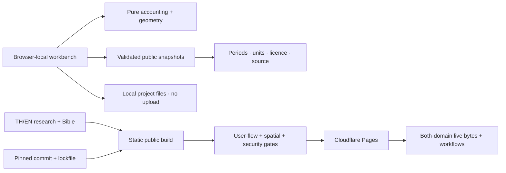

# Approved core execution · baseline and ownership

25 November 2026 · Codex. Core plan approved by the user; optional scopes remain excluded.

## Reconciliation

Production at inspection: `3c9ef32` on both domains. Local `de500e0` contained four unpublished research-strip commits; refreshed remote `72785ee` held NumPy2.5.5. Three staged files were preserved byte-for-byte in `/tmp/carbon-approved-staged-research.patch` and committed as `e3809dc` with the approved plan, then the remote dependency patch was merged. Python3.13.14 in an isolated environment passed HDF5, rasterization, GeoTIFF mask/window/mosaic, reprojection, area, PNG transparency, factor and coastal fallback smoke with NumPy2.5.5. No ledger regeneration occurred.

No open PRs or stashes were found during planning. A missing release worktree registration was pruned; a clean retained3c9ef32 checkout with no open files/process ownership was removed. Baseline measurements use a separately owned3c9ef32 checkout, not a concurrent agent's server.

## Architecture and lanes

One operator integrates and releases. Data lane owns public data loading/contracts and source candidates; session lane owns app state/local files/navigation; release lane owns pinned checkout/dependency/process/receipt operations. Root owns research, style/performance, accessibility integration and publication. An independent reviewer exercises finished geometry and attempts to falsify the fixes.

## Confirmed issues and repair criteria

| Priority | Reproduction / evidence | Criterion |
|---|---|---|
| P0 | createPristineTree ignored captured revision; caller node_modules shared | A captured / B current exports A; candidate npm ci and lock SHA |
| P1 | Failed grid promise persisted after rejection | Fail once, visible Retry succeeds; old selection response cannot win |
| P1 | Private imported boundary encoded by400ms hash timer; region returnURL restored it | Private marker absent from address/history/network after timer, reset and geography navigation |
| P1 | No unfinished draft reopen | Blank inputs, boundary and unapplied plots round trip without trusting result fields |
| P1 | Accessibility baseline | Valid dt/dd grouping, keyboard reachable scroll frames, spoken/visible button names agree |
| P1 | Independent200% text review:1440px body1743px, overlapping tools;390px KPI strip obscured map/actions | Text-aware wrap/relocation, unbroken numeric tokens, same evidence reachable |
| P1 | Synthetic valid20,000-vertex782,853-byte boundary took63,119.8ms synchronously;5,001vertices3,824.7ms | Off-thread identical validator, cancellation, bounded lifetime; no synchronous fallback |
| P2 | Bible initial lab CLS0.727 at390px as dynamic index appeared | Render complete reader once; visible compact loading state; no fake reserved hero |
| P2 | Repeated research prose and less-qualified duplicate table summaries | Preserve comparison columns, standards versions and uncertainty; remove duplicates |

## Laboratory baseline

Headless Chromium on this Mac,390×844, no CPU/network throttling, one-second observation after useful content and fonts; cold/warm same context. Local server serves no-store/uncompressed, so warm samples do **not** measure CDN/browser caching benefit. External tiles/feeds counted separately; cross-origin transfer can be hidden by Timing-Allow-Origin. This is not field INP or75th-percentile evidence.

| Initial surface | Same-origin resource body bytes | Cold LCP (ms) | CLS |
|---|---:|---:|---:|
| Thailand |3,527,872|236|0.0003|
| SEA |549,970|1,104|0.0114|
| Bible |1,543,652|156|0.7269|
| Research |495,323|356|0.0150|

Raw metrics and phone/tablet/desktop screenshots were captured under `/tmp/carbon-core-baseline-metrics/`. Baseline server needed Cloudflare-style extensionless HTML routing for `/sea`; its route handling was corrected identically for before/after, with application bytes still from3c9ef32. No unknown-server measurement is used. Follow-up receipts record candidate results and unverified physical-device/human evidence separately.
